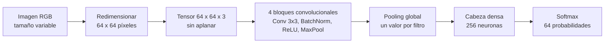

# Clasificador de personajes de Los Simpson con una CNN

Esta carpeta contiene una **red neuronal convolucional (CNN)** que identifica qué personaje de Los Simpson
aparece en una imagen RGB. Usa el dataset nuevo —64 personajes, una carpeta por personaje— y el mismo proceso
de entrenamiento y evaluación que el Perceptrón Multicapa de [`../PMC/`](../PMC/): la misma partición, las
mismas imágenes alteradas y parecidas, las mismas etiquetas de escena, los mismos pesos por clase, el mismo
bucle de entrenamiento, el mismo criterio de acierto y los mismos KPIs. Cambia el modelo.

> Las rutas de este documento son relativas a la carpeta `CNN/`, salvo las del script del dataset, los
> `requirements` y el entorno `.venv-gpu`, que están en la raíz del repositorio. Los comandos se ejecutan
> desde la raíz del repositorio.

<p align="center">
  
</p>

## Resultados de la corrida del 19-10-2026

El notebook de GPU se ejecutó completo a 64 × 64 en el mismo equipo que las corridas del MLP (Intel Core
i7-13620H y NVIDIA GeForce RTX 4060 Laptop). La accuracy usa el criterio de acierto del proyecto; la estricta
solo acepta el personaje de la carpeta.

| Métrica en test | MLP (`PMC/`, GPU 64 × 64) | CNN (GPU 64 × 64) |
|---|---:|---:|
| Accuracy | 0,550 | **0,830** |
| Accuracy estricta | 0,507 | **0,777** |
| Top-3 accuracy | 0,731 | **0,932** |
| F1 macro | 0,522 | **0,788** |
| Configuración final | R2 - solo color | E2 - 2 convoluciones por bloque |
| Parámetros del modelo final | 340.800 | 1.258.400 |
| Entrenamiento total | 17 min | 96 min |
| Duración de la corrida | 23 min 19 s | 1 h 44 min 33 s |

- **La forma es lo que le faltaba al MLP.** Con el mismo proceso y los mismos datos, la CNN sube la accuracy
  28 puntos y el F1 macro 27. La familia Simpson, que el MLP confundía por la piel amarilla compartida, pasa de
  un F1 de 0,35 a 0,67 a uno de 0,81 a 0,88, y ningún personaje queda por debajo de 0,30.
- **El color sigue importando.** En escala de grises (R1) la misma red pierde 20 puntos de F1 macro de
  validación: la forma sola rinde lo mismo que el color solo en el MLP, y las dos juntas son las que separan a
  los personajes.
- **Profundidad e invarianza a la posición.** La única configuración que supera a la base es E2, con dos
  convoluciones por bloque; por eso no hay combinación C1. El pooling global gana al aplanado del último mapa
  (E7), que memoriza antes.
- **Los cinco KPIs se cumplen con margen**, incluido el de costo: 5.326 imágenes por segundo de extremo a
  extremo, frente a 1.285–1.557 del MLP, que debe calcular sus descriptores en la CPU.
- **La accuracy es una cota inferior.** Grad-CAM se concentra en las caras de los personajes, y casi todos los
  errores con confianza alta nombran a un personaje que sí está en la imagen, pero que la escena del episodio y
  las gemelas no detectaron.
- **La corrida de CPU está pendiente.** El notebook de CPU sigue el mismo proceso, pero a 64 × 64 cada época
  le cuesta unos 130 s frente a 10 s en la GPU: una corrida completa tomaría más de quince horas.

Las lecturas completas, con las cifras de cada sección, están en el notebook de GPU.

## Cómo procesa una imagen



| Elemento | MLP (`PMC/`) | CNN (esta carpeta) |
|---|---|---|
| Entrada | 2.462 descriptores de color y textura (o 370 de solo color) | La imagen de 64 × 64 × 3, sin aplanar |
| Características | Elegidas a mano: histogramas HSV y Lab, LBP, Gabor, HOG | Aprendidas: filtros de 3 × 3 que recorren la imagen |
| Modelo base | Dos capas densas (512, 256) | Cuatro bloques convolucionales (32, 64, 128, 256 filtros), pooling global y una capa densa de 256 |
| Análisis de la decisión | Importancia por permutación de cada bloque de descriptores | Grad-CAM sobre la imagen |

## Experimentos

Cada experimento cambia un solo factor respecto del modelo base, y la configuración final se elige por F1
macro de validación:

| Exp. | Qué cambia |
|---|---|
| R1 | Entrada en escala de grises: cuánto depende la red del color |
| E1 / E2 | Un bloque menos / dos convoluciones por bloque |
| E3 | Activación tanh |
| E4 / E5 | Tasa de aprendizaje `1e-4` / batch 512 |
| E6 | Dropout 0,5 |
| E7 | Aplanado del último mapa en lugar de pooling global |
| P1 / P2 | Sin pesos por clase / pesos balanceados completos |
| S1 / S2 | Sin suavizado de etiquetas / sin etiquetas de escena |
| A1 | Sin imágenes alteradas |
| C1 | Combinación de los cambios que superaron a la base |

## Cómo ejecutarlo

Los pasos completos están en [notebooks/newDataset/README.md](notebooks/newDataset/README.md). En resumen:

1. Prepara el dataset con el script compartido, igual que para el MLP:

   ```powershell
   .\.venv-gpu\Scripts\python.exe scripts\newDataset\generar_imagenes_alteradas.py
   ```

2. Abre el notebook de GPU:

   ```powershell
   .\CNN\scripts\newDataset\ejecutar_notebook_gpu.ps1
   ```

   El de CPU, [LosSimpsonsCNN.ipynb](notebooks/newDataset/LosSimpsonsCNN.ipynb), se abre en el mismo
   `.venv-gpu` y oculta la GPU desde su primera celda. A 64 × 64 una corrida completa tarda del orden de hora
   y media en la GPU y más de quince horas en la CPU.

Cada corrida guarda su resumen en `resultados/newDataset/<CPU|GPU>/rendimiento_<entorno>_<resolución>.json`,
con el mismo formato que el MLP, y sus modelos en `models_gpu/newDataset/` (GPU) o `models/newDataset/` (CPU).

## Estructura de la carpeta

```text
CNN/
├── notebooks/newDataset/
│   ├── LosSimpsons_GPU_4060M.ipynb   # CNN en GPU: experimentos, evaluación, Grad-CAM y rendimiento
│   ├── LosSimpsonsCNN.ipynb          # Mismo proceso en CPU, con Keras 3 sobre PyTorch y la GPU oculta
│   └── README.md                     # Qué cambia respecto del MLP, ejecución y tiempos
├── models/newDataset/                # Modelos .keras de la corrida en CPU, ignorados por Git
├── models_gpu/newDataset/            # Modelos de la corrida en GPU, ignorados por Git
├── resultados/newDataset/
│   ├── CPU/                          # rendimiento_cpu_<resolucion>.json
│   └── GPU/                          # rendimiento_gpu_<resolucion>.json
├── scripts/newDataset/
│   └── ejecutar_notebook_gpu.ps1     # Comprueba el entorno y abre el notebook de GPU
├── images/                           # Ilustraciones de la portada de los notebooks
└── README.md                         # Este documento
```

No hay versión para el dataset anterior de 25 personajes: la CNN se entrena solo sobre el dataset nuevo.
