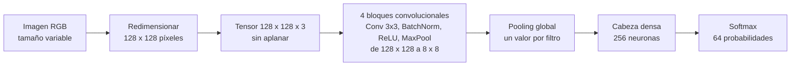

# Clasificador de personajes de Los Simpson con una CNN

Esta carpeta contiene una **red neuronal convolucional (CNN)** que identifica qué personaje de Los Simpson
aparece en una imagen RGB. Usa el dataset nuevo —64 personajes, una carpeta por personaje— y el mismo proceso
de entrenamiento y evaluación que el Perceptrón Multicapa de [`../PMC/`](../PMC/): la misma partición, las
mismas imágenes alteradas y parecidas, la misma caja alrededor de cada personaje, los mismos pesos por clase,
el mismo bucle de entrenamiento, el mismo criterio de acierto y los mismos KPIs. Cambia el modelo. Todo se
entrena y se evalúa a **128 × 128 en la GPU** (NVIDIA GeForce RTX 4060 Laptop).

> **Cada personaje en su caja (desde el 07-11-2026).** El notebook de GPU ya no recibe el fotograma completo,
> sino el recorte de la caja del personaje de la carpeta, que pone
> [`scripts/newDataset/detectar_cajas.py`](../scripts/newDataset/detectar_cajas.py) sin anotar nada a mano
> (Grounding DINO encuentra a los personajes y una CNN les pone nombre). Una predicción acierta solo si nombra
> a ese personaje, y una sección nueva muestra cada caja de un fotograma con su nombre y su confianza
> (`Jasper Beardly · 92 %`). Los modelos van a `models_gpu/newDataset/cajas/` y los resultados a
> `resultados/newDataset/cajas/GPU/`. Las cifras de este documento son de la corrida con la imagen completa.

> Las rutas de este documento son relativas a la carpeta `CNN/`, salvo las del script del dataset, los
> `requirements` y el entorno `.venv-gpu`, que están en la raíz del repositorio. Los comandos se ejecutan
> desde la raíz del repositorio.

<p align="center">
  
</p>

**Presentación de resultados.** [presentacion_resultados_CNN.html](presentacion_resultados_CNN.html) resume las
tres corridas en 29 diapositivas: el cambio de dataset respecto de la EP1, modelo, mapas de activación,
experimentos, KPIs, el criterio estricto, F1 por personaje, confusiones, Grad-CAM (también uno por personaje),
errores, costo por resolución, la comparación con el MLP —con su capacidad de generalización y las ventajas y
desventajas de cada arquitectura—, las mejoras por regularización y el impacto ético, con anexos de tablas
completas. Es un solo archivo:
descárgalo y ábrelo en el navegador (GitHub solo muestra su código). El botón **Presentar** muestra una
diapositiva a la vez en pantalla completa; las flechas avanzan y `Esc` sale. Todavía muestra las tres corridas
de octubre (32, 64 y 128 píxeles): se rehace con la corrida a 128 × 128 con cajas.

**Informe técnico.** [docs/newDataset/Informe.md](docs/newDataset/Informe.md) documenta la Evaluación Parcial 2:
el cambio de dataset respecto de la EP1, la preparación de los datos, el diseño y el entrenamiento de la CNN,
los experimentos, las métricas con el criterio del proyecto y con el estricto, los mapas de activación, la
comparación con el MLP, el impacto ético y las conclusiones. El encargo de la evaluación está en
[docs/EP2_TLY1102_Instrucciones.docx](docs/EP2_TLY1102_Instrucciones.docx).

## Resultados de la corrida del 19-10-2026

El notebook de GPU se ejecutó completo a 128 × 128, con la imagen completa, en el mismo equipo que la corrida
del MLP (Intel Core i7-13620H y NVIDIA GeForce RTX 4060 Laptop). La accuracy usa el criterio de acierto de
entonces; la estricta solo acepta el personaje de la carpeta y es la comparable con las corridas con cajas.

| Corrida | Configuración final | Accuracy | Estricta | Top-3 | F1 macro | Duración |
|---|---|---:|---:|---:|---:|---:|
| GPU 128 × 128 | Base - 1 convolución por bloque | **0,847** | **0,797** | **0,937** | **0,810** | 5 h 08 min 56 s |

Frente al MLP, también en GPU a 128 × 128 (diferencias en puntos):

| Accuracy MLP | Accuracy CNN | Diferencia | F1 macro MLP | F1 macro CNN | Diferencia | Entrenamiento MLP → CNN |
|---:|---:|---:|---:|---:|---:|---:|
| 0,586 | **0,847** | +26,1 | 0,559 | **0,810** | +25,1 | 15,9 → 290,5 min |

- **La forma es lo que le faltaba al MLP.** Con el mismo proceso y los mismos datos, la CNN sube la accuracy
  26,1 puntos y el F1 macro 25,1. Homero, Marge, Bart y Lisa, que el MLP confundía por la piel amarilla
  compartida, llegan a un F1 de 0,81 a 0,89, y ningún personaje queda por debajo de 0,30.
- **Gana el modelo base.** E2 (dos convoluciones por bloque) y E5 (batch 512) no caben en los 8 GB de la GPU,
  ninguna variante supera a la base (la segunda, S2, queda a 0,6 puntos de F1 macro de validación) y C1 no se
  entrena. El modelo final tiene 473.120 parámetros.
- **El color sigue importando.** En escala de grises (R1) la misma red pierde 11,3 puntos de F1 macro de
  validación: la forma suple parte del color, pero no todo.
- **Los cinco KPIs se cumplen**, incluido el de costo: 3.085 imágenes por segundo de extremo a extremo.
- **La GPU trabaja de verdad.** Entrenar es el 94 % de la corrida, y la tarjeta está ocupada el 98,8 % del
  tiempo (el MLP, el 33,7 %).
- **La accuracy es una cota inferior.** Grad-CAM se concentra en las cabezas de los personajes, y casi todos los
  errores con confianza alta nombran a un personaje que sí está en la imagen, pero que la escena del episodio y
  las gemelas no detectaron.

Las lecturas completas, con las cifras de cada sección, están en el notebook de GPU.

## Cómo procesa una imagen



| Elemento | MLP (`PMC/`) | CNN (esta carpeta) |
|---|---|---|
| Entrada | 2.462 descriptores de color y textura (o 370 de solo color) | La imagen de 128 × 128 × 3, sin aplanar |
| Características | Elegidas a mano: histogramas HSV y Lab, LBP, Gabor, HOG | Aprendidas: filtros de 3 × 3 que recorren la imagen |
| Modelo base | Dos capas densas (512, 256) | Cuatro bloques convolucionales (32, 64, 128, 256 filtros), pooling global y una capa densa de 256 |
| Análisis de la decisión | Importancia por permutación de cada bloque de descriptores | Grad-CAM sobre la imagen, también uno por personaje |

## Experimentos

Cada experimento cambia un solo factor respecto del modelo base, y la configuración final se elige por F1
macro de validación:

| Exp. | Qué cambia |
|---|---|
| R1 | Entrada en escala de grises: cuánto depende la red del color |
| E1 / E2 | Un bloque menos / dos convoluciones por bloque |
| E3 | Activación tanh |
| E4 / E5 | Tasa de aprendizaje `1e-4` / batch 512 |
| E6 | Dropout 0,5 |
| E7 | Aplanado del último mapa en lugar de pooling global |
| P1 / P2 | Sin pesos por clase / pesos balanceados completos |
| S1 / S2 | Sin suavizado de etiquetas / sin etiquetas de escena |
| A1 | Sin imágenes alteradas |
| C1 | Combinación de los cambios que superaron a la base |

Antes de entrenar cada configuración, el notebook mide cuánta memoria de la GPU usa: a 128 × 128, E2 y E5 no
caben en los 8 GB de la tarjeta y quedan fuera de la comparación.

## Cómo ejecutarlo

Los pasos completos están en [notebooks/newDataset/README.md](notebooks/newDataset/README.md). En resumen:

1. Prepara el dataset con el script compartido, igual que para el MLP:

   ```powershell
   .\.venv-gpu\Scripts\python.exe scripts\newDataset\generar_imagenes_alteradas.py
   ```

2. Abre el notebook de GPU:

   ```powershell
   .\CNN\scripts\newDataset\ejecutar_notebook_gpu.ps1
   ```

   Una corrida completa a 128 × 128 tarda unas cinco horas. Guarda su resumen en
   `resultados/newDataset/cajas/GPU/rendimiento_gpu_128x128.json`, con el mismo formato que el MLP, y sus
   modelos en `models_gpu/newDataset/cajas/`.

3. La presentación se rehace después de la corrida a 128 × 128 con cajas. Su generador,
   `CNN/scripts/newDataset/generar_presentacion.py`, todavía lee las tres corridas de octubre, incluidos los
   JSON de 32 × 32 y 64 × 64 que ya no están en el repositorio, así que hay que adaptarlo a una sola corrida
   antes de volver a ejecutarlo.

4. Clasifica cualquier imagen con el modelo final, sin abrir el notebook:

   ```powershell
   .\.venv-gpu\Scripts\python.exe CNN\scripts\newDataset\predecir_imagen.py ruta\a\imagen.jpg
   ```

   Muestra las cinco candidatas más probables (`--top` cambia cuántas) y, si la imagen está en una carpeta con
   el nombre de un personaje, si el modelo acertó. Acepta varias imágenes a la vez, `--json` para leer el
   resultado desde otro programa y `--cpu` para no usar la GPU. Usa `models_gpu/newDataset/cnn_final.keras` con el
   pre-procesamiento del notebook. La red siempre nombra a alguno de sus 64
   personajes, así que bajo un 50 % de confianza avisa que conviene revisar la imagen a mano.

## Estructura de la carpeta

```text
CNN/
├── notebooks/newDataset/
│   ├── LosSimpsons_GPU_4060M.ipynb   # CNN en GPU: experimentos, evaluación, Grad-CAM y rendimiento
│   └── README.md                     # Qué cambia respecto del MLP, ejecución y tiempos
├── models_gpu/newDataset/            # Modelos de la corrida en GPU, ignorados por Git
├── resultados/newDataset/
│   ├── GPU/                          # rendimiento_gpu_128x128.json, la corrida con la imagen completa
│   └── cajas/GPU/                    # El de la corrida con cajas, al ejecutar el notebook
├── scripts/newDataset/
│   ├── ejecutar_notebook_gpu.ps1     # Comprueba el entorno y abre el notebook de GPU
│   ├── generar_presentacion.py       # Genera presentacion_resultados_CNN.html
│   └── predecir_imagen.py            # Clasifica una o más imágenes con el modelo final
├── images/                           # Ilustraciones de la portada de los notebooks
├── docs/
│   ├── EP2_TLY1102_Instrucciones.docx  # Encargo de la Evaluación Parcial 2
│   └── newDataset/
│       ├── Informe.md                # Informe técnico de la EP2
│       └── figuras/                  # Figuras del informe, tomadas de las salidas del notebook de GPU
├── presentacion_resultados_CNN.html  # Presentación de resultados (29 diapositivas)
└── README.md                         # Este documento
```

No hay versión para el dataset anterior de 25 personajes: la CNN se entrena solo sobre el dataset nuevo.
