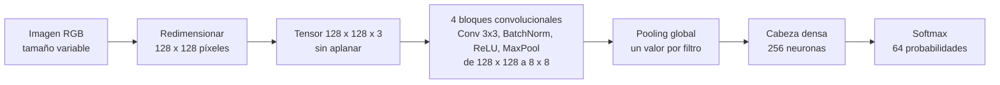

# Clasificador de personajes de Los Simpson con una CNN

Esta carpeta contiene una **red neuronal convolucional (CNN)** que identifica qué personaje de Los Simpson
aparece en una imagen RGB. Usa el dataset nuevo —64 personajes, una carpeta por personaje— y el mismo proceso
de entrenamiento y evaluación que el Perceptrón Multicapa de [`../PMC/`](../PMC/): la misma partición, las
mismas imágenes alteradas y parecidas, la misma imagen completa como entrada, los mismos pesos por clase,
el mismo bucle de entrenamiento, el mismo criterio de acierto y los mismos KPIs. Cambia el modelo. Todo se
entrena y se evalúa a **128 × 128 en la GPU** (NVIDIA GeForce RTX 4060 Laptop). Las funciones del pipeline son
las mismas para las dos redes y viven en [`../scripts/newDataset/pipeline_comun/`](../scripts/newDataset/pipeline_comun/).

> **Primero el modelo, después las cajas.** El notebook de GPU entrena y evalúa con la imagen completa, y una
> predicción acierta solo si nombra al personaje de la carpeta. Al final guarda el modelo con todo lo necesario
> para usarlo fuera de él (`cnn_final.keras`, `.json`, `_entrada.py` y `_particion.csv`). Después,
> [`scripts/newDataset/detectar_cajas.py`](../scripts/newDataset/detectar_cajas.py) encuentra a cada personaje
> con Grounding DINO y la CNN nombra cada caja con su confianza (`Jasper Beardly · 92 %`), sin anotar nada a
> mano. El notebook no depende de ese script. Las cifras de este documento son de la corrida del 14-11-2026.

> Las rutas de este documento son relativas a la carpeta `CNN/`, salvo las del script del dataset, los
> `requirements` y el entorno `.venv-gpu`, que están en la raíz del repositorio. Los comandos se ejecutan
> desde la raíz del repositorio.

<p align="center">
  
</p>

**Presentación de resultados.** [presentacion_resultados_CNN.html](presentacion_resultados_CNN.html) resume la
corrida del 14-11-2026 en 23 diapositivas: el problema, los datos y su origen, el pipeline integrado, el modelo, la
parada temprana, el efecto de cada técnica de regularización, los experimentos de un factor a la vez, el Random
Search, la selección del modelo, los KPIs, la evaluación por personaje, los errores, los mapas de activación,
Grad-CAM, la calibración y el umbral de revisión, los sesgos por subgrupo, la comparación con el MLP, la
arquitectura seleccionada, el impacto ético, las limitaciones y las conclusiones. Es un solo archivo: descárgalo y
ábrelo en el navegador (GitHub solo muestra su código). El botón **Presentar** muestra una diapositiva a la vez en
pantalla completa; las flechas avanzan y `Esc` sale.

**Informe técnico.** [docs/newDataset/Informe.md](docs/newDataset/Informe.md) documenta la Evaluación Parcial 3:
el cambio de dataset respecto de la EP1, el pipeline integrado, la regularización, la optimización con un factor a
la vez y Random Search, la evaluación, la auditoría (calibración, umbral de revisión y sesgos), Grad-CAM, la
comparación con el MLP, la arquitectura seleccionada y las conclusiones. El encargo de la evaluación está en
[docs/EP3_TLY1102_Instrucciones Estudiante.docx](docs/EP3_TLY1102_Instrucciones%20Estudiante.docx).

## Resultados de la corrida del 14-11-2026

El notebook de GPU se ejecutó completo a 128 × 128, con la imagen completa, en el mismo equipo que la corrida
del MLP (Intel Core i7-13620H y NVIDIA GeForce RTX 4060 Laptop). Todas las configuraciones se entrenaron con el
mismo presupuesto: 60 épocas como máximo y paciencia 12. Una predicción acierta solo si nombra al personaje de la
carpeta.

| Corrida | Configuración final | Accuracy | Top-3 | F1 macro | ROC-AUC macro | Duración |
|---|---|---:|---:|---:|---:|---:|
| GPU 128 × 128 | G4 - aumento de datos en línea | **0,775** | **0,908** | **0,755** | **0,987** | 16 h 28 min 18 s |

Frente al MLP, también en GPU a 128 × 128 (corrida del 09-11-2026; diferencias en puntos):

| Accuracy MLP | Accuracy CNN | Diferencia | F1 macro MLP | F1 macro CNN | Diferencia | Segundos por época MLP → CNN |
|---:|---:|---:|---:|---:|---:|---:|
| 0,544 | **0,775** | +23,1 | 0,551 | **0,755** | +20,4 | 2,1 → 51,7 |

- **La forma es lo que le faltaba al MLP.** Con el mismo proceso y los mismos datos, la CNN sube la accuracy
  23,1 puntos y el F1 macro 20,4. Homero, Marge, Bart y Lisa, que el MLP confundía por la piel amarilla
  compartida, llegan a un F1 de 0,78 a 0,82, y ningún personaje queda por debajo de 0,30.
- **Gana el aumento de datos en línea (G4).** Sube el F1 macro de validación 3,8 puntos sobre la base y baja la
  brecha entre entrenamiento y validación de 0,142 a 0,033. El Random Search llega a lo mismo: su mejor
  configuración, también con aumento en línea, queda a 0,1 puntos. Sin dropout se pierden 5,7 puntos y sin Batch
  Normalization 2,5; L2 y más dropout no cambian nada.
- **El color sigue importando.** En escala de grises (R1) la misma red pierde 8,1 puntos de F1 macro de
  validación: la forma suple parte del color, pero no todo.
- **Los cinco KPIs se cumplen**, incluido el de costo: 3.567 imágenes por segundo de extremo a extremo.
- **La auditoría encuentra un sesgo de origen.** La CNN acierta el 93 % de las imágenes de Kaggle y el 67 % de los
  fotogramas de episodio. Es subconfiada (ECE de 0,078), y con un umbral elegido en validación resuelve sola el
  71,6 % del test con un 90,4 % de acierto.
- **La accuracy es una cota inferior.** Grad-CAM se concentra en las caras de los personajes, y los errores más
  confiados nombran a un personaje que sí está en la imagen.

Las lecturas completas, con las cifras de cada sección, están en el notebook de GPU.

## Cómo procesa una imagen



| Elemento | MLP (`PMC/`) | CNN (esta carpeta) |
|---|---|---|
| Entrada | 2.462 descriptores de color y textura (o 370 de solo color) | La imagen de 128 × 128 × 3, sin aplanar |
| Características | Elegidas a mano: histogramas HSV y Lab, LBP, Gabor, HOG | Aprendidas: filtros de 3 × 3 que recorren la imagen |
| Modelo base | Dos capas densas (512, 256) | Cuatro bloques convolucionales (32, 64, 128, 256 filtros), pooling global y una capa densa de 256 |
| Análisis de la decisión | SHAP agrupado por canal de color y zona de la imagen | Grad-CAM sobre la imagen, también uno por personaje |

## Experimentos

Todas las configuraciones se entrenan con el mismo presupuesto (60 épocas, paciencia 12), y la configuración final
se elige por F1 macro de validación. Cada experimento cambia un solo factor respecto del modelo base:

| Exp. | Qué cambia |
|---|---|
| R1 | Entrada en escala de grises: cuánto depende la red del color |
| E1 / E2 | Un bloque menos / dos convoluciones por bloque |
| E3 | Activación tanh |
| E4 / E5 | Tasa de aprendizaje `1e-4` / batch 512 |
| E6 | Dropout 0,5 |
| E7 | Aplanado del último mapa en lugar de pooling global |
| P1 / P2 | Sin pesos por clase / pesos balanceados completos |
| S1 | Sin suavizado de etiquetas |
| A1 | Sin imágenes alteradas |
| G1 / G2 / G3 / G4 | Sin dropout / sin Batch Normalization / L2 de 5·10⁻⁴ / aumento de datos en línea |
| C1 | Combinación de los cambios que superaron a la base |
| RS1, RS2 | Las dos finalistas del Random Search sobre tasa, dropout, L2 y aumento en línea (8 configuraciones a 15 épocas, las 2 mejores con el presupuesto completo) |

Antes de entrenar cada configuración, el notebook mide cuánta memoria de la GPU usa: a 128 × 128, E2 y E5 no
caben en los 8 GB de la tarjeta y quedan fuera de la comparación.

## Cómo ejecutarlo

Los pasos completos están en [notebooks/README.md](notebooks/README.md). En resumen:

1. Prepara el dataset con el script compartido, igual que para el MLP:

   ```powershell
   .\.venv-gpu\Scripts\python.exe scripts\newDataset\generar_imagenes_alteradas.py
   ```

2. Abre el notebook de GPU:

   ```powershell
   .\CNN\scripts\newDataset\ejecutar_notebook_gpu.ps1
   ```

   Una corrida completa a 128 × 128 tarda unas 16 horas y media; con `SIMPSONS_PRUEBA=1` el notebook corre de
   punta a punta en pocos minutos, con 40 imágenes por personaje y 2 épocas, para comprobarlo antes. Si la corrida
   se corta, lo ya entrenado se recupera de `models_gpu/newDataset/historiales/`. Guarda su resumen en
   `resultados/newDataset/GPU/rendimiento_gpu_128x128.json`, con el mismo formato que el MLP, sus figuras en
   `docs/newDataset/figuras/` y sus modelos en `models_gpu/newDataset/`, con el modelo final listo para usarse
   fuera del notebook.

3. Genera la presentación desde los resultados de la corrida:

   ```powershell
   .\.venv-gpu\Scripts\python.exe scripts\newDataset\generar_presentacion.py --modelo cnn
   ```

4. Clasifica cualquier imagen con el modelo final, sin abrir el notebook:

   ```powershell
   .\.venv-gpu\Scripts\python.exe CNN\scripts\newDataset\predecir_imagen.py ruta\a\imagen.jpg
   ```

   Muestra las cinco candidatas más probables (`--top` cambia cuántas) y, si la imagen está en una carpeta con
   el nombre de un personaje, si el modelo acertó. Acepta varias imágenes a la vez, `--json` para leer el
   resultado desde otro programa y `--cpu` para no usar la GPU. Usa `models_gpu/newDataset/cnn_final.keras` con el
   pre-procesamiento del notebook. La red siempre nombra a alguno de sus 64
   personajes, así que bajo un 50 % de confianza avisa que conviene revisar la imagen a mano.

5. Pon cada personaje de una imagen en su caja, con su nombre y su confianza, usando el modelo guardado:

   ```powershell
   .\.venv-gpu\Scripts\python.exe -m pip install -r requirements-cajas.txt
   .\.venv-gpu\Scripts\python.exe scripts\newDataset\detectar_cajas.py --modelo cnn ruta\a\imagen.jpg
   ```

   Grounding DINO encuentra a cada personaje y la CNN nombra cada caja. Deja `cajas.csv`, las imágenes con sus
   cajas y un `resumen.json` en `models_gpu/newDataset/cajas_cnn_final/`.

## Estructura de la carpeta

```text
CNN/
├── notebooks/
│   ├── LosSimpsons_GPU_4060M.ipynb   # CNN en GPU: experimentos, Random Search, auditoría, Grad-CAM y rendimiento
│   └── README.md                     # Qué cambia respecto del MLP, ejecución y tiempos
├── models_gpu/newDataset/            # Modelos, historiales y cajas_cnn_final/, ignorados por Git
├── resultados/newDataset/
│   ├── GPU/                          # rendimiento_gpu_128x128.json; cada corrida reemplaza el anterior
│   └── recreaciones/                 # Recreación de cada personaje desde la CNN (anexo del notebook)
├── scripts/newDataset/
│   ├── ejecutar_notebook_gpu.ps1     # Comprueba el entorno y abre el notebook de GPU
│   └── predecir_imagen.py            # Clasifica una o más imágenes con el modelo final
├── images/                           # Ilustraciones de la portada de los notebooks
├── docs/
│   ├── EP3_TLY1102_Instrucciones Estudiante.docx  # Encargo de la Evaluación Parcial 3
│   └── newDataset/
│       ├── Informe.md                # Informe técnico de la EP3
│       └── figuras/                  # Figuras del informe, guardadas por el notebook al ejecutarse
├── presentacion_resultados_CNN.html  # Presentación de resultados (23 diapositivas)
└── README.md                         # Este documento
```

El generador de la presentación, común a la CNN y al MLP, está en
[`../scripts/newDataset/generar_presentacion.py`](../scripts/newDataset/generar_presentacion.py). No hay versión
para el dataset anterior de 25 personajes: la CNN se entrena solo sobre el dataset nuevo.
