# Informe técnico — Optimización y auditoría de una red convolucional para reconocer personajes de Los Simpson

Evaluación Parcial 3 · Técnicas Avanzadas de Machine Learning · 15-11-2026

## Resumen

| Tema | Lo importante | Dónde |
|---|---|---|
| Qué se entrega | El Pipeline Integrado de la EP2, optimizado y auditado: una CNN de cuatro bloques convolucionales (473.120 parámetros) que reconoce a 64 personajes, comparada con un MLP entrenado con las mismas imágenes y el mismo proceso | §4, §13 |
| Resultado | Accuracy de test 0,775, F1 macro 0,755, top-3 0,908 y ROC-AUC macro 0,987, frente a 0,556, 0,557 y 0,732 del MLP: 22, 20 y 18 puntos más. Los cinco KPIs se cumplen | §10, §13 |
| Presupuesto | Todas las configuraciones se entrenaron con el mismo máximo de 60 épocas y paciencia 12: la comparación es en igualdad de condiciones | §8, §9 |
| Regularización | Se midió cada técnica con y sin ella. El dropout es imprescindible (sin él, −5,7 puntos de F1 y brecha de 0,31), Batch Normalization aporta 2,5 puntos y el aumento de datos en línea es la mejora clara (+3,8 puntos, brecha de 0,033); L2 y más dropout no cambian nada | §8 |
| Optimización | Un factor a la vez (14 variantes y una combinación) más un Random Search en dos etapas. Gana G4, el modelo base con aumento de datos en línea, empatado en la práctica con la mejor del Random Search, que también usa aumento en línea | §9 |
| Auditoría | Métricas por clase, matriz de confusión, ROC-AUC, curvas de aprendizaje, calibración (ECE de 0,078, subconfiado), umbral de revisión (resuelve solo el 71,6 % del test al 90,4 % de acierto), sesgos por subgrupo y Grad-CAM | §10, §11, §12 |
| Sesgos | El sesgo grande es el origen: 0,93 de accuracy en las imágenes de Kaggle y 0,67 en los fotogramas de episodio. El desbalance (20:1) deja una huella pequeña y la familia Simpson ya no es un problema | §12 |
| Arquitectura seleccionada | La CNN: gana en desempeño, generalización, interpretabilidad, catalogación de extremo a extremo y parámetros; el MLP solo en costo de entrenamiento (23 veces menor por época) y en calibración | §13 |
| Uso responsable | Asistente con revisión humana: se equivoca en el 22,5 % del test, siempre responde algún personaje y no debe usarse con fotos de personas | §12 |

## 1. Identificación del proyecto

| Elemento | Descripción verificable |
|---|---|
| Tipo de proyecto | Clasificación supervisada de imágenes RGB con una red neuronal convolucional (CNN), comparada con un Perceptrón Multicapa (MLP). |
| Unidad de predicción | Una imagen recibe una sola etiqueta entre 64 personajes. |
| Implementación evaluada | `CNN/notebooks/LosSimpsons_GPU_4060M.ipynb`: Keras 3 sobre PyTorch, en Windows con una GPU NVIDIA GeForce RTX 4060 Laptop de 8 GB; con las salidas de la corrida a 128 × 128 del 14-11-2026. |
| Módulo común | `scripts/newDataset/pipeline_comun/`: las funciones del pipeline que importan los dos notebooks, con sus pruebas en `scripts/newDataset/tests/`. |
| MLP de la comparación | `PMC/notebooks/LosSimpsons_GPU_4060M.ipynb`: el MLP sobre el mismo dataset y con el mismo proceso, corrida del 15-11-2026. |
| Evidencia de ejecución | Salidas guardadas de los dos notebooks; resúmenes JSON en `CNN/resultados/newDataset/GPU/` y `PMC/resultados/newDataset/GPU/`; historiales de cada configuración en `CNN/models_gpu/newDataset/historiales/`. |
| Framework | Keras 3.15.1 sobre PyTorch 2.14.0 (CUDA 13.0), Python 3.13. |
| Ejecución | Local, en la RTX 4060 Laptop, acordada con el profesor en lugar de Google Colab: la corrida completa tomó 16 h 28 min. |
| Integrantes | Vincent Farenden Cerón; Rodrigo Ignacio Martínez Becker; Iván Manuel Pavón Barría; Diego Ignacio Peña y Lillo Luhrs. |
| Profesor | Francisco Javier Jerez Salazar. |

Cada cifra de este informe sale de las salidas guardadas de los notebooks o de sus resúmenes JSON, y cada figura la
guarda el propio notebook en `figuras/` al ejecutarse.

## 2. Problema, variante y cambio de dataset

### 2.1 Problema abordado

**Clasificación multiclase de etiqueta única**: dada una imagen RGB de Los Simpson, el modelo asigna exactamente uno
de 64 personajes, con su confianza. El escenario de uso declarado es un archivo audiovisual que crece más rápido de
lo que un equipo puede catalogarlo: el modelo propone el personaje y una persona valida, así que el trabajo pasa de
*etiquetar* a *revisar*. No es un encargo de un cliente real, por lo que los KPIs se expresan en cantidades
medibles sobre los datos.

### 2.2 Variante del grupo

| Decisión | Valor |
|---|---|
| Personajes | 64, una carpeta por personaje; la etiqueta es siempre la carpeta, nunca el nombre del archivo |
| Imágenes | Todas las originales de cada personaje (56.268, 3,4 GB), sin tope |
| Partición | 70 / 20 / 10 por personaje, estratificada, con semilla 42 |
| Imágenes alteradas | Una variante (giro de 10 a 20°, cambio de color y filtro de textura) para un cuarto de las imágenes de cada personaje, siempre en el mismo conjunto que su original |
| Imágenes parecidas | Las 9.040 imágenes casi idénticas a otra del mismo personaje entran con una versión filtrada |
| Criterio de acierto | Nombrar al personaje de la carpeta. La accuracy por escena, que también acepta a otro personaje presente, se informa solo como referencia |
| Resolución | 128 × 128 |

### 2.3 Cambio de dataset respecto de la EP1 y trazabilidad

La pauta recomienda el dataset de la EP1 y pide, si se modifica la variante, justificarlo y mantener la
trazabilidad. El dataset es la misma fuente de Kaggle (Los Simpson, `alfaro96`), ampliada por el equipo:

| | EP1 (MLP) | EP2 y EP3 (MLP y CNN) |
|---|---|---|
| Personajes | 25 | 64 |
| Imágenes originales | 20.074 (16.137 en `train` y 3.937 en `test`) | 56.268: 22.162 de Kaggle y 34.106 fotogramas de episodio |
| Partición | La de Kaggle, de criterio no documentado | Propia: 70 / 20 / 10 estratificada, semilla 42 |
| Casi duplicados entre conjuntos | No se verificaban | Filtrados; cada alterada en el conjunto de su original |
| Información de escena | No | 42.646 de las 70.345 imágenes de trabajo (60,6 %) son fotogramas con episodio e instante conocidos |

Razones: un archivo audiovisual también tiene a los personajes secundarios, y con 64 aparecen los que se parecen
entre sí (Patty y Selma, Carl y Lenny, los Flanders), la prueba más exigente para comparar arquitecturas; una CNN
aprende sus filtros de los píxeles y necesita más ejemplos; y la partición propia permite auditar que una misma
escena no caiga en entrenamiento y test.

**Trazabilidad.** El trabajo de la EP1 se conserva en `PMC/docs/oldDataset/` y `PMC/resultados/oldDataset/`, y su
notebook de GPU en el historial de Git (`PMC/notebooks/oldDataset/LosSimpsons_GPU_4060M.ipynb`, commit `4b8b80e`);
su MLP final alcanzó 0,517 de accuracy de test sobre 25 personajes. Para la comparación de la EP3 el MLP se volvió a
entrenar sobre el dataset nuevo con el mismo pipeline que la CNN. Las cifras de la EP1 no se comparan con las
actuales porque miden otros personajes sobre otra partición. La corrida anterior de la CNN, del 13-11-2026, se
compara con la actual en el anexo del notebook. Frente a la de octubre (19-10-2026, 40.123 originales), la
accuracy con el criterio de la carpeta baja de 0,797 a 0,775 porque el test tiene ahora más fotogramas de
episodio (60 % frente a 44,7 %): con las accuracies por origen de esta corrida, un test con la proporción de
octubre daría unos 0,816.

### 2.4 Objetivos

**Objetivo general.** Optimizar y auditar una CNN que asigne a cada imagen uno de los 64 personajes, reutilizando
el Pipeline Integrado de la EP2, y compararla con el MLP en igualdad de condiciones.

**Objetivos específicos.** Medir el aporte de cada técnica de regularización con el mismo presupuesto de
entrenamiento; seleccionar la configuración con experimentos de un factor a la vez y un Random Search; auditar el
modelo con accuracy, precision, recall, F1, ROC-AUC, matriz de confusión, curvas de aprendizaje, calibración, un
umbral de revisión y Grad-CAM; identificar los sesgos del dataset y sus implicancias; y justificar la arquitectura
seleccionada.

## 3. KPIs

Los umbrales se fijaron antes de entrenar y son los mismos para el MLP y la CNN.

| KPI | Qué mide en el negocio | Métrica técnica | Umbral | CNN | MLP |
|---|---|---|---|---:|---:|
| Cobertura de asistencia | Si el catalogador encuentra la respuesta entre tres sugerencias | Top-3 accuracy en test | ≥ 0,70 | 0,908 | 0,732 |
| Equidad entre personajes | Que el catálogo sirva para todos los personajes | F1 macro en test | ≥ 0,45 | 0,755 | 0,557 |
| Automatización sin revisión | Imágenes que el sistema resuelve solo | Accuracy en test | ≥ 0,50 | 0,775 | 0,556 |
| Ventaja sobre el criterio trivial | Información real frente a etiquetar todo como Homero | Accuracy / clase mayoritaria | ≥ 4× | 13,2× | 9,4× |
| Costo de catalogación | Procesar el archivo en un tiempo razonable | Imágenes por segundo, entrada + red | ≥ 1.000 | 3.567 | 1.360 |

Las dos redes cumplen los cinco. El de costo se mide con una pasada de calentamiento y la mediana de tres repeticiones, tras
liberar la memoria que el entrenamiento dejó reservada en la GPU. En la corrida, la primera versión de la celda medía
una sola vez en frío y dio 569 imágenes por segundo: medía la reserva de memoria, no la catalogación. La celda se
corrigió y se volvió a ejecutar sola; el benchmark de inferencia, medido aparte, da lo mismo para la red sola
(3.553 imágenes por segundo). El MLP se mide igual: su catalogación incluye calcular los descriptores de color en la
CPU, y una sola medición en frío daba 988 imágenes por segundo, por el arranque de los procesos que los calculan.

## 4. Pipeline Integrado

La EP3 continúa las actividades anteriores: el pipeline de la EP2 se reutiliza y se extiende con las etapas de
regularización, optimización y auditoría. El mismo pipeline sirve a las dos redes, y sus funciones viven en el módulo
`scripts/newDataset/pipeline_comun/`, que importan los dos notebooks: solo cambia la función que construye el modelo.

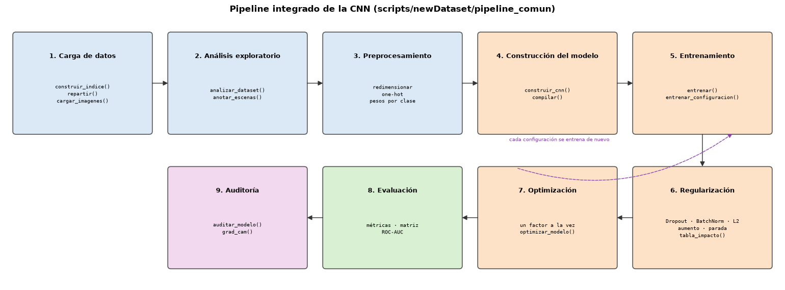

| Etapa | Funciones | Módulo |
|---|---|---|
| Carga de datos | `construir_indice()`, `repartir()`, `cargar_imagenes()` | `datos`, `preprocesamiento` |
| Análisis exploratorio | `analizar_dataset()`, `anotar_escenas()` | `datos` |
| Preprocesamiento | `cargar_y_redimensionar()`, `comprobar_particion()`, `compute_class_weight()` | `preprocesamiento`, `datos` |
| Construcción del modelo | `construir_cnn()`, `compilar()` | notebook (lo único propio de cada red) |
| Entrenamiento | `entrenar()`, `entrenar_o_reanudar()` | `entrenamiento` |
| Regularización | Dropout, Batch Normalization, L2, `aumentar_imagenes()`, parada temprana, `tabla_impacto()` | `entrenamiento`, `experimentacion` |
| Optimización | `combinar_mejoras()`, `optimizar_modelo()` | `experimentacion` |
| Evaluación | `classification_report`, `confusion_matrix`, `roc_auc_score` | scikit-learn |
| Auditoría | `auditar_modelo()`, `grad_cam()` | `auditoria`, notebook |
| Reporte final | `comparar_redes()`, `guardar_figura()` y el resumen JSON | `comparacion`, `rendimiento` |

**Justificación de la estructura.**

1. **Una responsabilidad por etapa**, cada una con su comprobación automática o su tabla antes de seguir.
2. **La partición va antes que los píxeles**: cada personaje se reparte antes de cargar imágenes y cada alterada
   sigue a su original, de modo que ninguna decisión posterior puede filtrar información del test.
3. **Las mismas funciones para todas las configuraciones**: `construir_cnn()` y `entrenar()` reciben como
   parámetros todos los factores que se experimentan, así que la base y cada variante salen del mismo código.
4. **El mismo pipeline para el MLP y la CNN**, con el mismo formato de resumen: la comparación es cifra a cifra.
5. **Funciones reutilizables, etapas a la vista**: las funciones están documentadas y probadas en el módulo común,
   y el notebook las llama celda a celda, con texto, tablas y gráficos en cada paso.
6. **Mismo presupuesto y entrenamientos reanudables**: toda configuración se entrena con 60 épocas como máximo y
   paciencia 12, y su historial queda en disco, de modo que una corrida cortada se reanuda donde quedó.

## 5. Carga de datos y análisis exploratorio

| Hallazgo | Evidencia | Decisión que motiva |
|---|---|---|
| Desbalance | De 3.118 imágenes de `homer_simpson` a 151 de `maggie_simpson`: 20,6:1 en el dataset y 20,1:1 en entrenamiento | Pesos por clase, partición estratificada y selección por F1 macro |
| Dos orígenes | 60,6 % de fotogramas de episodio y 39,4 % de imágenes de Kaggle, en la misma proporción en los tres conjuntos | Auditoría por origen (§12) |
| Tamaños muy distintos | De 28 a 2.700 píxeles de ancho y de 42 a 3.600 de alto, con una mediana de 960 × 720 | Redimensionado de la imagen completa a 128 × 128 |
| Casi duplicados | 9.040 originales casi idénticas a otra del mismo personaje, en 6.291 grupos (similitud mediana de 0,98) | Versión filtrada en su lugar (similitud mediana de 0,55) |
| Variantes alteradas | 14.077, una por cada cuarto de las originales | Cada una en el mismo conjunto que su original |
| Escenas compartidas | 16.747 imágenes (23,8 %) con otro personaje presente; 6.101 pares de gemelas en carpetas distintas | Accuracy por escena de referencia y análisis de los errores que nombran a otro personaje |
| Parejas en escena | Lou y Wiggum (351 imágenes), Patty y Selma (307), Chalmers y Skinner (274) | Se anticipan como las confusiones más probables |

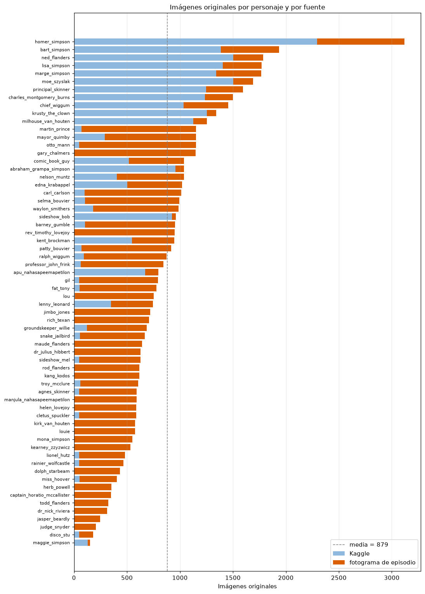

| Conjunto | Originales | Alteradas | Total |
|---|---:|---:|---:|
| Entrenamiento (70 %) | 39.387 | 9.761 | 49.148 |
| Validación (20 %) | 11.254 | 2.876 | 14.130 |
| Test (10 %) | 5.627 | 1.440 | 7.067 |

Ninguna imagen ni ninguna de sus variantes aparece en dos conjuntos, y la desviación máxima de la estratificación es
de 0,35 %.

## 6. Preprocesamiento

1. Cada imagen se convierte a RGB y se redimensiona a **128 × 128** con interpolación bilineal.
2. Las imágenes quedan como un tensor `(N, 128, 128, 3)` en `uint8`, **sin aplanar**. En `uint8` ocupan 3,22 GB y
   caben enteras en la VRAM; en `float32` ocuparían 12,88 GB.
3. El escalado a [0, 1] lo hace la primera capa del modelo (`Rescaling(1/255)`), ya en la GPU.
4. Las etiquetas pasan a índice entero y a vector one-hot de 64 posiciones.
5. Los pesos por clase se calculan solo con entrenamiento: la raíz cuadrada del peso balanceado (de 0,55 para Homero
   a 2,48 para Maggie).

Cada paso tiene una celda de comprobación en el notebook.

## 7. Modelo base

| Componente | Configuración |
|---|---|
| Entrada | Imagen RGB de 128 × 128 × 3 en `uint8`, escalada a [0, 1] dentro del modelo |
| Bloques convolucionales | 4, de 32, 64, 128 y 256 filtros de 3 × 3; cada uno `Conv2D` → `BatchNormalization` → ReLU → `MaxPooling2D` de 2 × 2 |
| Cabeza | `GlobalAveragePooling2D` → Dropout 0,3 → densa de 256 con ReLU → BatchNormalization → Dropout 0,3 → densa de 64 con `softmax` |
| Pérdida y optimizador | Entropía cruzada categórica con suavizado de etiquetas de 0,1; Adam, tasa 0,001; batch 128 |
| Parámetros | 473.120 (471.648 entrenables); `conv_4` concentra el 62,5 % |

El campo receptivo del último bloque cubre 38 × 38 píxeles, el 30 % del lado de la imagen. A 128 × 128, la primera
capa densa de 512 neuronas de un MLP sobre los píxeles tendría 25.165.824 pesos; la primera convolución de la CNN
tiene 864.

## 8. Entrenamiento y regularización

### 8.1 Control del entrenamiento

El modelo se define con Keras y se entrena con un bucle propio sobre PyTorch, con los datos en la VRAM, que deja la
GPU ocupada el 99,4 % del tiempo. El bucle (`pipeline_comun.entrenamiento.entrenar()`) incluye:

| Mecanismo | Configuración |
|---|---|
| Presupuesto | 60 épocas como máximo para todas las configuraciones |
| Parada temprana | `val_loss` sin mejora en 12 épocas; restaura los pesos de la mejor época |
| Reducción de la tasa | A la mitad tras 4 épocas sin mejora, mínimo 1e-5 |
| Regularización L2 | Opcional (`l2`), sobre los núcleos de las convoluciones y de las capas densas |
| Aumento de datos en línea | Opcional (`aumentar_imagenes()`), en la GPU sobre cada lote: espejo, giro de hasta 10°, escala de 0,9 a 1,1, desplazamiento de hasta un 8 % y cambio de brillo y contraste |
| Reanudación | El historial de cada configuración se guarda en disco con una huella de sus factores; si la corrida se corta, lo ya entrenado se carga en lugar de reentrenarse |

### 8.2 Curvas del modelo base

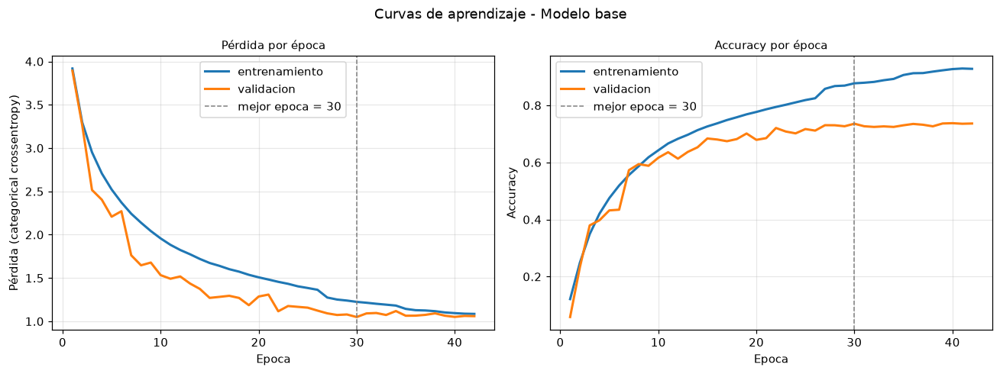

El modelo base se detiene en la época 42 de 60 con su mínimo de `val_loss` (1,050) en la 30. El primer escalón de
la tasa, tras la época 26, sube la accuracy de validación de 0,712 a 0,730. En la mejor época la accuracy es de
0,877 en entrenamiento y 0,736 en validación: **una brecha de 0,142, sobreajuste moderado**, que es lo que la
regularización debe atacar.

### 8.3 Parada temprana

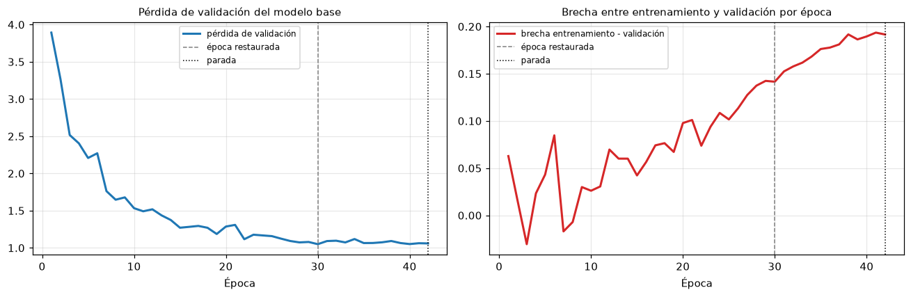

La parada ahorró 18 épocas (unos 17 minutos), pero su aporte principal es la restauración: entre la época 30 y la 42
la pérdida de validación no mejoró (de 1,050 a 1,060) mientras la brecha subía de 0,141 a 0,192. Sin ella, el modelo
final sería el de la última época, más sobreajustado. En las variantes, la parada cortó 8 de 14 y les ahorró entre 2
y 24 épocas; las otras seis y la combinación C1 llegaron al tope, casi todas con su mejor época al final.

### 8.4 Efecto de cada técnica de regularización

Cada técnica se mide frente a la base cambiando solo ese factor, con el mismo presupuesto.

| Técnica | Experimento | Accuracy val. | F1 macro val. | Δ F1 | Brecha | Parada |
|---|---|---:|---:|---:|---:|---|
| Ninguna: la base | Base (dropout 0,3, BatchNorm, suavizado, alteradas) | 0,736 | 0,714 | — | 0,142 | paciencia (42) |
| Dropout | G1 · sin dropout | 0,680 | 0,657 | −5,7 | 0,310 | paciencia (57) |
| Dropout | E6 · dropout 0,5 | 0,734 | 0,712 | −0,2 | 0,130 | tope |
| Batch Normalization | G2 · sin Batch Normalization | 0,714 | 0,689 | −2,5 | 0,133 | tope |
| Regularización L2 | G3 · L2 de 5·10⁻⁴ | 0,741 | 0,714 | −0,1 | 0,194 | paciencia (56) |
| Aumento fuera de línea | A1 · sin alteradas | 0,736 | 0,715 | +0,1 | 0,182 | paciencia (52) |
| Aumento en línea | **G4 · aumento en línea** | **0,770** | **0,752** | **+3,8** | **0,033** | tope |
| Suavizado de etiquetas | S1 · sin suavizado | 0,723 | 0,703 | −1,1 | 0,098 | paciencia (36) |
| Combinación | C1 · G4 + P2 + A1 | 0,749 | 0,732 | +1,8 | 0,041 | tope |

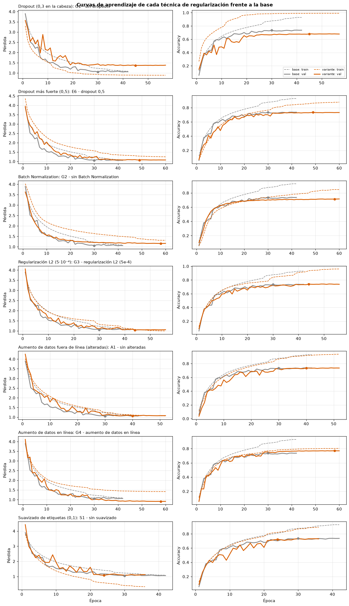

- **Dropout, imprescindible pero 0,3 basta.** Sin él la red memoriza (0,990 de accuracy en entrenamiento, brecha de
  0,31) y la pérdida de validación se queda en 1,37. Con 0,5 nada mejora.
- **Batch Normalization, aporte claro a un costo alto.** Sin ella se pierden 2,5 puntos y la red aprende más lento,
  pero cada época cuesta 27,3 s en lugar de 56,4.
- **L2, sin efecto.** Sumada a la pérdida y optimizada con Adam, la penalización se diluye: ni el F1 ni la brecha
  mejoran. Un *weight decay* desacoplado (AdamW) queda como propuesta.
- **Aumento de datos en línea, la mejora clara.** +3,8 puntos de F1, +3,4 de accuracy y la menor pérdida de
  validación de toda la experimentación (0,905). Su brecha de 0,033 se mide contra imágenes transformadas, más
  difíciles; lo que la respalda es la validación. Llegó al tope con su mejor época en la 58: todavía mejoraba.
- **Las mejoras no se suman.** C1 junta las tres variantes que superaron a la base y rinde la mitad que G4 solo.

**Conclusión.** La regularización mejora la generalización, pero no cualquiera: el dropout y Batch Normalization son
necesarios, y la que además mejora la validación es la que da variedad a los datos, no la que restringe más los
pesos.

## 9. Optimización

**Estrategia de búsqueda.** Dos estrategias complementarias, las dos con el presupuesto de 60 épocas y paciencia 12:

1. **Un factor a la vez** alrededor del modelo base, para atribuir cada diferencia a una causa, más la combinación
   C1 de los factores que superaron a la base.
2. **Random Search** (`optimizar_modelo(estrategia="aleatoria")`) sobre los cuatro factores que más interactúan:
   tasa de aprendizaje {10⁻³, 5·10⁻⁴, 2·10⁻⁴}, dropout {0,2, 0,3, 0,4, 0,5}, L2 {0, 10⁻⁴, 5·10⁻⁴} y aumento en línea
   {no, sí}, un espacio de 72 combinaciones. En dos etapas: 8 configuraciones al azar con 15 épocas (paciencia 5) y
   las 2 mejores reentrenadas con el presupuesto completo.

Una grilla completa no es viable: cada configuración cuesta unos 50 minutos, y las 72 combinaciones del espacio de
búsqueda tomarían unas 60 horas.

| Exp. | Cambio | Accuracy val. | F1 macro val. | Brecha | Parada |
|---|---|---:|---:|---:|---|
| **G4** | **Aumento de datos en línea** | **0,770** | **0,752** | 0,033 | tope |
| RS1 | Random Search: tasa 10⁻³, dropout 0,2, L2 5·10⁻⁴, aumento en línea | 0,767 | 0,751 | 0,057 | tope |
| C1 | G4 + pesos balanceados + sin alteradas | 0,749 | 0,732 | 0,041 | tope |
| P2 | Pesos balanceados completos | 0,739 | 0,719 | 0,174 | paciencia |
| A1 | Sin imágenes alteradas | 0,736 | 0,715 | 0,182 | paciencia |
| Base | RGB, 4 bloques de una convolución, pooling global | 0,736 | 0,714 | 0,142 | paciencia |
| G3 | L2 de 5·10⁻⁴ | 0,741 | 0,714 | 0,194 | paciencia |
| E6 | Dropout 0,5 | 0,734 | 0,712 | 0,130 | tope |
| RS2 | Random Search: tasa 10⁻³, dropout 0,3, sin L2 ni aumento | 0,730 | 0,711 | 0,173 | paciencia |
| P1 | Sin pesos por clase | 0,734 | 0,709 | 0,143 | paciencia |
| S1 | Sin suavizado de etiquetas | 0,723 | 0,703 | 0,098 | paciencia |
| E1 | 3 bloques (32, 64, 128) | 0,716 | 0,691 | 0,023 | tope |
| G2 | Sin Batch Normalization | 0,714 | 0,689 | 0,133 | tope |
| G1 | Sin dropout | 0,680 | 0,657 | 0,310 | paciencia |
| E7 | Aplanado en lugar de pooling global | 0,680 | 0,653 | 0,304 | paciencia |
| R1 | Escala de grises | 0,663 | 0,633 | 0,227 | paciencia |
| E3 | Activación tanh | 0,651 | 0,623 | 0,115 | tope |
| E4 | Tasa de aprendizaje 0,0001 | 0,636 | 0,605 | −0,010 | tope |
| E2 | Dos convoluciones por bloque | No cabe en los 8 GB de la GPU | | | |
| E5 | Batch 512 | No cabe en los 8 GB de la GPU | | | |

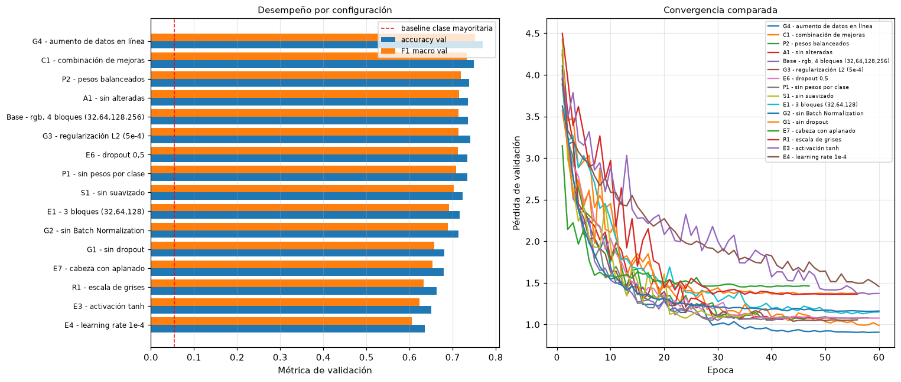

**Random Search.** En la etapa 1 las ocho configuraciones pararon por el tope de 15 épocas, así que el orden premia
a las que aprenden rápido: las dos con tasa 10⁻³ quedan arriba (0,546 y 0,533) y las dos peores (0,354 y 0,329)
combinan la tasa más baja con dropout alto. En la etapa 2, RS1, que usa aumento en línea, llega a 0,751, a 0,1
puntos de G4; RS2, sin aumento, se queda en 0,711, bajo la base. El Random Search llega a la misma conclusión que un
factor a la vez por otro camino: el aumento en línea es lo que importa. Las dos etapas tomaron 3 h 11 min; entrenar
las ocho con el presupuesto completo habría costado unas 7 h.

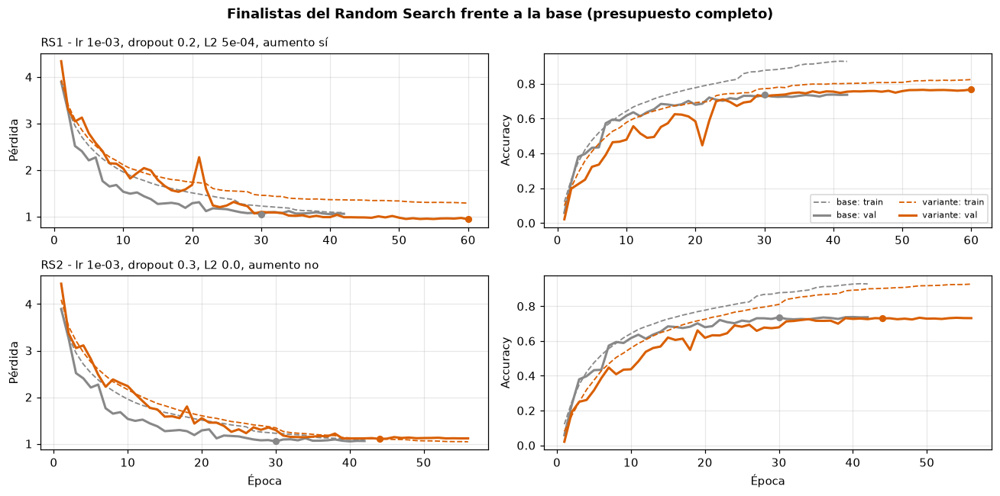

**Selección.** Gana **G4**, por F1 macro de validación. Con RS1 es un empate en la práctica (0,1 puntos), y todo lo
demás favorece a G4: mayor accuracy, menor pérdida (0,905), menor brecha (0,033 frente a 0,057) y un solo factor
cambiado respecto de la base, así que su mejora tiene una causa identificada. Su margen sobre la base, 3,8 puntos, es
el doble de la variación entre corridas que se observó el 13-11-2026 (hasta 1,9 puntos, por el no determinismo de
cuDNN), y G4 ya había ganado en esa corrida, con 35 épocas. Los factores propios de una CNN se confirman: quitar el
color cuesta 8,1 puntos, aplanar en lugar de promediar 6,1 y quitar un bloque 2,3; la tasa de 0,0001 (−10,9) y tanh
(−9,2) son las peores. La reserva: G4, RS1 y C1 llegaron al tope con su mejor época entre la 58 y la 60, así que
todavía podían mejorar.

## 10. Evaluación y auditoría en test

El test se abre una sola vez, con el modelo elegido.

| Métrica | Valor |
|---|---:|
| Accuracy | 0,775 |
| Precision macro / ponderada | 0,754 / 0,783 |
| Recall macro / ponderado | 0,762 / 0,775 |
| F1 macro / ponderado | 0,755 / 0,776 |
| Top-3 accuracy | 0,908 |
| ROC-AUC macro / ponderada / micro | 0,987 / 0,987 / 0,989 |
| Accuracy por escena (referencia) | 0,848 |

Referencias: azar 1/64 = 0,016 y clase mayoritaria 0,059. La CNN las supera 49,6 y 13,2 veces. El F1 macro de test
(0,755) es prácticamente el de validación (0,752): elegir entre 18 configuraciones por su F1 de validación no infló
la cifra.

- **Por personaje.** 53 de 64 tienen F1 de 0,60 o más y ninguno queda bajo 0,30. Los mejores son Kang y Kodos (0,96),
  Krusty (0,94), Kent Brockman (0,93), Disco Stu y Sideshow Bob (0,89); los peores, Rod Flanders (0,32), Helen
  Lovejoy (0,39), Louie (0,44), Maude Flanders (0,45) y Todd Flanders (0,46). La correlación entre imágenes de
  entrenamiento y F1 es de solo 0,25: Maggie, con 135 imágenes de entrenamiento, llega a 0,77.
- **ROC-AUC.** Ningún personaje queda bajo 0,90; los peores son Helen Lovejoy (0,913), el Rico Texano (0,928) y Rod
  Flanders (0,947). Rod tiene 0,95 de ROC-AUC y 0,32 de F1: el modelo da a sus imágenes más probabilidad que a casi
  todas las demás, pero Todd, que se le parece, queda por delante.

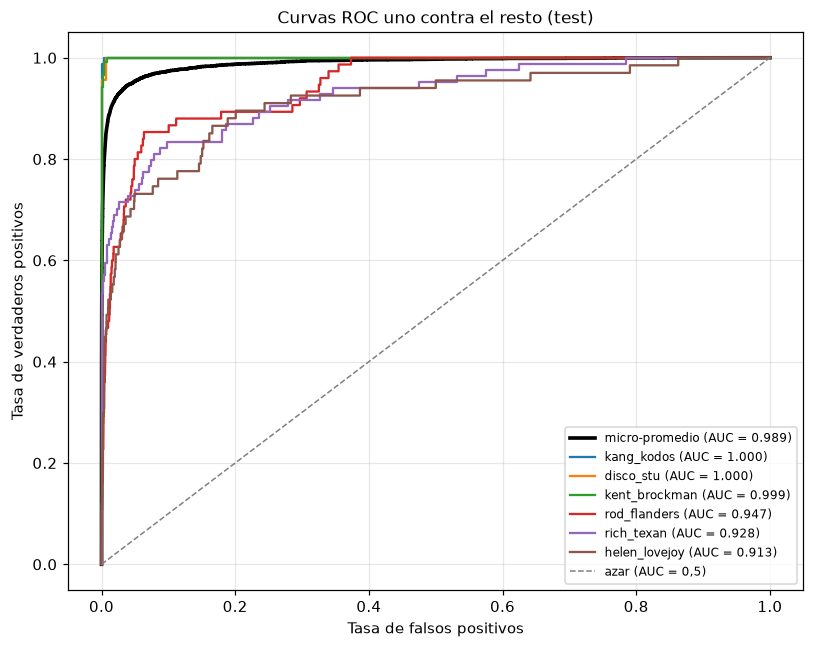

- **Matriz de confusión.** Recall medio de 0,762. Las confusiones son de personajes dibujados casi iguales —Selma
  como Patty en el 42,2 % de sus imágenes, Todd como Rod en el 30,0 %, Lenny como Carl en el 20,7 %— o que salen
  juntos —Louie como Fat Tony en el 22,4 %, Wiggum como Lou en el 19,8 %, Burns como Smithers en el 11,9 %—. Ninguna
  de las quince confusiones más frecuentes es de la familia Simpson.
- **Escenas.** El 23,9 % del test tiene otro personaje presente; ahí la accuracy es 0,543, frente a 0,848 en el
  resto, y el 32,3 % de los errores nombra a un personaje que sí está en la escena.
- **Tipos de imagen.** Originales 0,770, parecidas 0,831 y alteradas 0,758: la red casi no pierde con el giro, el
  color y la textura (−1,2 puntos), y como el MLP, gana con las tomas casi idénticas a otra (+6,1).
- **Errores.** 1.589 (22,5 %). La confianza separa aciertos (0,78) de errores (0,42), y solo 137 errores superan
  0,80. En los diez más confiados el personaje predicho aparece en la imagen; en los de menor confianza (0,06 a
  0,07) hay escenas en blanco y negro, bocetos sin color o personajes diminutos.

## 11. Explicabilidad: mapas de activación y Grad-CAM

**Mapas de activación.** La representación se vuelve más selectiva con la profundidad: en una imagen de Comic Book
Guy, el 40 % de los valores es distinto de cero en el primer bloque y el 1 % en el último, donde solo la mitad de los
filtros se activa. Con cuatro imágenes de la familia, la correlación de la activación media de los filtros entre
ellas es de 0,40 en el tercer bloque —lo común a los Simpson: la piel amarilla, los ojos, el trazo— y cae a 0,14 en el
cuarto y a 0,15 en el pooling global: cada personaje activa su propio conjunto de filtros.

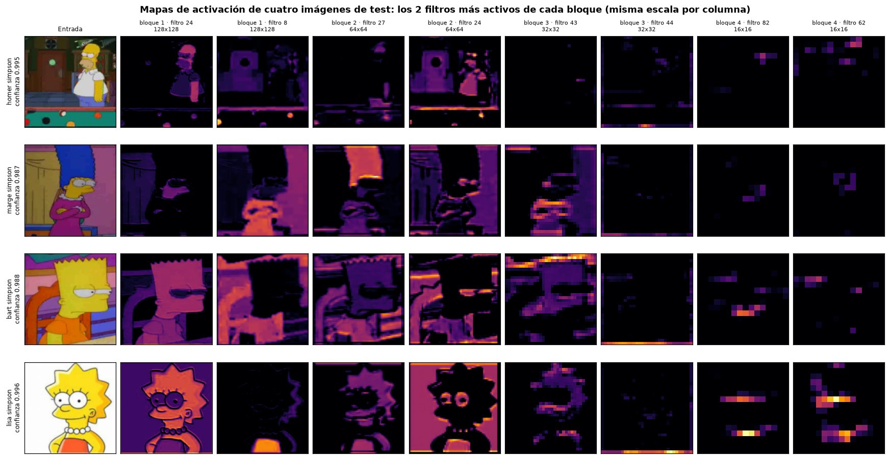

**Grad-CAM.** La red mira a los personajes, sobre todo a sus caras: el 10 % de píxeles más cálidos reúne el 72,7 % de
la influencia (10 % si mirara toda la imagen por igual) y la mitad central, el 49,6 % en los aciertos (25 % con un
reparto uniforme). Los tres errores más confiados miran la cara de un personaje que sí está en la imagen: Edna
Krabappel en la carpeta de Martin Prince, el abuelo Jasper en la de Bart y Agnes Skinner en la de Helen Lovejoy, que
es a quien muestra la imagen. Calculado para la clase de cada carpeta, los 64 ejemplos caen sobre el personaje, y la
concentración del calor acompaña al reconocimiento: su correlación con el recall de cada personaje es de 0,52. Los de
calor más disperso —Louie, Rod Flanders, el Rico Texano y Helen Lovejoy— están también entre los de peor F1.

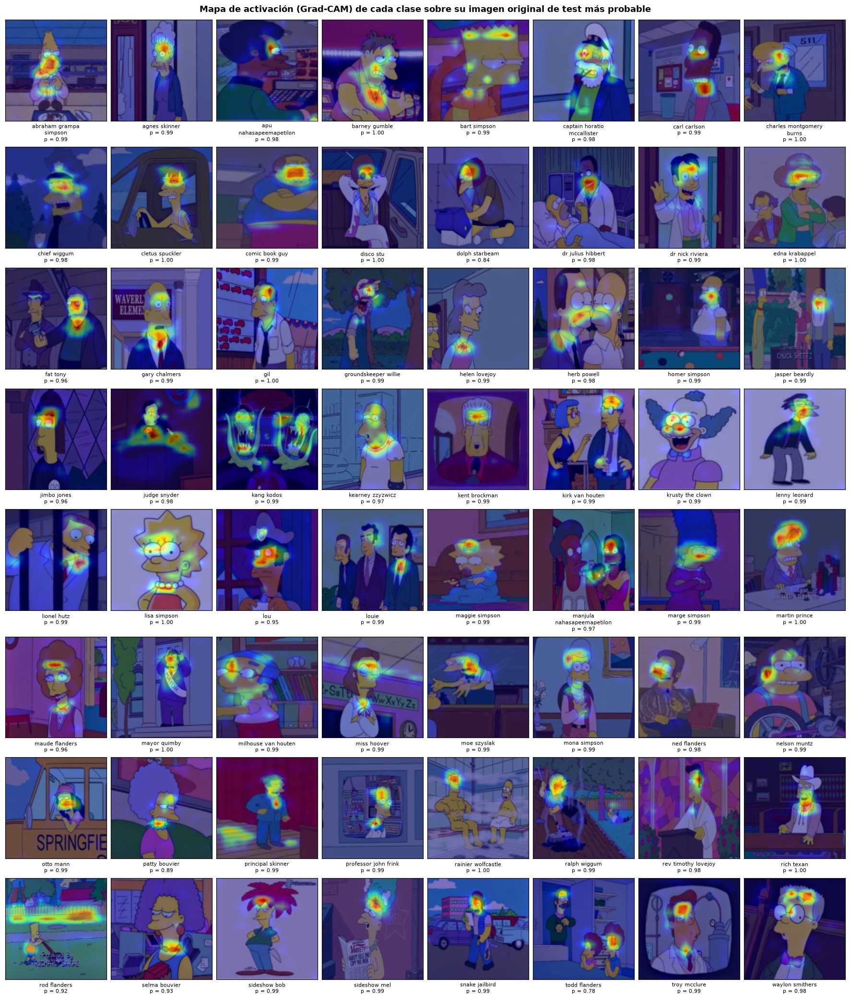

## 12. Auditoría, sesgos e impacto ético

`auditar_modelo()` audita el modelo final sin volver a entrenar: ROC-AUC, calibración, un umbral de revisión elegido
en validación y el desempeño por subgrupo.

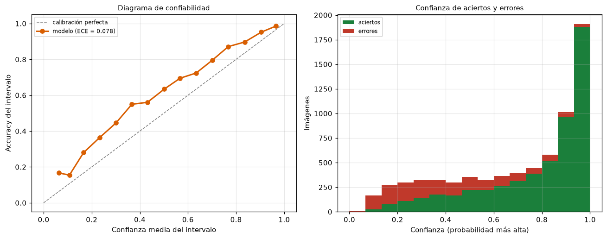

- **Calibración.** ECE de 0,078. El modelo es **subconfiado**: confianza media de 0,698 frente a una accuracy de
  0,775, por el suavizado de etiquetas y por entrenar con imágenes aumentadas, más difíciles que las de test. Para
  catalogar es el lado seguro del error.
- **Umbral de revisión.** Elegido en validación para que lo aceptado acierte al menos el 90 %: 0,529. En test el
  sistema resuelve solo el **71,6 %** de las imágenes con una accuracy de **0,904** (en validación, 71,8 % y 0,900) y
  manda el resto a revisión, donde acertaría el 45 %.

| Variable | Grupos | Accuracy en test | Brecha |
|---|---|---|---:|
| Origen | Kaggle / fotograma de episodio | 0,933 / 0,670 | 26,3 puntos |
| Tamaño de la clase | grandes / medianas / pequeñas | 0,795 / 0,768 / 0,727 | 6,8 puntos |
| Tipo de imagen | parecida / original / alterada | 0,831 / 0,770 / 0,758 | 7,3 puntos |
| Familia Simpson | familia / resto | 0,779 / 0,774 | 0,5 puntos |

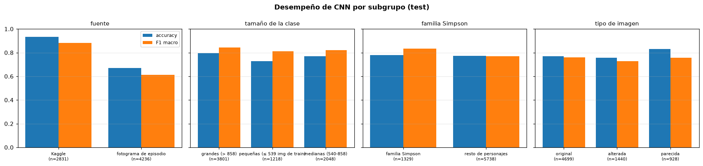

- **Sesgo de origen.** Es el más grande: en las imágenes de Kaggle, donde el personaje suele llenar el encuadre, el
  modelo acierta el 93 % (F1 macro de 0,881); en los fotogramas de episodio, con planos generales y varios
  personajes, el 67 % (0,612). La accuracy global promedia dos poblaciones muy distintas, y la cifra que representa un
  archivo de episodios es la de los fotogramas.
- **Sesgo de selección de la ampliación.** Parte de los fotogramas entró al dataset con la herramienta de Frinkiac,
  que usó la CNN de octubre para decidir cuáles eran «seguros». Si eso los hiciera fáciles, rendirían por encima de
  las imágenes de Kaggle, y rinden 26 puntos por debajo; aun así, el dataset subrepresenta los fotogramas que ningún
  modelo reconocía, y la cifra de los fotogramas es, si acaso, optimista frente a un archivo sin filtrar.
- **Desbalance y parecido.** El tercil de personajes pequeños pierde 6,8 puntos frente al de los grandes: los pesos por
  clase no lo anulan, pero pesa poco. Lo que más pesa es parecerse a otro o salir con él: usado para medir presencia en
  pantalla, el catálogo contaría a Patty Bouvier y a Lou 1,41 veces sus apariciones reales, a Selma 0,80 y a Homero
  0,92. Ese error llegaría directamente a decisiones de licencias o de merchandising.
- **Ruido en las etiquetas.** Hay imágenes cuya carpeta no corresponde al personaje que muestran: Agnes Skinner en la
  carpeta de Helen Lovejoy, Ned Flanders al volante en la de Maude. El modelo aprende de ellas y la evaluación las
  cuenta como errores; hay que limpiarlas antes de usar el catálogo para medir algo.
- **Revisión humana.** Se equivoca en el 22,5 % del test, 137 errores superan una confianza de 0,80 y siempre
  responde algún personaje. Debe usarse como asistente: aceptar solo lo que supera el umbral de 0,529, mostrar las
  tres sugerencias en el resto (90,8 % de cobertura) y revisar a mano todo lo que afecte a terceros.
- **Derechos de autor.** Personajes y fotogramas son obras protegidas; se usan solo con fines académicos y ni el
  dataset ni los modelos se versionan.
- **Fuera del dominio.** Con fotos de personas reales sería reconocimiento facial, con problemas de privacidad y
  consentimiento que el proyecto no aborda: no debe usarse así.

## 13. Comparación entre el MLP y la CNN

### 13.1 Desempeño y costo

| Concepto | MLP · GPU 128 × 128 | CNN · GPU 128 × 128 | Diferencia |
|---|---:|---:|---|
| Configuración final | GS01 del Grid Search, sobre 370 valores de color | G4, aumento de datos en línea | |
| Parámetros | 1.059.648 | 473.120 | La CNN tiene menos de la mitad |
| Accuracy | 0,556 | 0,775 | +22,0 puntos |
| Precision / recall macro | 0,558 / 0,560 | 0,754 / 0,762 | +19,6 / +20,2 |
| F1 macro | 0,557 | 0,755 | +19,8 |
| F1 ponderado | 0,554 | 0,776 | +22,2 |
| Top-3 accuracy | 0,732 | 0,908 | +17,7 |
| ROC-AUC macro | 0,940 | 0,987 | +4,7 |
| Accuracy por escena (referencia) | 0,648 | 0,848 | +20,0 |
| Error de calibración (ECE) | 0,044 | 0,078 | El MLP está mejor calibrado |
| Errores con confianza > 0,80 | 401 | 137 | |
| Segundos por época (benchmark) | 2,25 | 51,7 | 23 veces más |
| Inferencia de la red sola | 76.661 img/s | 3.553 img/s | |
| Catalogación de extremo a extremo | 1.360 img/s, limitada por los descriptores en la CPU | 3.567 img/s | La CNN, 2,6 veces más rápida |
| Uso de la GPU | 27,8 %, unos 11 W | 99,4 %, unos 70 W | |

Las cifras del MLP son de su corrida del 15-11-2026 (`PMC/docs/newDataset/Informe.md`) y salen de su resumen JSON y
de las salidas de su notebook. El tiempo total de entrenamiento no se compara: la CNN entrenó 26 configuraciones y el
MLP 54, con su Grid Search.

### 13.2 Capacidad de generalización

| Indicador | MLP | CNN |
|---|---:|---:|
| Brecha entre entrenamiento y validación del modelo base | 0,397 | 0,142 |
| Brecha del modelo final | 0,337 | 0,033 |
| Caída en las alteradas frente a las originales (puntos) | 9,0 | 1,2 |
| Ventaja de las parecidas sobre las originales (puntos) | 7,8 | 6,1 |
| Errores con confianza > 0,80 por cada 1.000 imágenes de test | 56,7 | 19,4 |

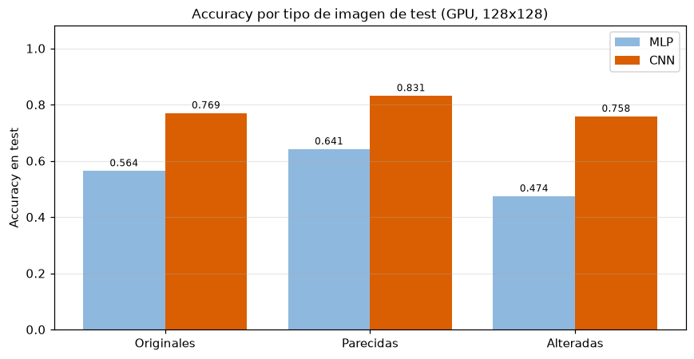

La CNN memoriza menos, resiste mejor las alteraciones y comete menos errores confiados, casi todos nombrando a un
personaje que sí está en la imagen. Las dos redes ganan algo parecido con las tomas casi idénticas a otra: haber visto
casi la misma toma ayuda a cualquier modelo, y por eso la partición por grupo de tomas es una de las propuestas.

### 13.3 Interpretabilidad

| | Grad-CAM (CNN) | SHAP (MLP) |
|---|---|---|
| Qué explica | Qué zona de la imagen sube la probabilidad de la clase | Cuánto aporta cada descriptor a la probabilidad de la clase |
| Granularidad | Un mapa de 16 × 16 sobre la imagen, por predicción y por clase | Por grupo de descriptores: canal de color × zona |
| Costo | Una pasada hacia adelante y una hacia atrás por imagen | Cientos de evaluaciones por imagen, sobre una muestra |
| Limitación | Resolución gruesa; dice dónde, no qué rasgo | Explica descriptores, no la imagen |

Grad-CAM confirma que la CNN mira al personaje, y hasta sus errores más confiados miran a un personaje presente. En
el MLP, la explicación solo puede repartir la decisión entre canales de color y zonas, porque su entrada no tiene
forma ni textura: SHAP muestra que el tono pesa más que el brillo (el canal H y el eje b* de Lab reúnen el 44 % de la
explicación) y que la zona en que aparece cada color pesa más que el histograma de la imagen completa. Es exacta sobre lo que la red usa, pero lo que usa no es lo que una persona mira para reconocer a un
personaje. La CNN es la más interpretable para quien usa el catálogo: su explicación está sobre la misma imagen.

### 13.4 Ventajas, desventajas y arquitectura seleccionada

| | Ventajas | Desventajas |
|---|---|---|
| **MLP** | Cada época cuesta 23 veces menos; la red sola infiere 76.661 imágenes por segundo; apenas ocupa la GPU; mejor calibrado (ECE de 0,044) | No aprende de la imagen: combina histogramas de color y confunde a los personajes que comparten paleta (la familia Simpson, con F1 de 0,37 a 0,64 y 11,3 puntos de sesgo); memoriza más (brecha de 0,397); calcular los descriptores en la CPU limita su velocidad de extremo a extremo (1.360 imágenes por segundo) |
| **CNN** | Aprende sus propios filtros y reconoce la forma (la familia Simpson sube a F1 de 0,78 a 0,82); 22 puntos más de accuracy con menos de la mitad de parámetros; generaliza mejor; cataloga 2,6 veces más rápido de extremo a extremo; Grad-CAM explica cada decisión | Entrenar cuesta 23 veces más por época y exige GPU; a 128 × 128 dos configuraciones no caben en 8 GB; el modelo base sobreajusta si no se le da variedad a los datos |

**La CNN es la arquitectura seleccionada**, en su configuración G4. Gana en todos los criterios menos en el costo de
entrenamiento y en la calibración. El costo se paga una sola vez —unos 50 minutos por configuración en la RTX 4060—, mientras que la calidad y
la velocidad de catalogación se aprovechan en cada imagen del archivo.

## 14. Limitaciones y medidas para la robustez y la confiabilidad

| Limitación | Medida propuesta |
|---|---|
| Sesgo de origen: 0,67 en fotogramas de episodio frente a 0,93 en Kaggle | Más fotogramas con planos generales y varios personajes, sin filtrarlos con un modelo anterior; informar siempre la cifra por origen |
| Personajes parecidos o que salen siempre juntos (Patty y Selma, Rod y Todd, Louie y Fat Tony) | Nombrar a cada personaje en su propia caja (`scripts/newDataset/detectar_cajas.py`) o una salida multietiqueta con sigmoides |
| Ruido en las etiquetas | Revisar las imágenes con errores de confianza muy alta o muy baja y sacar de su carpeta las que no muestran al personaje |
| G4, RS1 y C1 pararon por el tope, todavía mejorando | Más épocas para las configuraciones con aumento en línea |
| Variedad de los datos: el aumento en línea fue la mejor regularización | Aumento más fuerte (recortes, giros mayores, cambios de tono) |
| Subconfianza (ECE de 0,078) | Calibración por temperatura en validación; mientras tanto, el umbral de revisión elegido en validación |
| L2 sin efecto | *Weight decay* desacoplado (AdamW) y `SpatialDropout2D` tras cada bloque |
| Entrenada desde cero | Transfer learning (MobileNet, ResNet, EfficientNet) |
| Resolución y memoria: E2 y E5 no caben en 8 GB | Acumulación de gradientes o precisión mixta (`bfloat16`) |
| Variación entre corridas de hasta 1,9 puntos de F1 | Varias semillas o validación cruzada, reportando media y desviación |
| Tomas casi idénticas a otra (+6,1 puntos) | Partición por grupo de tomas o por episodio |
| El modelo siempre responde algún personaje | Umbral de confianza para derivar a revisión humana (0,529) |

## 15. Reproducibilidad y estructura de entrega

```text
CNN/docs/EP3_TLY1102_Instrucciones Estudiante.docx    # encargo de la evaluación
CNN/docs/newDataset/Informe.md                        # este informe
CNN/docs/newDataset/figuras/                          # figuras del informe, guardadas por el notebook
CNN/notebooks/LosSimpsons_GPU_4060M.ipynb             # notebook evaluado, con salidas
CNN/notebooks/README.md
CNN/presentacion_resultados_CNN.html                  # presentación de resultados
CNN/resultados/newDataset/GPU/rendimiento_gpu_128x128.json
scripts/newDataset/pipeline_comun/                    # funciones del pipeline, comunes al MLP y la CNN
scripts/newDataset/tests/                             # pruebas del módulo común
scripts/newDataset/generar_imagenes_alteradas.py      # prepara el dataset para el MLP y la CNN
scripts/newDataset/generar_presentacion.py            # genera las presentaciones desde los resultados
PMC/notebooks/LosSimpsons_GPU_4060M.ipynb             # MLP de la comparación
```

**Ejecución.** Crear el entorno `.venv-gpu` con `requirements-gpu-windows.txt`, ubicar el dataset (o fijar
`SIMPSONS_DATASET`), ejecutar una vez `scripts/newDataset/generar_imagenes_alteradas.py` y ejecutar el notebook
completo con el kernel de `.venv-gpu`. Con `SIMPSONS_PRUEBA=1` el notebook corre de punta a punta con 40 imágenes por
personaje y 2 épocas, y escribe en carpetas `prueba/` aparte: sirve para comprobarlo antes de la corrida completa. Las
pruebas del módulo común se ejecutan con `pytest scripts/newDataset/tests`. La ejecución local quedó acordada con el
profesor en lugar de Google Colab.

**Estado de las salidas.** Las salidas son las de la corrida completa del 14-11-2026 (de 18:19 a 10:48 del día
siguiente, 16 h 28 min 18 s), ejecutada de principio a fin sin intervención: las 82 celdas de código terminaron sin
errores. Después de la corrida solo se volvió a ejecutar la celda de los KPIs, con la medición del costo corregida
(§3). `cudnn.benchmark` elige el algoritmo de convolución por tiempo, así que una misma configuración puede variar
entre corridas; para reproducir las cifras exactas hay que fijar `torch.backends.cudnn.benchmark = False` y
`torch.backends.cudnn.deterministic = True`.

## 16. Conclusiones

La CNN resuelve lo que el MLP no podía: reconocer a los personajes por su forma. Con el mismo pipeline, los mismos
datos y la misma resolución, sube la accuracy de test de 0,556 a 0,775 y el F1 macro de 0,557 a 0,755, con una
ROC-AUC macro de 0,987, cumple los cinco KPIs y no deja a ningún personaje bajo 0,30 de F1.

La optimización y la auditoría de la EP3 dejan cuatro lecciones. **La regularización que sirve es la que da
variedad**: el aumento de datos en línea fue la mejora clara (+3,8 puntos) y bajó la brecha a 0,033, el Random Search
llegó a lo mismo por otro camino, y restringir los pesos no aportó. **Comparar con el mismo presupuesto cambia la
lectura**: con 60 épocas para todas, la ventaja del aumento en línea se duplicó respecto de la corrida con 35.
**Lo difícil ya no es tener pocas imágenes, sino parecerse a otro**: los personajes que fallan comparten diseño o
escena con otro, y Grad-CAM muestra que la red reparte entre ellos la evidencia. **La auditoría encuentra lo que la
accuracy esconde**: el modelo acierta el 93 % de las imágenes de Kaggle y el 67 % de los fotogramas de episodio, es
subconfiado, y un umbral elegido en validación permite catalogar sin revisión tres de cada cuatro imágenes al 90 % de
acierto.

Los próximos pasos siguen esa evidencia: más épocas y más variedad en los datos, más fotogramas difíciles, limpieza de
las etiquetas, nombrar a cada personaje en su propia caja, transfer learning y varias semillas para confirmar
diferencias de un punto.

## Referencias

- Alfaro, A. (s. f.). *Los Simpson* [conjunto de datos]. Kaggle. https://www.kaggle.com/datasets/alfaro96/los-simpson
- LeCun, Y., Bottou, L., Bengio, Y. y Haffner, P. (1998). Gradient-based learning applied to document
  recognition. *Proceedings of the IEEE, 86*(11), 2278-2324.
- Bergstra, J. y Bengio, Y. (2012). Random search for hyper-parameter optimization. *Journal of Machine Learning
  Research, 13*, 281-305.
- Guo, C., Pleiss, G., Sun, Y. y Weinberger, K. Q. (2017). On calibration of modern neural networks. *ICML 2017*.
  https://arxiv.org/abs/1706.04599
- Ioffe, S. y Szegedy, C. (2015). Batch Normalization: Accelerating deep network training by reducing internal
  covariate shift. *ICML 2015*. https://arxiv.org/abs/1502.03167
- Srivastava, N., Hinton, G., Krizhevsky, A., Sutskever, I. y Salakhutdinov, R. (2014). Dropout: A simple way to
  prevent neural networks from overfitting. *Journal of Machine Learning Research, 15*, 1929-1958.
- Simonyan, K. y Zisserman, A. (2015). Very deep convolutional networks for large-scale image recognition.
  *ICLR 2015*. https://arxiv.org/abs/1409.1556
- Lin, M., Chen, Q. y Yan, S. (2014). Network in network. *ICLR 2014*. https://arxiv.org/abs/1312.4400
- Selvaraju, R. R., Cogswell, M., Das, A., Vedantam, R., Parikh, D. y Batra, D. (2017). Grad-CAM: Visual
  explanations from deep networks via gradient-based localization. *ICCV 2017*. https://arxiv.org/abs/1610.02391
- Lundberg, S. M. y Lee, S.-I. (2017). A unified approach to interpreting model predictions. *NeurIPS 2017*.
  https://arxiv.org/abs/1705.07874
- Loshchilov, I. y Hutter, F. (2019). Decoupled weight decay regularization. *ICLR 2019*.
  https://arxiv.org/abs/1711.05101
- Shorten, C. y Khoshgoftaar, T. M. (2019). A survey on image data augmentation for deep learning. *Journal of Big
  Data, 6*, 60. https://doi.org/10.1186/s40537-019-0197-0
