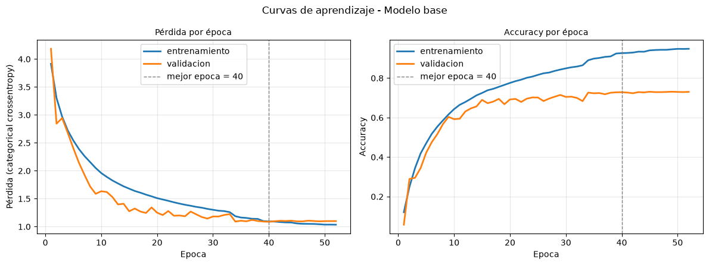
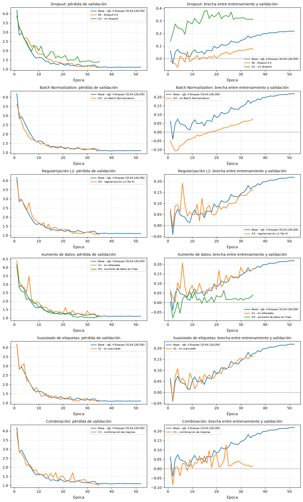
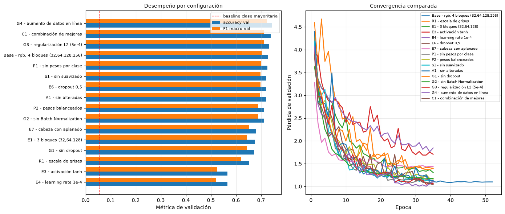
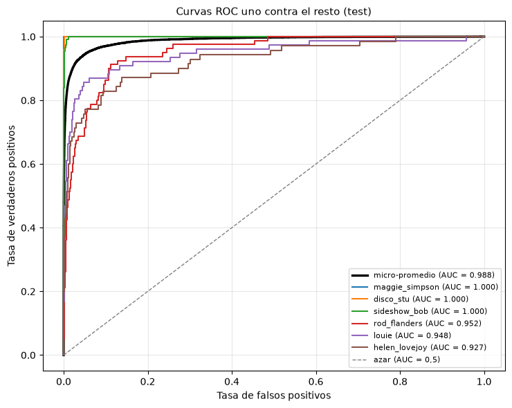
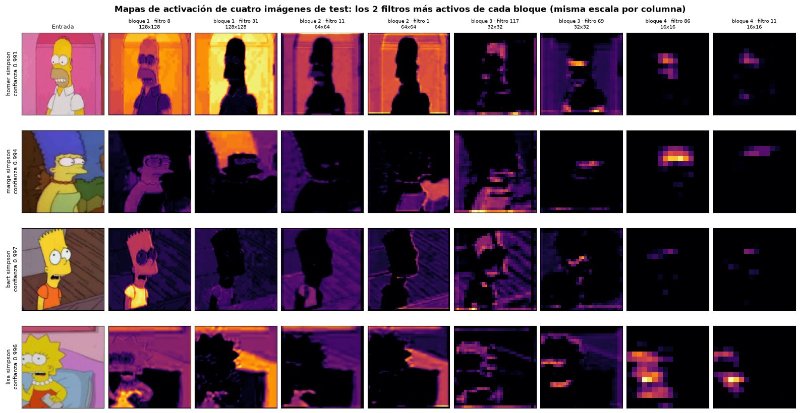
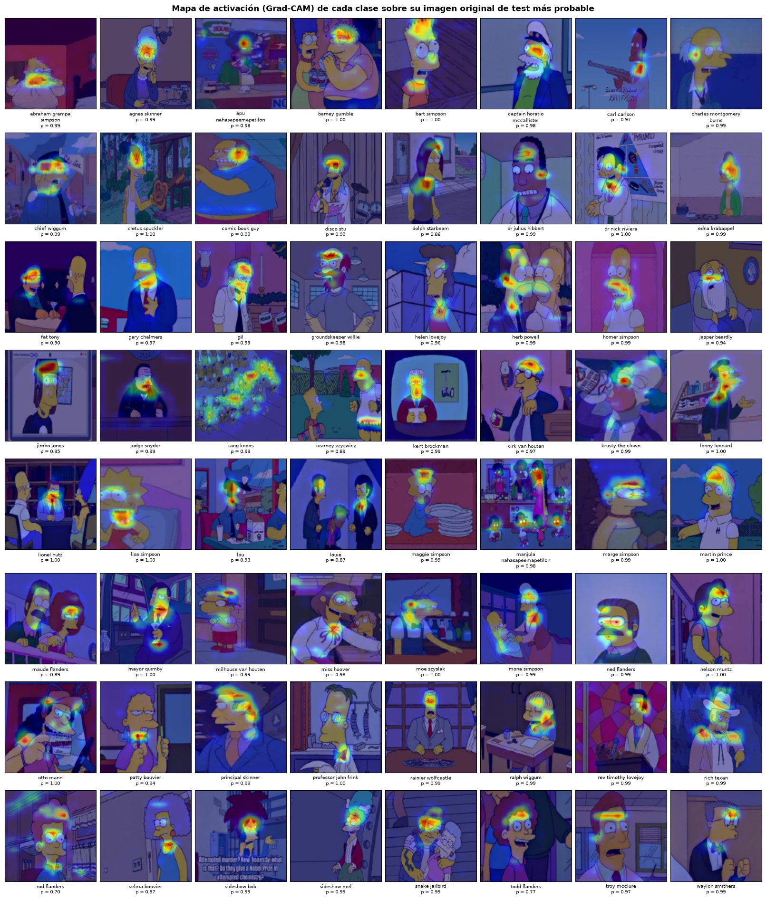
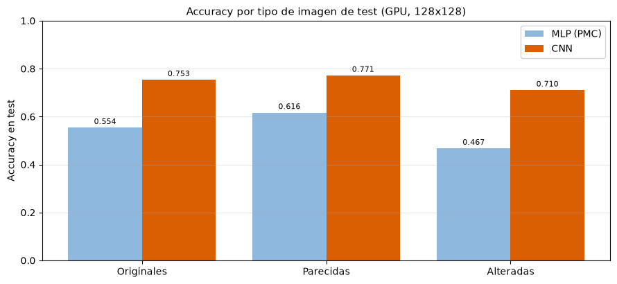

# Informe técnico — Optimización y auditoría de una red convolucional para reconocer personajes de Los Simpson

Evaluación Parcial 3 · Técnicas Avanzadas de Machine Learning

## Resumen

| Tema | Lo importante | Dónde |
|---|---|---|
| Qué se entrega | El Pipeline Integrado de la EP2, optimizado y auditado: una CNN de cuatro bloques convolucionales (473.120 parámetros) que reconoce a 64 personajes, comparada con un MLP entrenado con las mismas imágenes y el mismo proceso | §4, §13 |
| Resultado | Accuracy de test 0,747, F1 macro 0,731, top-3 0,891 y ROC-AUC macro 0,986, frente a 0,544, 0,551 y 0,736 del MLP: 20, 18 y 16 puntos más. Los cinco KPIs se cumplen | §10, §13 |
| Regularización | Se midió cada técnica con y sin ella. El dropout es imprescindible (sin él, −6,0 puntos de F1 y brecha de 0,31); el aumento de datos en línea es la única mejora clara (+1,9 puntos, brecha casi nula); L2 aporta poco (+0,6) y combinarlo con el aumento no suma | §8 |
| Optimización | Búsqueda por ejes alrededor del modelo base: 15 configuraciones que cambian un factor a la vez, más una combinación. Gana G4, el modelo base con aumento de datos en línea, en los tres criterios de validación | §9 |
| Auditoría | Métricas por clase, matriz de confusión, ROC-AUC, curvas de aprendizaje, Grad-CAM por predicción y por clase, análisis de errores, de escenas compartidas y de tipos de imagen | §10, §11 |
| Sesgos | El desbalance (21:1) ya no es lo que más pesa; los personajes que fallan son los que se parecen a otro o salen siempre con él, y hay ruido en las etiquetas: imágenes cuya carpeta no corresponde al personaje que muestran | §12 |
| Arquitectura seleccionada | La CNN: gana en desempeño, generalización, interpretabilidad y parámetros; el MLP solo en costo de entrenamiento (26 veces menor) | §13 |
| Uso responsable | Asistente con revisión humana: se equivoca en el 25 % del test, siempre responde algún personaje y no debe usarse con fotos de personas | §12 |

## 1. Identificación del proyecto

| Elemento | Descripción verificable |
|---|---|
| Tipo de proyecto | Clasificación supervisada de imágenes RGB con una red neuronal convolucional (CNN), comparada con un Perceptrón Multicapa (MLP). |
| Unidad de predicción | Una imagen recibe una sola etiqueta entre 64 personajes. |
| Implementación evaluada | `CNN/notebooks/LosSimpsons_GPU_4060M.ipynb`: Keras 3 sobre PyTorch, en Windows con una GPU NVIDIA GeForce RTX 4060 Laptop de 8 GB; con las salidas de la corrida a 128 × 128 del 13-11-2026. |
| MLP de la comparación | `PMC/notebooks/LosSimpsons_GPU_4060M.ipynb`: el MLP sobre el mismo dataset y con el mismo proceso, corrida del 09-11-2026. |
| Evidencia de ejecución | Salidas guardadas de los dos notebooks; resúmenes JSON en `CNN/resultados/newDataset/GPU/` y `PMC/resultados/newDataset/GPU/`. |
| Framework | Keras 3.15.1 sobre PyTorch 2.14.0 (CUDA 13.0), Python 3.13. |
| Integrantes | Vincent Farenden Cerón; Rodrigo Ignacio Martínez Becker; Iván Manuel Pavón Barría; Diego Ignacio Peña y Lillo Luhrs. |
| Profesor | Francisco Javier Jerez Salazar. |

Cada cifra de este informe sale de las salidas guardadas de los notebooks o de sus resúmenes JSON.

## 2. Problema, variante y cambio de dataset

### 2.1 Problema abordado

**Clasificación multiclase de etiqueta única**: dada una imagen RGB de Los Simpson, el modelo asigna exactamente uno
de 64 personajes, con su confianza. El escenario de uso declarado es un archivo audiovisual que crece más rápido de
lo que un equipo puede catalogarlo: el modelo propone el personaje y una persona valida, así que el trabajo pasa de
*etiquetar* a *revisar*. No es un encargo de un cliente real, por lo que los KPIs se expresan en cantidades
medibles sobre los datos.

### 2.2 Variante del grupo

| Decisión | Valor |
|---|---|
| Personajes | 64, una carpeta por personaje; la etiqueta es siempre la carpeta, nunca el nombre del archivo |
| Imágenes | Todas las originales de cada personaje (56.676), sin tope |
| Partición | 70 / 20 / 10 por personaje, estratificada, con semilla 42 |
| Imágenes alteradas | Una variante (giro de 10 a 20°, cambio de color y filtro de textura) para un cuarto de las imágenes de cada personaje, siempre en el mismo conjunto que su original |
| Imágenes parecidas | Las 9.042 imágenes casi idénticas a otra del mismo personaje entran con una versión filtrada |
| Criterio de acierto | Nombrar al personaje de la carpeta. La accuracy por escena, que también acepta a otro personaje presente, se informa solo como referencia |
| Resolución | 128 × 128 |

### 2.3 Cambio de dataset respecto de la EP1 y trazabilidad

La pauta recomienda el dataset de la EP1 y pide, si se modifica la variante, justificarlo y mantener la
trazabilidad. El dataset es la misma fuente de Kaggle (Los Simpson, `alfaro96`), ampliada por el equipo:

| | EP1 (MLP) | EP2 y EP3 (MLP y CNN) |
|---|---|---|
| Personajes | 25 | 64 |
| Imágenes originales | 20.074 (16.137 en `train` y 3.937 en `test`) | 56.676 |
| Partición | La de Kaggle, de criterio no documentado | Propia: 70 / 20 / 10 estratificada, semilla 42 |
| Casi duplicados entre conjuntos | No se verificaban | Filtrados; cada alterada en el conjunto de su original |
| Información de escena | No | 43.138 de las 70.855 imágenes de trabajo (60,9 %) son fotogramas con episodio e instante |

Razones: un archivo audiovisual también tiene a los personajes secundarios, y con 64 aparecen los que se parecen
entre sí (Patty y Selma, Carl y Lenny, los Flanders), la prueba más exigente para comparar arquitecturas; una CNN
aprende sus filtros de los píxeles y necesita más ejemplos; y la partición propia permite auditar que una misma
escena no caiga en entrenamiento y test.

**Trazabilidad.** El trabajo de la EP1 se conserva en `PMC/notebooks/oldDataset/`, `PMC/docs/oldDataset/` y
`PMC/resultados/oldDataset/`; su MLP final alcanzó 0,517 de accuracy de test sobre 25 personajes. Para la
comparación de la EP3 el MLP se volvió a entrenar sobre el dataset nuevo con el mismo pipeline que la CNN. Las
cifras de la EP1 no se comparan con las actuales porque miden otros personajes sobre otra partición.

### 2.4 Objetivos

**Objetivo general.** Optimizar y auditar una CNN que asigne a cada imagen uno de los 64 personajes, reutilizando
el Pipeline Integrado de la EP2, y compararla con el MLP en igualdad de condiciones.

**Objetivos específicos.** Medir el aporte de cada técnica de regularización; seleccionar la configuración con
experimentos controlados de un factor a la vez; auditar el modelo con accuracy, precision, recall, F1, ROC-AUC,
matriz de confusión, curvas de aprendizaje y Grad-CAM; identificar los sesgos del dataset y sus implicancias; y
justificar la arquitectura seleccionada.

## 3. KPIs

Los umbrales se fijaron antes de entrenar y son los mismos para el MLP y la CNN.

| KPI | Qué mide en el negocio | Métrica técnica | Umbral | CNN | MLP |
|---|---|---|---|---:|---:|
| Cobertura de asistencia | Si el catalogador encuentra la respuesta entre tres sugerencias | Top-3 accuracy en test | ≥ 0,70 | 0,891 | 0,736 |
| Equidad entre personajes | Que el catálogo sirva para todos los personajes | F1 macro en test | ≥ 0,45 | 0,731 | 0,551 |
| Automatización sin revisión | Imágenes que el sistema resuelve solo | Accuracy en test | ≥ 0,50 | 0,747 | 0,544 |
| Ventaja sobre el criterio trivial | Información real frente a etiquetar todo como Homero | Accuracy / clase mayoritaria | ≥ 4× | 13,5× | 9,8× |
| Costo de catalogación | Procesar el archivo en un tiempo razonable | Imágenes por segundo, entrada + red | ≥ 1.000 | 2.649 | ver §13.1 |

La CNN cumple los cinco con margen.

## 4. Pipeline Integrado

La EP3 continúa las actividades anteriores: el pipeline de la EP2 se reutiliza y se extiende con las etapas de
regularización, optimización y auditoría. El mismo pipeline sirve a las dos redes; solo cambia la función que
construye el modelo.

```text
Problema y KPIs
   ↓
Carga de datos ............ construir_indice(), cargar_y_redimensionar()
   ↓
Análisis exploratorio ..... dimensiones, alteradas, parecidas, escenas compartidas y desbalance
   ↓
Preprocesamiento .......... partición estratificada, tensor uint8, one-hot, compute_class_weight()
   ↓
Construcción del modelo ... construir_cnn(), compilar()
   ↓
Entrenamiento ............. entrenar(), _pasada(), a_gpu()
   ↓
Regularización ............ Dropout, Batch Normalization, L2, aumentar_lote(), suavizado y parada temprana
   ↓
Optimización .............. entrenar_configuracion(), registrar(), cabe_en_la_gpu()
   ↓
Evaluación ................ classification_report, confusion_matrix, roc_auc_score
   ↓
Auditoría ................. grad_cam(), mostrar_ejemplos(), confusiones, escenas y sesgos
   ↓
Reporte final ............. resumen JSON, comparación con el MLP y modelo guardado
```

**Justificación de la estructura.**

1. **Una responsabilidad por etapa**, cada una con su comprobación automática o su tabla antes de seguir.
2. **La partición va antes que los píxeles**: cada personaje se reparte antes de cargar imágenes y cada alterada
   sigue a su original, de modo que ninguna decisión posterior puede filtrar información del test.
3. **Las mismas funciones para todas las configuraciones**: `construir_cnn()` y `entrenar()` reciben como
   parámetros todos los factores que se experimentan, así que la base y cada variante salen del mismo código.
4. **El mismo pipeline para el MLP y la CNN**, con el mismo formato de resumen: la comparación es cifra a cifra.
5. **Cada etapa a la vista**: el notebook se ejecuta celda a celda, con texto, tablas y gráficos en cada paso, y
   lo reutilizable queda en funciones documentadas y en los archivos del modelo final.

## 5. Carga de datos y análisis exploratorio

| Hallazgo | Evidencia | Decisión que motiva |
|---|---|---|
| Desbalance | De 3.118 imágenes de `homer_simpson` a 151 de `maggie_simpson`: 20,6:1 en el dataset y 21,0:1 en entrenamiento | Pesos por clase, partición estratificada y selección por F1 macro |
| Tamaños muy distintos | De 28 a 2.700 píxeles de ancho y de 42 a 3.600 de alto, con una mediana de 960 × 720 | Redimensionado de la imagen completa a 128 × 128 |
| Casi duplicados | 9.042 originales casi idénticas a otra del mismo personaje, en 6.293 grupos (similitud mediana de 0,98) | Versión filtrada en su lugar (similitud mediana de 0,55) |
| Variantes alteradas | 14.179, una por cada cuarto de las originales | Cada una en el mismo conjunto que su original |
| Escenas compartidas | 17.022 imágenes (24,0 %) con otro personaje presente; 6.222 pares de gemelas en carpetas distintas | Accuracy por escena de referencia y análisis de los errores que nombran a otro personaje |
| Parejas en escena | Lou y Wiggum (354 imágenes), Patty y Selma (307), Chalmers y Skinner (276) | Se anticipan como las confusiones más probables |
| Duplicados exactos | Ninguno, comprobado byte a byte | — |

| Conjunto | Originales | Alteradas | Total |
|---|---:|---:|---:|
| Entrenamiento (70 %) | 39.673 | 9.952 | 49.625 |
| Validación (20 %) | 11.335 | 2.837 | 14.172 |
| Test (10 %) | 5.668 | 1.390 | 7.058 |

Ninguna imagen ni ninguna de sus variantes aparece en dos conjuntos, y la desviación de la estratificación es
menor que un 1 % en todos los personajes.

## 6. Preprocesamiento

1. Cada imagen se convierte a RGB y se redimensiona a **128 × 128** con interpolación bilineal.
2. Las imágenes quedan como un tensor `(N, 128, 128, 3)` en `uint8`, **sin aplanar**. En `uint8` ocupan 3,24 GB y
   caben enteras en la VRAM; en `float32` ocuparían 12,97 GB.
3. El escalado a [0, 1] lo hace la primera capa del modelo (`Rescaling(1/255)`), ya en la GPU.
4. Las etiquetas pasan a índice entero y a vector one-hot de 64 posiciones.
5. Los pesos por clase se calculan solo con entrenamiento: la raíz cuadrada del peso balanceado, reescalada para
   que el peso medio sea 1 (de 0,55 para Homero a 2,54 para Maggie).

Cada paso tiene una celda de comprobación en el notebook.

## 7. Modelo base

| Componente | Configuración |
|---|---|
| Entrada | Imagen RGB de 128 × 128 × 3 en `uint8`, escalada a [0, 1] dentro del modelo |
| Bloques convolucionales | 4, de 32, 64, 128 y 256 filtros de 3 × 3; cada uno `Conv2D` → `BatchNormalization` → ReLU → `MaxPooling2D` de 2 × 2 |
| Cabeza | `GlobalAveragePooling2D` → Dropout 0,3 → densa de 256 con ReLU → BatchNormalization → Dropout 0,3 → densa de 64 con `softmax` |
| Pérdida y optimizador | Entropía cruzada categórica con suavizado de etiquetas de 0,1; Adam, tasa 0,001; batch 128 |
| Parámetros | 473.120 (471.648 entrenables); `conv_4` concentra el 62,5 % |

El campo receptivo del último bloque cubre 38 × 38 píxeles, el 30 % del lado de la imagen. A 128 × 128, la primera
capa densa de 512 neuronas de un MLP sobre los píxeles tendría 25.165.824 pesos; la primera convolución de la CNN
tiene 864.

## 8. Entrenamiento y regularización

### 8.1 Control del entrenamiento

El modelo se define con Keras y se entrena con un bucle propio sobre PyTorch, que deja la GPU ocupada el 99,3 %
del tiempo. El bucle incluye:

| Mecanismo | Configuración |
|---|---|
| Parada temprana | `val_loss` sin mejora en 12 épocas (9 en los experimentos); restaura los pesos de la mejor época |
| Reducción de la tasa | A la mitad tras 4 épocas sin mejora, mínimo 1e-5 |
| Regularización L2 | Opcional (`l2`), sobre los núcleos de las convoluciones y de las capas densas |
| Aumento de datos en línea | Opcional (`aumentar_lote()`), en la GPU sobre cada lote: espejo, giro de hasta 10°, escala de 0,9 a 1,1, desplazamiento de hasta un 8 % y cambio de brillo y contraste |

### 8.2 Curvas del modelo base



El modelo base se detiene en la época 52 de 60 con su mínimo de `val_loss` (1,087) en la 40. El primer escalón de
la tasa, tras la época 33, sube la accuracy de validación de 0,684 a 0,727. En la mejor época la accuracy es de
0,927 en entrenamiento y 0,729 en validación: **una brecha de 0,198, sobreajuste claro**, que es lo que la
regularización debe atacar.

### 8.3 Parada temprana

La parada ahorró 8 épocas, pero su aporte principal es la restauración: entre la época 40 y la 52 la pérdida de
validación no mejoró (de 1,087 a 1,099) mientras la brecha subía de 0,198 a 0,218. Sin ella, el modelo final sería
el de la última época, más sobreajustado.

### 8.4 Efecto de cada técnica de regularización

Cada técnica se mide frente a la base cambiando solo ese factor (35 épocas; la brecha de la base en la época 35 era
de 0,176).

| Técnica | Experimento | Accuracy val. | F1 macro val. | Δ F1 | Brecha |
|---|---|---:|---:|---:|---:|
| Ninguna: la base | Base (dropout 0,3, BatchNorm, suavizado, alteradas) | 0,729 | 0,705 | — | 0,198 |
| Dropout | G1 · sin dropout | 0,671 | 0,644 | −6,0 | 0,312 |
| Dropout | E6 · dropout 0,5 | 0,720 | 0,697 | −0,8 | 0,075 |
| Batch Normalization | G2 · sin Batch Normalization | 0,710 | 0,687 | −1,8 | 0,062 |
| Regularización L2 | G3 · L2 de 5·10⁻⁴ | 0,733 | 0,711 | +0,6 | 0,148 |
| Aumento de datos | A1 · sin alteradas | 0,719 | 0,697 | −0,8 | 0,175 |
| Aumento de datos | **G4 · aumento en línea** | **0,744** | **0,724** | **+1,9** | **0,020** |
| Suavizado de etiquetas | S1 · sin suavizado | 0,720 | 0,698 | −0,6 | 0,114 |
| Combinación | C1 · G3 + G4 | 0,739 | 0,712 | +0,7 | 0,014 |



- **Dropout, imprescindible.** Sin él la red memoriza desde la tercera época (brecha mayor que 0,25) y la pérdida
  de validación se estanca en torno a 1,4. Con 0,5 baja la brecha pero también el F1: 0,3 es el punto medio.
- **Batch Normalization, poco aporte y mucho costo.** Sin ella se pierden 1,8 puntos, pero cada época cuesta
  27,4 s en lugar de 56,6: el costo de esta red está en las operaciones elemento a elemento de BatchNorm.
- **L2, mejora pequeña.** +0,6 puntos y una brecha de 0,148 frente a 0,176.
- **Aumento de datos en línea, la única mejora clara.** +1,9 puntos de F1, +1,5 de accuracy y la menor pérdida de
  validación de toda la experimentación (1,005). Su brecha de 0,020 se mide contra imágenes transformadas, más
  difíciles; lo que la respalda es la validación.
- **Las mejoras no se suman.** C1, con L2 y aumento en línea a la vez, rinde menos que G4 solo: dos restricciones
  juntas frenan el aprendizaje en 35 épocas.

**Conclusión.** La regularización mejora la generalización, pero no cualquiera: la que sirve es la que da
variedad a los datos, no la que restringe más los pesos.

## 9. Optimización

**Estrategia de búsqueda.** Un *grid search* por ejes: alrededor del modelo base se recorre una grilla de valores
para un factor a la vez, y después la combinación C1 junta los que superaron a la base. Una grilla completa no es
viable —cada configuración cuesta unos 33 minutos y dos valores de cada uno de los 14 factores darían 16.384
configuraciones—, y un *random search* con el mismo presupuesto cambiaría varios factores a la vez sin permitir
atribuir cada diferencia a uno de ellos. Se selecciona por F1 macro de validación.

| Exp. | Cambio | Accuracy val. | F1 macro val. | Brecha |
|---|---|---:|---:|---:|
| **G4** | **Aumento de datos en línea** | **0,744** | **0,724** | 0,020 |
| C1 | L2 + aumento en línea | 0,739 | 0,712 | 0,014 |
| G3 | L2 de 5·10⁻⁴ | 0,733 | 0,711 | 0,148 |
| Base | RGB, 4 bloques de una convolución, pooling global | 0,729 | 0,705 | 0,198 |
| P1 | Sin pesos por clase | 0,726 | 0,701 | 0,189 |
| S1 | Sin suavizado de etiquetas | 0,720 | 0,698 | 0,114 |
| E6 | Dropout 0,5 | 0,720 | 0,697 | 0,075 |
| A1 | Sin imágenes alteradas | 0,719 | 0,697 | 0,175 |
| P2 | Pesos balanceados completos | 0,711 | 0,688 | 0,131 |
| G2 | Sin Batch Normalization | 0,710 | 0,687 | 0,062 |
| E7 | Aplanado en lugar de pooling global | 0,680 | 0,651 | 0,300 |
| E1 | 3 bloques (32, 64, 128) | 0,675 | 0,645 | 0,001 |
| G1 | Sin dropout | 0,671 | 0,644 | 0,312 |
| R1 | Escala de grises | 0,651 | 0,619 | 0,206 |
| E3 | Activación tanh | 0,566 | 0,524 | 0,057 |
| E4 | Tasa de aprendizaje 0,0001 | 0,566 | 0,522 | −0,043 |
| E2 | Dos convoluciones por bloque | No cabe en los 8 GB de la GPU | | |
| E5 | Batch 512 | No cabe en los 8 GB de la GPU | | |



**Selección.** Gana **G4**: tiene el mayor F1 macro, la mayor accuracy y la menor pérdida de validación. Es la
arquitectura de la base con aumento en línea al entrenar. Los factores propios de una CNN se confirman: quitar el
color cuesta 8,6 puntos, quitar un bloque 6,0 y aplanar en lugar de promediar 5,4; la tasa de 0,0001 (−18,3) y
tanh (−18,0) son las peores. El margen de G4 sobre la base, 1,9 puntos, es del orden de lo que cambió una misma
configuración entre dos corridas (hasta 1,9 puntos, por el no determinismo de cuDNN): confirmarlo exigiría varias
semillas, pero es coherente con la caída de la brecha y con el test, donde el modelo final de una corrida anterior
sin aumento en línea llegaba a 0,726 de accuracy y 0,706 de F1.

## 10. Evaluación y auditoría en test

El test se abre una sola vez, con el modelo elegido.

| Métrica | Valor |
|---|---:|
| Accuracy | 0,747 |
| Precision macro / ponderada | 0,741 / 0,759 |
| Recall macro / ponderado | 0,734 / 0,747 |
| F1 macro / ponderado | 0,731 / 0,747 |
| Top-3 accuracy | 0,891 |
| ROC-AUC macro / ponderada / micro | 0,986 / 0,985 / 0,988 |
| Accuracy por escena (referencia) | 0,824 |

Referencias: azar 1/64 = 0,016 y clase mayoritaria 0,055. La CNN las supera 48 y 13,5 veces.

- **Por personaje.** 51 de 64 tienen F1 de 0,60 o más y ninguno queda bajo 0,30. Los mejores son Krusty (0,93),
  Disco Stu (0,92), Kent Brockman (0,91) y Milhouse (0,90); los peores, Rod Flanders (0,33), Maude Flanders (0,40),
  Kearney (0,44), Jimbo (0,44) y Helen Lovejoy (0,45). La correlación entre imágenes de entrenamiento y F1 es de solo
  0,21: Maggie, con 130 imágenes de entrenamiento, llega a 0,90.
- **ROC-AUC.** Ningún personaje queda bajo 0,90; los peores son Helen Lovejoy (0,927), Louie (0,948) y Rod Flanders
  (0,952). Rod tiene 0,95 de ROC-AUC y 0,33 de F1: el modelo da a sus imágenes más probabilidad que a casi todas las
  demás, pero Todd, que se le parece, queda por delante.



- **Matriz de confusión.** Recall medio de 0,734. Las confusiones son de personajes dibujados casi iguales —Selma
  como Patty en el 46,8 % de sus imágenes, Lenny como Carl en el 21,6 %, Rod como Todd en el 16,2 %— o que salen
  juntos —Dolph como Jimbo en el 37,5 %, Wiggum como Lou en el 20,5 %, Louie como Fat Tony en el 20,8 %—. La familia
  Simpson ya no es un problema: su única confusión entre las quince más frecuentes es Bart como Martin Prince (5,0 %).
- **Escenas.** El 23,7 % del test tiene otro personaje presente; ahí la accuracy es 0,507, frente a 0,822 en el
  resto, y el 30,3 % de los errores nombra a un personaje que sí está en la escena.
- **Tipos de imagen.** Originales 0,753, parecidas 0,771 y alteradas 0,710: la red depende poco de haber visto una
  toma parecida y pierde 4,3 puntos con el giro, el color y la textura.
- **Errores.** 1.786 (25,3 %). La confianza separa aciertos (0,76) de errores (0,38), y solo 104 errores superan
  0,80. En los diez más confiados el personaje predicho aparece en la imagen; en los de menor confianza, muchas veces
  no hay personaje.

## 11. Explicabilidad: mapas de activación y Grad-CAM

**Mapas de activación.** En la imagen de Quimby, el acierto más seguro del test, el primer bloque responde a zonas
de color (el traje, las ventanas), el segundo a bordes, el tercero a combinaciones de bordes y el cuarto a unas pocas
manchas sobre la boca y la mano con la copa. La representación se vuelve más selectiva: el 47 % de los valores es
distinto de cero en el primer bloque y el 2 % en el último. Con cuatro imágenes de la familia, la correlación de la
activación media de los filtros entre ellas baja de 0,35–0,50 en los tres primeros bloques a 0,23 en el cuarto: cada
personaje activa su propio conjunto de filtros.



**Grad-CAM.** La red mira a los personajes, sobre todo a sus cabezas: el 10 % de píxeles más cálidos reúne el 73 %
de la influencia (10 % si mirara toda la imagen por igual) y la mitad central, el 50 % en los aciertos (25 % con un
reparto uniforme). Los tres errores más confiados miran a un personaje que sí está en la imagen. Calculado para la
clase de cada carpeta, los 64 ejemplos caen sobre el personaje, y la concentración del calor acompaña al
reconocimiento: su correlación con el recall de cada personaje es de 0,51. Los personajes de calor más disperso,
como Rod Flanders, son los que comparten la evidencia con otro personaje parecido.



## 12. Sesgos e impacto ético

- **Desbalance y parecido.** La razón de 21:1 no desaparece con los pesos por clase, pero ya no es lo que más pesa.
  El sesgo cambia de forma: usado para medir presencia en pantalla, el catálogo contaría a Patty Bouvier 1,47 veces
  sus apariciones reales y a su gemela Selma 0,52; a Homero, 0,84, y a Gil, 0,60. Ese error llegaría directamente a
  decisiones de licencias o de merchandising.
- **Ruido en las etiquetas.** La auditoría de errores encontró imágenes cuya carpeta no corresponde al personaje que
  muestran: Bart en la carpeta de Barney, una hoja de presupuesto escolar tres veces en la de Otto. El modelo aprende
  de ellas y la evaluación las cuenta como errores; hay que limpiarlas antes de usar el catálogo para medir algo.
- **Revisión humana.** Se equivoca en el 25,3 % del test, 104 errores superan una confianza de 0,80 y siempre
  responde algún personaje. Debe usarse como asistente: tres sugerencias (89,1 % de cobertura), revisión de las
  predicciones de confianza baja y revisión manual de todo lo que afecte a terceros.
- **Derechos de autor.** Personajes y fotogramas son obras protegidas; se usan solo con fines académicos y ni el
  dataset ni los modelos se versionan.
- **Fuera del dominio.** Con fotos de personas reales sería reconocimiento facial, con problemas de privacidad y
  consentimiento que el proyecto no aborda: no debe usarse así.

## 13. Comparación entre el MLP y la CNN

### 13.1 Desempeño y costo

| Concepto | MLP · GPU 128 × 128 | CNN · GPU 128 × 128 | Diferencia |
|---|---:|---:|---|
| Configuración final | C1, sobre 370 valores de color | G4, aumento de datos en línea | |
| Parámetros | 1.059.648 | 473.120 | La CNN tiene menos de la mitad |
| Accuracy | 0,544 | 0,747 | +20,3 puntos |
| Precision / recall macro | 0,560 / 0,550 | 0,741 / 0,734 | |
| F1 macro | 0,551 | 0,731 | +18,0 |
| F1 ponderado | 0,542 | 0,747 | +20,5 |
| Top-3 accuracy | 0,736 | 0,891 | +15,6 |
| ROC-AUC macro | no medida | 0,986 | |
| Accuracy por escena (referencia) | 0,632 | 0,824 | +19,2 |
| Errores con confianza > 0,80 | 261 | 104 | |
| Entrenamiento total | 20,0 min | 522,2 min | 26,1 veces más |
| Segundos por época (benchmark) | 2,1 | 52,1 | 24,8 veces más |
| Inferencia de la red sola | 74.193 img/s | 3.570 img/s | |
| Inferencia de extremo a extremo | Limitada por los descriptores en la CPU: unas 430 img/s | 2.649 img/s | La CNN no calcula descriptores |
| Uso de la GPU | 29,5 %, unos 11 W | 99,3 %, unos 73 W | |

Las cifras del MLP salen de su resumen JSON, salvo la precision y el recall, que salen de las salidas de su notebook.

### 13.2 Capacidad de generalización

| Indicador | MLP | CNN |
|---|---:|---:|
| Brecha entre entrenamiento y validación del modelo base | 0,378 | 0,198 |
| Caída en las alteradas frente a las originales (puntos) | 8,7 | 4,3 |
| Ventaja de las parecidas sobre las originales (puntos) | 6,3 | 1,8 |
| Errores con confianza > 0,80 por cada 1.000 imágenes de test | 37,0 | 14,7 |



La CNN memoriza menos, resiste mejor las alteraciones, depende menos de haber visto casi la misma toma y comete
menos errores confiados, casi todos nombrando a un personaje que sí está en la imagen.

### 13.3 Interpretabilidad

El MLP solo puede explicarse por bloques de descriptores, con la importancia por permutación: dice que pesa el
color, no dónde. La CNN se explica sobre la propia imagen con Grad-CAM, de cada predicción y de cada clase, y sus
mapas de activación muestran la jerarquía de lo que aprende. Además, sus errores son interpretables: mira a un
personaje que está en la imagen.

### 13.4 Ventajas, desventajas y arquitectura seleccionada

| | Ventajas | Desventajas |
|---|---|---|
| **MLP** | Entrena 26 veces más rápido; la red sola infiere 74.193 imágenes por segundo; apenas ocupa la GPU | No aprende de la imagen: combina histogramas de color y confunde a los personajes que comparten paleta (la familia Simpson, con F1 de 0,34 a 0,64); memoriza más (brecha de 0,378); calcular los descriptores en la CPU limita su velocidad de extremo a extremo |
| **CNN** | Aprende sus propios filtros y reconoce la forma (la familia Simpson sube a F1 de 0,71 a 0,83); 20 puntos más de accuracy con menos de la mitad de parámetros; generaliza mejor; es más rápida de extremo a extremo; Grad-CAM explica cada decisión | Entrenar cuesta 26 veces más y exige GPU; a 128 × 128 dos configuraciones no caben en 8 GB; el modelo base sobreajusta si no se le da variedad a los datos |

**La CNN es la arquitectura seleccionada.** Para este problema, donde lo que separa a los personajes es su dibujo,
la diferencia de desempeño —20 puntos de accuracy y 18 de F1 macro— y de generalización justifica un costo de
entrenamiento que se paga una sola vez.

## 14. Limitaciones y medidas para la robustez y la confiabilidad

| Limitación | Medida propuesta |
|---|---|
| Personajes parecidos o que salen siempre juntos (Patty y Selma, Rod y Todd, Jimbo, Dolph y Kearney) | Nombrar a cada personaje en su propia caja (`scripts/newDataset/detectar_cajas.py`) o una salida multietiqueta con sigmoides |
| Ruido en las etiquetas | Revisar las imágenes con errores de confianza muy alta o muy baja y sacar de su carpeta las que no muestran al personaje |
| Variedad de los datos: el aumento en línea fue la mejor regularización | Aumento más fuerte (recortes, giros mayores, cambios de tono) con el presupuesto de épocas de la base |
| Regularización de las capas convolucionales | `SpatialDropout2D` tras cada bloque y un barrido de la intensidad de L2 o del *weight decay* de AdamW |
| Entrenada desde cero | Transfer learning (MobileNet, ResNet, EfficientNet) |
| Resolución y memoria: E2 y E5 no caben en 8 GB | Acumulación de gradientes o precisión mixta (`bfloat16`) |
| Variación entre corridas de hasta 1,9 puntos de F1 | Varias semillas o validación cruzada, reportando media y desviación |
| El modelo siempre responde algún personaje | Umbral de confianza para derivar a revisión humana |

## 15. Reproducibilidad y estructura de entrega

```text
CNN/docs/EP3_TLY1102_Instrucciones Estudiante.docx    # encargo de la evaluación
CNN/docs/newDataset/Informe.md                        # este informe
CNN/docs/newDataset/figuras/                          # figuras del informe, tomadas de las salidas del notebook
CNN/notebooks/LosSimpsons_GPU_4060M.ipynb             # notebook evaluado, con salidas
CNN/notebooks/README.md
CNN/resultados/newDataset/GPU/rendimiento_gpu_128x128.json
scripts/newDataset/generar_imagenes_alteradas.py      # prepara el dataset para el MLP y la CNN
PMC/notebooks/LosSimpsons_GPU_4060M.ipynb             # MLP de la comparación
```

**Ejecución.** Crear el entorno `.venv-gpu` con `requirements-gpu-windows.txt`, ubicar el dataset (o fijar
`SIMPSONS_DATASET`), ejecutar una vez `scripts/newDataset/generar_imagenes_alteradas.py` y ejecutar el notebook
completo. En **Google Colab**, con un entorno de GPU, la primera celda de datos monta Google Drive y lee el dataset
desde `MyDrive/simpsons_dataset`; la comparación con el MLP y la recreación de personajes necesitan el repositorio
completo, y sin él esas celdas lo avisan y siguen.

**Estado de las salidas.** Las salidas son las de la corrida completa del 13-11-2026 (de 21:40 a 06:52 del día
siguiente, 9 h 11 min 40 s), ejecutada de principio a fin sin intervención: las 78 celdas de código terminaron sin
errores. `cudnn.benchmark` elige el algoritmo de convolución por tiempo, así que una misma configuración puede
variar entre corridas; para reproducir las cifras exactas de una evaluación hay que fijar
`torch.backends.cudnn.benchmark = False` y `torch.backends.cudnn.deterministic = True`.

## 16. Conclusiones

La CNN resuelve lo que el MLP no podía: reconocer a los personajes por su forma. Con el mismo pipeline, los mismos
datos y la misma resolución, sube la accuracy de test de 0,544 a 0,747 y el F1 macro de 0,551 a 0,731, con una
ROC-AUC macro de 0,986, cumple los cinco KPIs y no deja a ningún personaje bajo 0,30 de F1.

La optimización y la auditoría de la EP3 dejan tres lecciones. **La regularización que sirve es la que da
variedad**: el aumento de datos en línea fue la única mejora clara y bajó la brecha casi a cero, mientras que
restringir los pesos aportó poco y combinar técnicas no sumó. **Lo difícil ya no es tener pocas imágenes, sino
parecerse a otro**: los personajes que fallan comparten diseño o escena con otro, y Grad-CAM muestra que la red
reparte entre ellos la evidencia. **La evaluación tiene límites que la auditoría hace visibles**: escenas con
varios personajes e imágenes mal archivadas hacen que la accuracy de 0,747 sea una cota inferior de lo que acierta
la red.

Los próximos pasos siguen esa evidencia: más variedad en los datos, limpieza de las etiquetas, nombrar a cada
personaje en su propia caja, transfer learning y varias semillas para confirmar diferencias de un punto.

## Referencias

- Alfaro, A. (s. f.). *Los Simpson* [conjunto de datos]. Kaggle. https://www.kaggle.com/datasets/alfaro96/los-simpson
- LeCun, Y., Bottou, L., Bengio, Y. y Haffner, P. (1998). Gradient-based learning applied to document
  recognition. *Proceedings of the IEEE, 86*(11), 2278-2324.
- Ioffe, S. y Szegedy, C. (2015). Batch Normalization: Accelerating deep network training by reducing internal
  covariate shift. *ICML 2015*. https://arxiv.org/abs/1502.03167
- Srivastava, N., Hinton, G., Krizhevsky, A., Sutskever, I. y Salakhutdinov, R. (2014). Dropout: A simple way to
  prevent neural networks from overfitting. *Journal of Machine Learning Research, 15*, 1929-1958.
- Simonyan, K. y Zisserman, A. (2015). Very deep convolutional networks for large-scale image recognition.
  *ICLR 2015*. https://arxiv.org/abs/1409.1556
- Lin, M., Chen, Q. y Yan, S. (2014). Network in network. *ICLR 2014*. https://arxiv.org/abs/1312.4400
- Selvaraju, R. R., Cogswell, M., Das, A., Vedantam, R., Parikh, D. y Batra, D. (2017). Grad-CAM: Visual
  explanations from deep networks via gradient-based localization. *ICCV 2017*. https://arxiv.org/abs/1610.02391
- Loshchilov, I. y Hutter, F. (2019). Decoupled weight decay regularization. *ICLR 2019*.
  https://arxiv.org/abs/1711.05101
- Shorten, C. y Khoshgoftaar, T. M. (2019). A survey on image data augmentation for deep learning. *Journal of Big
  Data, 6*, 60. https://doi.org/10.1186/s40537-019-0197-0
