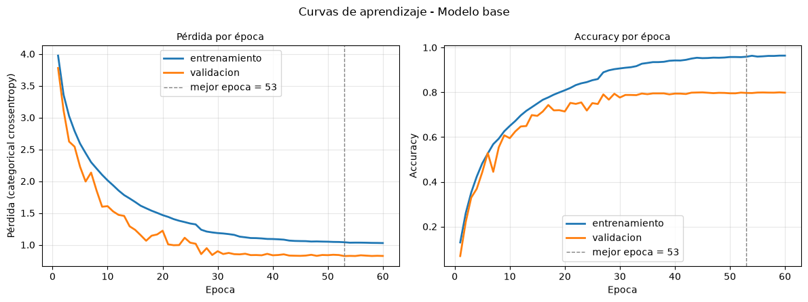
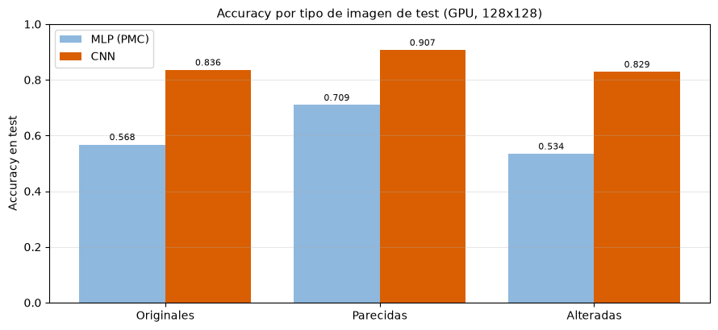
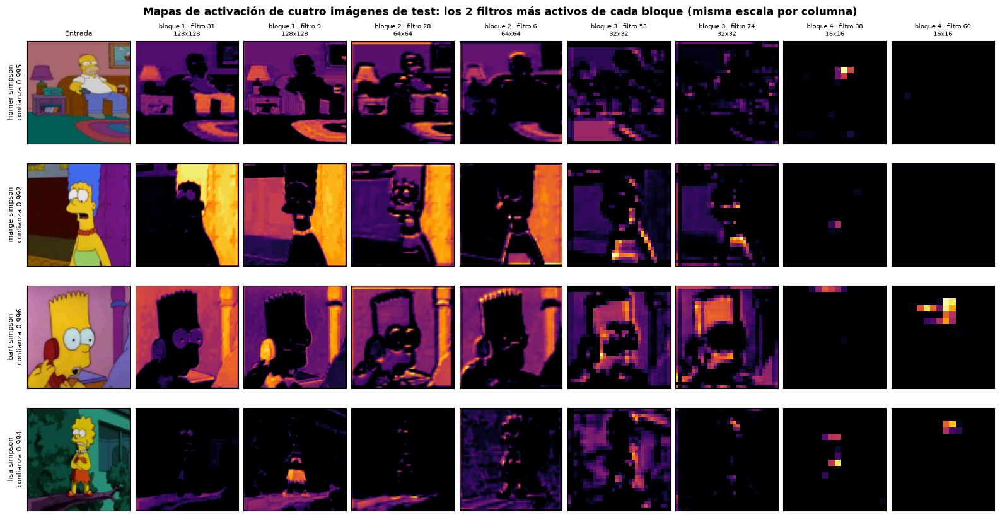
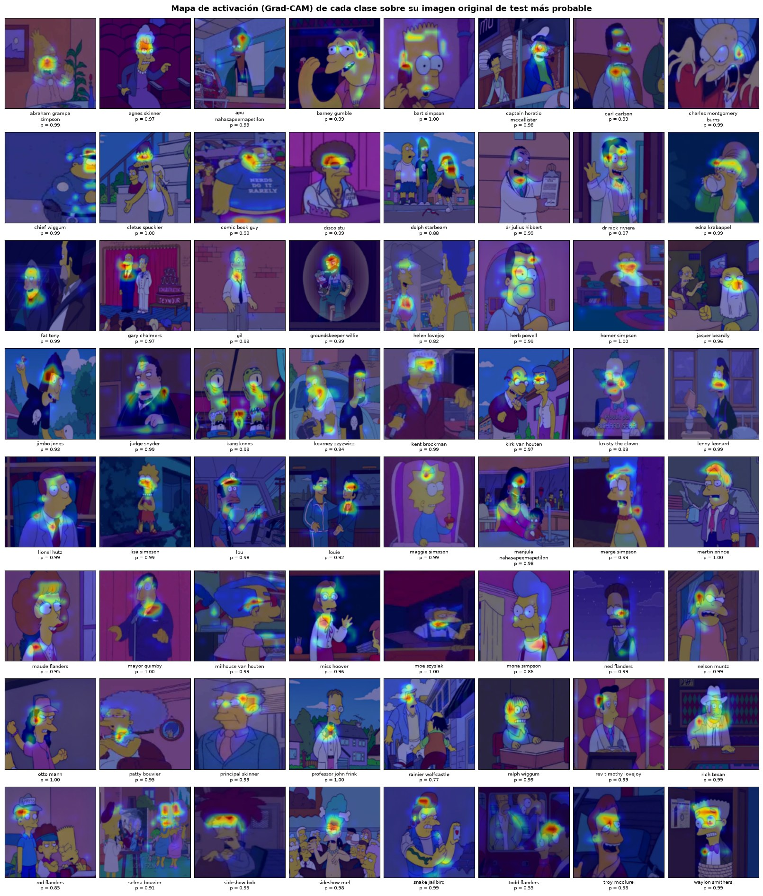

# Informe técnico — Clasificación de personajes de Los Simpson con una red neuronal convolucional

Evaluación Parcial 2 · Técnicas Avanzadas de Machine Learning

## 1. Identificación del proyecto

| Elemento | Descripción verificable |
|---|---|
| Tipo de proyecto | Clasificación supervisada de imágenes RGB mediante una red neuronal convolucional (CNN), comparada con el Perceptrón Multicapa (MLP) de la Evaluación Parcial 1. |
| Unidad de predicción | Una imagen recibe una sola etiqueta entre 64 personajes. |
| Implementación evaluada | `CNN/notebooks/newDataset/LosSimpsons_GPU_4060M.ipynb`: GPU en Windows nativo, Keras 3 sobre PyTorch, con las salidas de la corrida a 128 × 128 del 19-10-2026. |
| Implementación en CPU | `CNN/notebooks/newDataset/LosSimpsonsCNN.ipynb`: el mismo proceso en la CPU, a 64 × 64. No se ha ejecutado: una corrida completa tomaría más de quince horas. |
| MLP de la comparación | `PMC/notebooks/newDataset/`: el MLP reentrenado sobre el mismo dataset, con el mismo proceso. |
| Evidencia de ejecución | Salidas guardadas del notebook de GPU; resúmenes de las corridas en `CNN/resultados/newDataset/GPU/` (32 × 32, 64 × 64 y 128 × 128) y `PMC/resultados/newDataset/`. |
| Framework | Keras 3.15.1 sobre PyTorch 2.14.0 (CUDA 13.0), Python 3.13, NVIDIA GeForce RTX 4060 Laptop de 8 GB. |
| Integrantes | Vincent Farenden Cerón; Rodrigo Ignacio Martínez Becker; Iván Manuel Pavón Barría; Diego Ignacio Peña y Lillo Luhrs. |
| Profesor | Francisco Javier Jerez Salazar. |

Este informe describe lo que está implementado y ejecutado. Cada cifra sale de las salidas guardadas de los
notebooks o de los resúmenes JSON de las corridas; cuando una cifra existe solo para otra resolución, se indica.

## 2. Problema, variante y cambio de dataset

### 2.1 Problema abordado

El problema es el mismo de la EP1: **clasificación multiclase de etiqueta única**. Dada una imagen RGB de Los
Simpson, el modelo asigna exactamente uno de 64 personajes. No es detección de objetos: no localiza al
personaje ni admite varias etiquetas por imagen.

El escenario de uso declarado es un archivo audiovisual que crece más rápido de lo que un equipo puede
catalogarlo. El modelo propone el personaje de cada imagen y una persona valida: convierte el trabajo de
*etiquetar* en trabajo de *revisar*. Los casos de uso son la búsqueda por personaje, la pre-clasificación
asistida, las métricas de presencia en pantalla y el control de uso de marca. No es un encargo de un cliente
real, así que los KPIs se expresan en cantidades medibles sobre los datos.

### 2.2 Variante del grupo

| Decisión | Valor |
|---|---|
| Personajes | 64, una carpeta por personaje; la etiqueta es siempre la carpeta, nunca el nombre del archivo |
| Imágenes | Todas las originales de cada personaje (40.123), sin tope |
| Partición | 70 / 20 / 10 por personaje, estratificada, con semilla 42 |
| Imágenes alteradas | Una variante (giro de 10 a 20°, cambio de color y filtro de textura) para un cuarto de las imágenes de cada personaje, siempre en el mismo conjunto que su original |
| Imágenes parecidas | Las 9.041 imágenes casi idénticas a otra del mismo personaje entran con una versión filtrada |
| Criterio de acierto | Nombrar al personaje de la carpeta o a otro que aparece en la imagen (misma escena a ±3 s, gemela en otra carpeta o misma toma verificada). El criterio estricto, que solo acepta la carpeta, se informa siempre al lado |
| Resolución | 128 × 128 en la corrida evaluada; también se corrió a 32 × 32 y 64 × 64 |

### 2.3 Cambio de dataset respecto de la EP1 y trazabilidad

La pauta pide reutilizar preferentemente el dataset de la EP1 o justificar el cambio. El dataset cambió:

| | EP1 (MLP) | EP2 (MLP reentrenado y CNN) |
|---|---|---|
| Fuente | Los Simpson de Kaggle (`alfaro96`), con sus carpetas `train` y `test` | La misma fuente, ampliada por el equipo con más personajes y fotogramas propios |
| Personajes | 25 | 64 |
| Imágenes originales | 20.074 (16.137 en `train` y 3.937 en `test`) | 40.123 |
| Partición | La de Kaggle, de criterio no documentado; `train` se dividió en 12.909 y 3.228 con semilla 42 | Propia: 70 / 20 / 10 estratificada, semilla 42 |
| Casi duplicados entre conjuntos | No se verificaban | Filtrados; cada alterada en el conjunto de su original |
| Información de escena | No | 22.427 de las 50.166 imágenes de trabajo (44,7 %) son fotogramas con episodio e instante |

Razones del cambio:

1. **Más cerca del escenario de uso.** Un archivo audiovisual también tiene a los secundarios, y con 64
   personajes aparecen los que se parecen entre sí (Patty y Selma, Carl y Lenny, los Flanders): la prueba más
   exigente para comparar lo que aprende cada arquitectura.
2. **Más datos para aprender filtros.** Una CNN aprende sus filtros de los píxeles; el dataset nuevo duplica
   las imágenes originales.
3. **Una partición auditable.** En la EP1 no se podía comprobar que una misma escena no estuviera en `train` y
   en `test`. Ahora el notebook reparte cada personaje, filtra los casi duplicados y mantiene cada alterada con
   su original.
4. **Escenas compartidas.** Los fotogramas con episodio e instante permiten estimar quién más aparece en cada
   escena y evaluar con justicia las imágenes con varios personajes.

**Trazabilidad.** El trabajo de la EP1 se conserva en `PMC/notebooks/oldDataset/`, `PMC/docs/oldDataset/Informe.md`
y `PMC/resultados/oldDataset/`; su MLP final (E2, 51.002.393 parámetros) alcanzó una accuracy de test de 0,529
en CPU y 0,517 en GPU sobre 25 personajes. Para comparar con la CNN, el MLP se volvió a entrenar sobre el dataset
nuevo con el mismo proceso (`PMC/notebooks/newDataset/`). Las cifras de la EP1 no se comparan con las de la EP2:
miden otros personajes sobre otra partición.

### 2.4 Objetivos

**Objetivo general.** Implementar y evaluar una CNN que asigne a cada imagen RGB uno de los 64 personajes,
mediante un flujo reproducible, y compararla con el MLP en igualdad de condiciones.

**Objetivos específicos.**

1. Indexar las imágenes y asociar cada una con el personaje de su carpeta.
2. Repartir cada personaje en entrenamiento, validación y prueba, de forma estratificada y con semilla fija.
3. Preparar las imágenes para la CNN: RGB, tamaño fijo, tensores sin aplanar, normalización y etiquetas one-hot.
4. Entrenar un modelo base y compararlo con variantes que cambian un factor a la vez.
5. Seleccionar la configuración final por F1 macro de validación y medirla una sola vez en test.
6. Auditar el resultado: métricas por clase, matriz de confusión, errores, mapas de activación, Grad-CAM y
   comparación con el MLP.

## 3. KPIs

Los umbrales se fijaron antes de entrenar y son los mismos del MLP, para que las dos redes se midan con la
misma vara.

| KPI | Qué mide en el negocio | Métrica técnica | Umbral | CNN a 128 × 128 |
|---|---|---|---|---|
| Cobertura de asistencia | Si el catalogador encuentra la respuesta entre tres sugerencias | Top-3 accuracy en test | ≥ 0,70 | 0,937 |
| Equidad entre personajes | Que el catálogo sirva para todos los personajes | F1 macro en test | ≥ 0,45 | 0,810 |
| Automatización sin revisión | Imágenes que el sistema resuelve solo | Accuracy en test | ≥ 0,50 | 0,847 |
| Ventaja sobre el criterio trivial | Información real frente a etiquetar todo como Homero | Accuracy / clase mayoritaria | ≥ 4× | 10,8× |
| Costo de catalogación | Procesar el archivo en un tiempo razonable | Imágenes por segundo, entrada + red | ≥ 1.000 | 3.085 |

Los cinco se cumplen. Con el criterio estricto también: accuracy 0,797, F1 macro 0,738 y top-3 0,924.

## 4. Datos

### 4.1 Fuente y estructura

El dataset parte de [Los Simpson de Kaggle](https://www.kaggle.com/datasets/alfaro96/los-simpson/data), uno de
los cuatro autorizados por la pauta, y el equipo lo amplió a 64 personajes con fotogramas propios. Tiene una
carpeta por personaje y no se versiona en el repositorio; su ruta se fija con la variable `SIMPSONS_DATASET`.

### 4.2 Exploración

| Hallazgo | Evidencia |
|---|---|
| Tamaño | 40.123 originales (unos 2,1 GB), casi todas `.jpg` |
| Desbalance | De 3.118 imágenes de `homer_simpson` a 94 de `louie`: razón 33:1 |
| Dimensiones | De 38 × 42 a 2.700 × 3.600 píxeles; mediana 640 × 480 |
| Casi duplicados | 9.041 imágenes casi idénticas a otra del mismo personaje, en 6.292 grupos |
| Escenas | 22.427 fotogramas con episodio e instante; 7.533 imágenes con otro personaje presente estimado |
| Gemelas | 3.326 pares de la misma escena guardada en carpetas de dos personajes |
| Duplicados exactos | Ninguno: se comprobó byte a byte |

### 4.3 Partición

| Conjunto | Originales | Alteradas | Total |
|---|---:|---:|---:|
| Entrenamiento (70 %) | 28.086 | 6.937 | 35.023 |
| Validación (20 %) | 8.024 | 2.056 | 10.080 |
| Test (10 %) | 4.013 | 1.050 | 5.063 |

Ninguna imagen ni ninguna de sus variantes aparece en dos conjuntos. Validación y test conservan la
distribución real; el desbalance de entrenamiento (32:1) se compensa con pesos por clase.

## 5. Preparación de los datos para la CNN

1. Cada imagen se abre, se convierte a RGB y se redimensiona a **128 × 128** con interpolación bilineal.
2. Las imágenes quedan como un tensor de cuatro dimensiones `(N, 128, 128, 3)` en `uint8`, **sin aplanar**:
   las capas convolucionales trabajan sobre la vecindad de cada píxel.
3. El escalado a [0, 1] lo hace la primera capa del modelo (`Rescaling(1/255)`) sobre cada lote, ya en la GPU.
   En `uint8` el conjunto ocupa 2,30 GB y cabe entero en la VRAM; en `float32` ocuparía 9,19 GB.
4. Las etiquetas se codifican como índice entero y luego como vector one-hot de 64 posiciones.
5. Los pesos por clase se calculan solo con entrenamiento: la raíz cuadrada del peso balanceado, reescalada
   para que el peso medio sea 1 (de 0,49 para Homero a 2,78 para Louie).

Respecto del MLP cambian dos cosas: la imagen ya no se aplana ni se resume en descriptores de color y textura,
y la normalización se mueve dentro del modelo. La partición, las alteradas, las parecidas, las etiquetas de
escena y los pesos son los mismos. Cada paso tiene una celda de comprobación en el notebook.

## 6. Diseño de la red neuronal convolucional

### 6.1 Arquitectura del modelo base

| Componente | Configuración |
|---|---|
| Entrada | Imagen RGB de 128 × 128 × 3 en `uint8`, escalada a [0, 1] dentro del modelo |
| Capas convolucionales | 4 bloques, uno por cada 32, 64, 128 y 256 filtros |
| Tamaño de los filtros | 3 × 3, `padding="same"`, sin sesgo |
| Cada bloque | `Conv2D` → `BatchNormalization` → ReLU → `MaxPooling2D` de 2 × 2 |
| Mapa final | 8 × 8 × 256 |
| Pooling global | `GlobalAveragePooling2D`: un valor por filtro, 256 |
| Capas densas finales | Dropout 0,3 → densa de 256 con ReLU → BatchNormalization → Dropout 0,3 |
| Salida | Densa de 64 neuronas con `softmax` |
| Función de pérdida | Entropía cruzada categórica, con suavizado de etiquetas de 0,1 |
| Optimizador | Adam, tasa de aprendizaje 0,001 |
| Batch | 128 |
| Épocas | Hasta 60, con parada temprana |
| Parámetros | 473.120 (471.648 entrenables); `conv_4` concentra el 62,5 % |

### 6.2 Justificación técnica

| Decisión | Justificación |
|---|---|
| Imagen RGB sin aplanar | La convolución aprovecha la vecindad de los píxeles; el color se conserva porque el MLP mostró que distingue a muchos personajes (R1 mide la escala de grises) |
| Cuatro bloques que duplican los filtros | Con cuatro poolings el mapa pasa de 128 × 128 a 8 × 8 y el campo receptivo del último bloque cubre 38 × 38 píxeles, el 30 % del lado de la imagen; duplicar los filtros compensa la resolución que se pierde |
| Filtros de 3 × 3 | El menor filtro con centro y vecinos en todas direcciones; dos capas de 3 × 3 ven lo mismo que una de 5 × 5 con menos pesos |
| Batch Normalization | Estabiliza la escala de las activaciones capa a capa y permite usar la tasa de aprendizaje del MLP |
| ReLU | No se satura y es barata; tanh (E3) se mide como alternativa |
| Max pooling de 2 × 2 | Reduce el mapa a un cuarto, da invarianza aproximada a desplazamientos pequeños y abarata las capas siguientes |
| Pooling global y densa de 256 | Un número por filtro sin importar dónde se activó: la capa densa tiene 65.536 pesos; el aplanado (E7) se compara |
| Dropout de 0,3 en la cabeza | La parte densa es la que tiende a memorizar; 0,5 se prueba en E6 |
| Softmax | Distribución de probabilidad que suma 1, para una sola etiqueta por imagen |
| Adam, 0,001; entropía cruzada con suavizado 0,1; batch 128; pesos raíz | Los mismos del MLP, para que las dos redes se entrenen igual |

La ventaja estructural sobre el MLP se cuantifica en el notebook: a 128 × 128, la primera capa densa de 512
neuronas de un MLP sobre los píxeles tendría 25.165.824 pesos; la primera convolución de la CNN, 864, a
cualquier resolución.

## 7. Entrenamiento

El modelo se define con Keras y se entrena con un bucle escrito sobre PyTorch, porque `model.fit()` devuelve
el control al intérprete entre paso y paso y deja la GPU esperando. El bucle reproduce tres mecanismos:

| Mecanismo | Configuración |
|---|---|
| Parada temprana | `val_loss` sin mejora en 12 épocas; restaura los pesos de la mejor época |
| Reducción de la tasa | A la mitad tras 4 épocas sin mejora de `val_loss`, mínimo 1e-5 |
| Guardado del mejor modelo | La mejor época queda en `models_gpu/newDataset/` |

Resultado del modelo base a 128 × 128: usa las 60 épocas (39,9 s cada una) y toca su mínimo de `val_loss`
(0,824) en la época 53. La tasa baja a la mitad cinco veces; el primer escalón, tras la época 26, sube la
accuracy de validación de 0,748 a 0,791 en una época. En la mejor época, la accuracy es 0,959 en entrenamiento
y 0,797 en validación: una brecha de 0,162, menor que la de 0,211 a 64 × 64 y que la de 0,465 del MLP base. Las
curvas están en «Curvas de aprendizaje del modelo base».



## 8. Experimentación

Cada experimento cambia un factor respecto de la base y conserva todo lo demás. Los experimentos usan 35
épocas y paciencia 9; la base, 60 y 12. Se elige por F1 macro de validación.

| Exp. | Cambio | Accuracy val. | F1 macro val. |
|---|---|---:|---:|
| **Base** | RGB, 4 bloques de una convolución, pooling global | **0,797** | **0,734** |
| S2 | Sin etiquetas de escena | 0,783 | 0,728 |
| S1 | Sin suavizado de etiquetas | 0,782 | 0,726 |
| A1 | Sin imágenes alteradas | 0,776 | 0,720 |
| P1 | Sin pesos por clase | 0,789 | 0,718 |
| E6 | Dropout de 0,5 | 0,764 | 0,705 |
| P2 | Pesos balanceados completos | 0,726 | 0,687 |
| E1 | 3 bloques (32, 64, 128) | 0,713 | 0,647 |
| E7 | Aplanado en lugar de pooling global | 0,729 | 0,640 |
| R1 | Escala de grises | 0,702 | 0,620 |
| E3 | Activación tanh | 0,605 | 0,524 |
| E4 | Tasa de aprendizaje 0,0001 | 0,585 | 0,493 |
| E2 | Dos convoluciones por bloque | No cabe en los 8 GB de la GPU | |
| E5 | Batch 512 | No cabe en los 8 GB de la GPU | |

Ninguna variante supera a la base, así que la combinación C1 no se entrena y **el modelo final es el base**.
Lo que más cuesta es bajar la tasa de aprendizaje (−24,1 puntos de F1), usar tanh (−21,0), quitar el color
(−11,3), aplanar en lugar de promediar (−9,4) y quitar un bloque (−8,7). A 32 × 32 y 64 × 64, donde sí cabe,
ganó E2, con dos convoluciones por bloque.

## 9. Evaluación en test

El test se abre una sola vez, con el modelo elegido.

| Métrica | Criterio del proyecto | Criterio estricto |
|---|---:|---:|
| Accuracy | 0,847 | 0,797 |
| Precision macro | 0,838 | 0,765 |
| Recall macro | 0,795 | 0,727 |
| F1 macro | 0,810 | 0,738 |
| F1 ponderado | 0,846 | 0,796 |
| Top-3 accuracy | 0,937 | 0,924 |

Referencias: azar 1/64 = 0,016 y clase mayoritaria 0,078. La CNN las supera 54 y 11 veces.

- **Por personaje.** 62 de 64 personajes tienen F1 de 0,60 o más y ninguno queda bajo 0,30. Los mejores son
  Krusty (0,95), Fat Tony, Kent Brockman y Sideshow Bob (0,93); los peores, Helen Lovejoy (0,50), Rod Flanders
  (0,57), Disco Stu (0,61), Maggie (0,67) y Martin Prince (0,69). La correlación entre imágenes de
  entrenamiento y F1 es de 0,39.
- **Matriz de confusión.** Normalizada por fila, con recall medio de 0,795. Las confusiones que quedan son de
  personajes dibujados casi iguales (Patty y Selma, Carl y Lenny, el abuelo y Homero) o que comparten escena
  (Helen con el reverendo Lovejoy, Burns con Smithers).
- **Criterio estricto.** Cambia las cifras entre 5 y 7 puntos, no las conclusiones: los cinco KPIs se
  cumplen también con él. Pierden más los personajes que casi siempre salen acompañados —Louie (F1 de 0,923
  a 0,625), Maude Flanders (0,811 a 0,514), Lou (0,845 a 0,578)—, porque nombrar al acompañante pasa a contar
  como error. 55 de los 64 personajes conservan un F1 de 0,60 o más y solo Helen Lovejoy queda bajo 0,30; la
  familia Simpson sigue entre 0,79 y 0,84.

## 10. Comparación entre el MLP y la CNN

### 10.1 Misma resolución, mismo proceso

| Concepto | MLP · GPU 128 × 128 | CNN · GPU 128 × 128 | Diferencia |
|---|---:|---:|---|
| Configuración final | C1, combinación de mejoras, sobre los 370 valores de color | Base | |
| Parámetros | 1.059.648 | 473.120 | La CNN tiene menos de la mitad |
| Accuracy | 0,586 | 0,847 | +26,1 puntos |
| Accuracy estricta | 0,539 | 0,797 | +25,8 |
| Top-3 accuracy | 0,751 | 0,937 | +18,7 |
| F1 macro | 0,559 | 0,810 | +25,1 |
| F1 macro estricto | 0,490 | 0,738 | +24,8 |
| Accuracy en originales / parecidas / alteradas | 0,568 / 0,709 / 0,534 | 0,836 / 0,907 / 0,829 | |
| Errores con confianza > 0,80 | 88 | 41 | |
| Entrenamiento total | 15,9 min | 290,5 min | 18,3 veces más |
| Segundos por época (benchmark) | 1,5 | 37,1 | 24,7 veces más |
| Inferencia de la red sola | 88.027 img/s | 3.540 img/s | |
| Inferencia de extremo a extremo | 1.285–1.557 img/s | 3.085 img/s | La CNN no calcula descriptores |

La ventaja es estable: la CNN supera al MLP por 24,5 a 28,0 puntos de accuracy en las tres resoluciones
(32 × 32, 64 × 64 y 128 × 128).



### 10.2 Todas las métricas y la generalización

El resumen del MLP a 128 × 128 no guarda la precision, el recall ni la brecha de entrenamiento; las salidas de
su notebook, de la corrida a 64 × 64, sí. A esa resolución:

| Métrica en test | MLP · 64 × 64 (R2) | CNN · 64 × 64 (E2) | CNN · 128 × 128 (base) |
|---|---:|---:|---:|
| Accuracy | 0,550 | 0,830 | 0,847 |
| Precision macro | 0,543 | 0,817 | 0,838 |
| Recall macro | 0,516 | 0,774 | 0,795 |
| F1 macro | 0,522 | 0,788 | 0,810 |
| F1 ponderado | 0,547 | 0,828 | 0,846 |
| Top-3 accuracy | 0,731 | 0,932 | 0,937 |
| Brecha entrenamiento − validación del modelo base | 0,465 | 0,211 | 0,162 |

Capacidad de generalización, con los resúmenes de las corridas:

| Indicador | MLP 64 | CNN 64 | MLP 128 | CNN 128 |
|---|---:|---:|---:|---:|
| Caída en las alteradas frente a las originales (puntos) | 3,4 | 3,4 | 3,3 | 0,7 |
| Ventaja de las parecidas sobre las originales (puntos) | 9,3 | 6,0 | 14,2 | 7,1 |
| Errores con confianza > 0,80 por cada 1.000 imágenes | 6,9 | 12,6 | 17,4 | 8,1 |

La CNN memoriza menos (brecha de 0,21 frente a 0,47 a 64 × 64) y depende menos de haber visto casi la misma
toma en las tres resoluciones. Su ventaja frente a las alteradas y en errores confiados aparece solo a
128 × 128; a 64 × 64 las dos redes pierden lo mismo en las alteradas y la CNN comete más errores confiados,
aunque casi todos nombran a un personaje que sí está en la imagen.

### 10.3 Ventajas y desventajas de cada arquitectura

| | Ventajas | Desventajas |
|---|---|---|
| **MLP** | Entrena 18 veces más rápido y corre en CPU (su corrida completa a 128 × 128 tomó 53 minutos); la red sola infiere 88.027 imágenes por segundo; depende menos del número de imágenes por personaje (correlación de 0,19 entre imágenes de entrenamiento y F1) | No aprende de la imagen: combina histogramas de color calculados con reglas fijas y confunde a los personajes que comparten paleta (la familia Simpson, con F1 de 0,35 a 0,67 a 64 × 64); memoriza más (brecha de 0,465); calcular los descriptores en la CPU limita su velocidad de extremo a extremo |
| **CNN** | Aprende sus propios filtros y reconoce la forma (la familia Simpson sube a F1 de 0,81 a 0,89); 26 puntos más de accuracy con menos de la mitad de parámetros; memoriza menos; es más rápida de extremo a extremo; Grad-CAM explica cada decisión sobre la imagen | Entrenar cuesta 18 veces más y exige GPU (en CPU, más de quince horas); a 128 × 128 dos configuraciones no caben en 8 GB; depende más del número de imágenes por personaje (correlación de 0,39); sigue sobreajustando (brecha de 0,16) |

## 11. Mapas de características y de activación

### 11.1 Recorrido de una imagen

Una imagen de test de Martin Prince, predicha con 99,7 % de confianza, recorre la red bloque por bloque. El
primer bloque responde a bordes, contornos y zonas de color con la resolución completa; en el segundo y el
tercero los mapas combinan bordes en patrones más específicos; en el cuarto, de 16 × 16, los filtros más
activos se encienden sobre la cabeza del personaje. La representación se vuelve más selectiva: el 37 % de los
valores del primer bloque es distinto de cero, el 40 % del segundo, el 11 % del tercero y el 1 % del último.

### 11.2 Cuatro imágenes de test

Homero, Marge, Bart y Lisa —los cuatro personajes de la familia que el MLP confundía por la piel amarilla—
recorren la red juntos, con su imagen original de test acertada con mayor confianza (99,2 a 99,6 %). Cada
columna de la figura es el mismo filtro con la misma escala para los cuatro.

- **Bloques 1 y 2.** Responden a zonas de color del encuadre —la lámpara y la alfombra de Homero, el fondo de
  Bart— y a contornos, como la silueta de Marge o el borde del pelo de Bart.
- **Bloque 3.** Combinaciones de bordes más específicas, todavía repartidas entre el personaje y el fondo.
- **Bloque 4.** Solo el 1,0 % de los valores es distinto de cero, y lo que queda cae sobre los personajes.
  Un mismo filtro ya no responde igual a todos: uno se enciende con Bart y con Lisa y casi nada con Homero y
  Marge.

La correlación de la activación media de los filtros entre las cuatro imágenes es de 0,18 a 0,33 en los
tres primeros bloques y cae a 0,015 en el cuarto (0,031 en el vector del pooling global): cada personaje
activa su propio conjunto de filtros. Es la extracción automática de características que el MLP no tenía.



### 11.3 Grad-CAM

Grad-CAM pondera los mapas del último bloque por el gradiente de la probabilidad de la clase. En los aciertos
más seguros, la zona cálida cae sobre la cabeza del personaje. Sobre todo el test, el 10 % de píxeles más
cálidos reúne el 71,5 % de la influencia (sería el 10 % si la red mirara toda la imagen por igual) y la mitad
central el 48 % en los aciertos (25 % con un reparto uniforme). Los tres errores más confiados miran a un
personaje que sí está en la imagen.

### 11.4 Mapa de activación de cada clase

Para cada uno de los 64 personajes se calcula el Grad-CAM de la clase de su carpeta, de dos formas: sobre su
imagen original de test acertada con la mayor probabilidad (los 64 ejemplos son originales acertadas) y como
mapa medio sobre todas sus imágenes de test.

- En casi todos los ejemplos la zona más cálida cae sobre la cabeza: el peinado de Marge y de Sideshow Bob, el
  bigote de Ned Flanders, los lentes de Milhouse. En unos pocos cae sobre la ropa: la corbata de Lionel Hutz,
  el cuello de Frink, el pecho de Helen Lovejoy.
- Con la clase de la carpeta, el 10 % de píxeles más cálidos reúne de media el 71,3 % del Grad-CAM y la mitad
  central el 46,4 % (10 % y 25 % con un reparto uniforme).
- Los mapas medios de los personajes con muchas imágenes son una mancha compacta en el centro y la parte alta
  del encuadre; los de los que tienen pocas salen fragmentados porque promedian pocas tomas.
- La concentración del calor no explica qué personajes cuestan más: su correlación con el recall es de 0,05.
  Lo que pesa es el número de imágenes de entrenamiento (0,39 con el F1) y el parecido entre personajes.



## 12. Análisis de resultados y errores

- **Aciertos.** La red acierta con confianza de 1,00 a personajes pequeños en el encuadre, de espaldas o que
  comparten la piel amarilla con la familia: reconoce peinados, ropa y caras, no solo la paleta.
- **Errores.** 775 de 5.063 imágenes (15,3 %). La confianza separa aciertos (0,78 de media) de errores (0,36),
  y solo 15 errores superan 0,90. De los 41 que superan 0,80, en ocho de los diez más confiados el personaje
  predicho sí aparece en la imagen, pero el criterio no lo detectó: la accuracy es una cota inferior.
- **Clases difíciles.** Personajes con alrededor de cien imágenes de entrenamiento (Rod Flanders, Disco Stu,
  Maggie, Helen Lovejoy), gemelos de diseño (Patty y Selma) y personajes que casi siempre salen acompañados
  (el 35 % de las imágenes de Helen se predice como el reverendo Lovejoy, con quien comparte escena).
- **Escenas.** El 14,7 % del test tiene otro personaje presente; ahí la accuracy estricta es 0,539 y la del
  criterio del proyecto 0,877. Los aciertos por escena suben la accuracy 5,0 puntos.
- **Tipos de imagen.** Las alteradas cuestan 0,7 puntos frente a las originales (0,829 frente a 0,836) y las
  parecidas se aciertan 7,1 puntos más (0,907): la red reconoce al personaje y depende poco de la toma.

## 13. Impacto ético

- **Derechos de autor.** Personajes y fotogramas son obras protegidas, incluidos los que el equipo extrajo de
  los episodios. Se usan solo con fines académicos; ni el dataset ni los modelos se versionan. Un uso comercial
  exigiría la licencia del titular, y detectar a un personaje en material de terceros no prueba una infracción
  (la cita o la parodia pueden estar permitidas).
- **Sesgo por desbalance.** Con la razón de 33:1, el modelo encuentra a Helen Lovejoy en el 35 % de sus
  imágenes y a Homero en el 90 %. Usado para medir presencia en pantalla, contaría a Homero 1,16 veces sus
  apariciones reales y a Helen 0,41: un sesgo que llegaría a decisiones de licencias.
- **Revisión humana.** Se equivoca en el 15,3 % del test, 41 errores superan una confianza de 0,80 y siempre
  responde algo, aunque la imagen no tenga a ninguno de sus personajes. Debe usarse como asistente: mostrar
  las tres sugerencias (93,7 % de cobertura) y revisar a mano lo que afecte a terceros.
- **Fuera del dominio.** Con fotos de personas reales sería reconocimiento facial, con problemas de privacidad
  y consentimiento que el proyecto no aborda: no debe usarse así.

## 14. Limitaciones y mejoras

| Limitación | Mejora propuesta |
|---|---|
| Resolución: a 128 × 128 un personaje en un plano general ocupa pocas decenas de píxeles | Recorte previo del personaje con un detector; medir resoluciones mayores con acumulación de gradientes o `bfloat16` |
| Entrenada desde cero con unas 35.000 imágenes | Transfer learning (MobileNet, ResNet, EfficientNet) |
| Sobreajuste: brecha de 0,16; más Dropout en la cabeza (E6) bajó el F1 2,9 puntos | Regularizar las capas convolucionales, que tienen el 82 % de los parámetros entrenables: L2 o *weight decay* (AdamW) y `SpatialDropout2D` tras cada bloque; aumento de datos en línea en lugar de una variante fija |
| Invarianza solo aproximada a rotaciones y escala | Aumento de datos en línea: espejo, recorte y color distintos en cada época |
| Una sola etiqueta por imagen | Salida multietiqueta con sigmoides |
| Diferencias de menos de un punto entre configuraciones | Varias semillas o validación cruzada |
| Criterio de acierto estimado | Anotar a mano las escenas de una muestra del test |

## 15. Reproducibilidad y estructura de entrega

### 15.1 Archivos principales

```text
CNN/docs/EP2_TLY1102_Instrucciones.docx       # encargo de la evaluación
CNN/docs/newDataset/Informe.md                # este informe
CNN/docs/newDataset/figuras/                  # figuras del informe, tomadas de las salidas del notebook
CNN/notebooks/newDataset/LosSimpsons_GPU_4060M.ipynb   # notebook evaluado, con salidas
CNN/notebooks/newDataset/LosSimpsonsCNN.ipynb          # mismo proceso en CPU, sin ejecutar
CNN/notebooks/newDataset/README.md
CNN/resultados/newDataset/GPU/rendimiento_gpu_{32x32,64x64,128x128}.json
CNN/scripts/newDataset/generar_presentacion.py         # genera la presentación
CNN/scripts/newDataset/predecir_imagen.py              # clasifica imágenes con el modelo final
CNN/presentacion_resultados_CNN.html
scripts/newDataset/generar_imagenes_alteradas.py       # prepara el dataset para el MLP y la CNN
PMC/notebooks/newDataset/                              # MLP de la comparación
```

### 15.2 Ejecución

1. Crear el entorno `.venv-gpu` según `requirements-gpu-windows.txt`.
2. Ubicar el dataset y fijar su ruta en `SIMPSONS_DATASET`, o dejarlo en la ruta por defecto del notebook.
3. Ejecutar una vez `scripts/newDataset/generar_imagenes_alteradas.py`.
4. Abrir el notebook con `CNN/scripts/newDataset/ejecutar_notebook_gpu.ps1` y ejecutarlo completo: unas cinco
   horas a 128 × 128 en la RTX 4060 Laptop.

### 15.3 Estado de las salidas

Las salidas del notebook de GPU son las de la corrida a 128 × 128 del 19-10-2026. Cuatro celdas se agregaron
después —las métricas con el criterio estricto, los mapas de activación de cuatro imágenes, el mapa de
activación de cada clase y la capacidad de generalización— y se ejecutaron el 20-10-2026 con el modelo final
que guardó esa corrida (`cnn_final.keras`), sobre la misma partición y sin reentrenar.

Antes de guardar sus salidas se comprobó que reproducen la corrida: con el modelo guardado y los algoritmos
deterministas de cuDNN, la evaluación repetida da exactamente el mismo reporte por clase, la misma accuracy,
el mismo top-3 y los mismos aciertos por escena que las salidas del 19-10-2026. La comprobación dejó además un
hallazgo de reproducibilidad: con `cudnn.benchmark` activado, como en el notebook, cuDNN elige el algoritmo de
convolución por tiempo y esa elección varía entre ejecuciones. En 3 de 9 evaluaciones del mismo modelo con
esa configuración la accuracy de test fue 0,8467 en lugar de 0,8469 y el top-3, 0,9368 en lugar de 0,9372; con
algoritmos deterministas, las cinco evaluaciones hechas —incluida la de las celdas agregadas— reprodujeron
la corrida. Las diferencias afectan a unas
pocas imágenes con probabilidades casi empatadas y no cambian ninguna conclusión, pero quien quiera
reproducir las cifras exactas debe evaluar con `torch.backends.cudnn.benchmark = False` y
`torch.backends.cudnn.deterministic = True`.
Las salidas de 64 × 64 están en el commit `6db8274`, y de la corrida a 32 × 32 queda solo su resumen JSON.

## 16. Conclusiones

La CNN resuelve lo que el MLP no podía: reconocer a los personajes por su forma. Con el mismo proceso, los
mismos datos y la misma resolución, sube la accuracy de test de 0,586 a 0,847 y el F1 macro de 0,559 a 0,810,
cumple los cinco KPIs con margen y no deja a ningún personaje bajo 0,30 de F1. La familia Simpson, que el MLP
confundía por la piel amarilla, pasa a la parte alta de la tabla: lo que separa a Bart de Lisa es el peinado.

Las decisiones propias de una CNN se notan en los experimentos: el pooling global supera al aplanado y quitar un
bloque cuesta casi nueve puntos, porque la invarianza a la posición y la profundidad son las dos propiedades
que el MLP no tenía. Los mapas de activación y Grad-CAM muestran el mismo mecanismo desde dentro: bordes y
color en el primer bloque, partes del personaje en el último, y la evidencia de cada clase sobre su cabeza.

Los límites que quedan son de datos y de costo: un sobreajuste todavía claro, una dependencia mayor del número
de imágenes por personaje y un entrenamiento 18 veces más caro. Las mejoras más directas son el transfer
learning, el aumento de datos en línea y regularizar las capas convolucionales.

## Referencias

- Alfaro, A. (s. f.). *Los Simpson* [conjunto de datos]. Kaggle. https://www.kaggle.com/datasets/alfaro96/los-simpson
- LeCun, Y., Bottou, L., Bengio, Y. y Haffner, P. (1998). Gradient-based learning applied to document
  recognition. *Proceedings of the IEEE, 86*(11), 2278-2324.
- Ioffe, S. y Szegedy, C. (2015). Batch Normalization: Accelerating deep network training by reducing internal
  covariate shift. *ICML 2015*. https://arxiv.org/abs/1502.03167
- Simonyan, K. y Zisserman, A. (2015). Very deep convolutional networks for large-scale image recognition.
  *ICLR 2015*. https://arxiv.org/abs/1409.1556
- Lin, M., Chen, Q. y Yan, S. (2014). Network in network. *ICLR 2014*. https://arxiv.org/abs/1312.4400
- Selvaraju, R. R., Cogswell, M., Das, A., Vedantam, R., Parikh, D. y Batra, D. (2017). Grad-CAM: Visual
  explanations from deep networks via gradient-based localization. *ICCV 2017*. https://arxiv.org/abs/1610.02391
- Tompson, J., Goroshin, R., Jain, A., LeCun, Y. y Bregler, C. (2015). Efficient object localization using
  convolutional networks. *CVPR 2015*. https://arxiv.org/abs/1411.4280
- Loshchilov, I. y Hutter, F. (2019). Decoupled weight decay regularization. *ICLR 2019*.
  https://arxiv.org/abs/1711.05101
