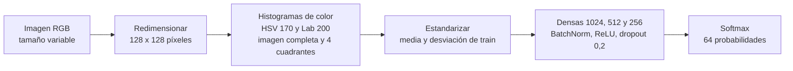

# Clasificador de personajes de Los Simpson con un MLP

Esta carpeta contiene un **Perceptrón Multicapa (MLP)** que identifica qué personaje de Los Simpson aparece en una
imagen RGB. Usa el dataset nuevo —64 personajes, una carpeta por personaje— y el mismo proceso de entrenamiento y
evaluación que la red convolucional de [`../CNN/`](../CNN/): la misma partición, las mismas imágenes alteradas y
parecidas, la misma imagen completa como entrada, los mismos pesos por clase, el mismo bucle de entrenamiento, el
mismo criterio de acierto y los mismos KPIs. Cambia el modelo: el MLP no recibe los píxeles sino **descriptores de
color y textura** calculados sobre la imagen. Todo se entrena y se evalúa a **128 × 128 en la GPU** (NVIDIA GeForce
RTX 4060 Laptop). Las funciones del pipeline son las mismas para las dos redes y viven en
[`../scripts/newDataset/pipeline_comun/`](../scripts/newDataset/pipeline_comun/).

> **Primero el modelo, después las cajas.** El notebook de GPU entrena y evalúa con la imagen completa, y una
> predicción acierta solo si nombra al personaje de la carpeta. Al final guarda el modelo con todo lo necesario
> para usarlo fuera de él (`mlp_final.keras`, `.json`, `_entrada.py` y `_particion.csv`). Después,
> [`scripts/newDataset/detectar_cajas.py`](../scripts/newDataset/detectar_cajas.py) encuentra a cada personaje
> con Grounding DINO y el MLP nombra cada caja con su confianza (`Jasper Beardly · 92 %`), sin anotar nada a
> mano. El notebook no depende de ese script. Las cifras de este documento son de la corrida del 15-11-2026.

> Las rutas de este documento son relativas a la carpeta `PMC/`, salvo las del script del dataset, los
> `requirements` y el entorno `.venv-gpu`, que están en la raíz del repositorio. Los comandos se ejecutan
> desde la raíz del repositorio.

<p align="center">
  
</p>

**Presentación de resultados.** [presentacion_resultados_PMC.html](presentacion_resultados_PMC.html) resume la
corrida del 15-11-2026 en 23 diapositivas: el problema, los datos y su origen, el pipeline integrado, el modelo y
sus descriptores, la parada temprana, el efecto de cada técnica de regularización, los experimentos de un factor a
la vez, el Grid Search, la selección del modelo, los KPIs, la evaluación por personaje, los errores, SHAP, la
recreación de cada personaje, la calibración y el umbral de revisión, los sesgos por subgrupo, la comparación con la
CNN, la arquitectura seleccionada, el impacto ético, las limitaciones y las conclusiones. Es un solo archivo:
descárgalo y ábrelo en el navegador (GitHub solo muestra su código). El botón **Presentar** muestra una diapositiva a
la vez en pantalla completa; las flechas avanzan y `Esc` sale.

**Informe técnico.** [docs/newDataset/Informe.md](docs/newDataset/Informe.md) documenta la Evaluación Parcial 3: el
cambio de dataset respecto de la EP1, el pipeline integrado, la regularización, la optimización con un factor a la
vez y Grid Search, la evaluación, la auditoría (calibración, umbral de revisión y sesgos), la importancia por
permutación y SHAP, la comparación con la CNN, la arquitectura seleccionada y las conclusiones. El encargo de la
evaluación está en [../CNN/docs/EP3_TLY1102_Instrucciones Estudiante.docx](../CNN/docs/EP3_TLY1102_Instrucciones%20Estudiante.docx).

## Resultados de la corrida del 15-11-2026

El notebook de GPU se ejecutó completo a 128 × 128, con la imagen completa, en el mismo equipo que la corrida de la
CNN (Intel Core i7-13620H y NVIDIA GeForce RTX 4060 Laptop). Todas las configuraciones se entrenaron con el mismo
presupuesto: 60 épocas como máximo y paciencia 12. Una predicción acierta solo si nombra al personaje de la carpeta.

| Corrida | Configuración final | Accuracy | Top-3 | F1 macro | ROC-AUC macro | Duración |
|---|---|---:|---:|---:|---:|---:|
| GPU 128 × 128 | GS01 - solo color, 3 capas, dropout 0,2 | **0,556** | **0,732** | **0,557** | **0,940** | 2 h 2 min 44 s |

Frente a la CNN, también en GPU a 128 × 128 (corrida del 14-11-2026; diferencias en puntos):

| Accuracy MLP | Accuracy CNN | Diferencia | F1 macro MLP | F1 macro CNN | Diferencia | Segundos por época MLP → CNN |
|---:|---:|---:|---:|---:|---:|---:|
| 0,556 | **0,775** | +22,0 | 0,557 | **0,755** | +19,8 | 2,25 → 51,7 |

- **La representación decide.** El color solo (370 histogramas HSV y Lab) supera a color y textura (2.462 valores)
  por 6,9 puntos de F1 macro de validación con la cuarta parte de los parámetros; los píxeles crudos son la peor
  entrada (−24,6). Una tercera capa aporta 1,2 puntos.
- **El Grid Search corrige a un factor a la vez.** Las 36 combinaciones de tasa, dropout, L2 y batch muestran que el
  dropout es lo que decide (0,556 de F1 en promedio con 0,2 y 0,493 con 0,5): el dropout 0,5 que C1 heredó de E6
  sobra con la entrada de solo color. GS01 sube 5,8 puntos sobre C1 y 10,5 sobre la base.
- **Regularización.** Sin dropout la red memoriza en tres épocas (−7,5 puntos); el suavizado de etiquetas y las
  imágenes alteradas suman 3,5 y 2,6; Batch Normalization 1,1; L2 no ayuda. El aumento en línea de la CNN no aplica:
  los descriptores se calculan en la CPU.
- **Los cinco KPIs se cumplen**, el de costo con 1.360 imágenes por segundo de extremo a extremo (descriptores en la
  CPU y red en la GPU), con poco margen sobre el umbral de 1.000.
- **La auditoría encuentra dos sesgos.** El MLP acierta 11,3 puntos menos en la familia Simpson que en el resto —sus
  personajes comparten la piel amarilla, y el MLP solo ve el color— y 11,9 puntos menos en los fotogramas de episodio
  que en las imágenes de Kaggle. Está bien calibrado (ECE de 0,044), pero con un umbral elegido en validación solo
  resuelve sin revisión el 14,3 % del test al 89,7 % de acierto.
- **SHAP muestra qué usa:** el tono (canal H y eje b* de Lab, el 44 % de la explicación) y la zona en que aparece cada
  color, no la forma. Por eso confunde a Bart con Lisa y a Patty con Selma, y por eso la arquitectura seleccionada
  para el problema es la CNN.

Las lecturas completas, con las cifras de cada sección, están en el notebook de GPU.

## Cómo procesa una imagen



| Elemento | MLP (esta carpeta) | CNN (`CNN/`) |
|---|---|---|
| Entrada | 2.462 descriptores de color y textura en el modelo base; 370 de solo color en el modelo final | La imagen de 128 × 128 × 3, sin aplanar |
| Características | Elegidas a mano: histogramas HSV y Lab, LBP, Gabor, HOG | Aprendidas: filtros de 3 × 3 que recorren la imagen |
| Modelo base | Dos capas densas (512, 256) | Cuatro bloques convolucionales (32, 64, 128, 256 filtros), pooling global y una capa densa de 256 |
| Modelo final | Tres capas densas (1024, 512, 256), 1.059.648 parámetros | El modelo base con aumento de datos en línea, 473.120 parámetros |
| Análisis de la decisión | Importancia por permutación y SHAP agrupado por canal de color y zona de la imagen | Grad-CAM sobre la imagen, también uno por personaje |

## Experimentos

Todas las configuraciones se entrenan con el mismo presupuesto (60 épocas, paciencia 12), y la configuración final
se elige por F1 macro de validación. Cada experimento cambia un solo factor respecto del modelo base:

| Exp. | Qué cambia |
|---|---|
| R1 / R2 / R3 | Entrada: píxeles crudos / solo color / solo textura |
| E1 / E2 | Una capa (512) / tres capas (1024, 512, 256) |
| E3 | Activación tanh |
| E4 / E5 | Tasa de aprendizaje `1e-4` / batch 512 |
| E6 | Dropout 0,5 |
| P1 / P2 | Sin pesos por clase / pesos balanceados completos |
| S1 | Sin suavizado de etiquetas |
| A1 | Sin imágenes alteradas |
| G1 / G2 / G3 | Sin dropout / sin Batch Normalization / L2 de 10⁻⁴ |
| C1 | Combinación de los cambios que superaron a la base |
| GS01 … GS36 | Grid Search sobre la entrada y la arquitectura de C1: tasa {10⁻³, 5·10⁻⁴} × dropout {0,2, 0,3, 0,5} × L2 {0, 10⁻⁵, 10⁻⁴} × batch {128, 512}; las tres mejores compiten con las demás |

Son 54 configuraciones; el entrenamiento completo tomó 1 h 46 min, porque cada época del MLP cuesta unos 2,5 s.

## Cómo ejecutarlo

Los pasos completos están en [notebooks/README.md](notebooks/README.md). En resumen:

1. Prepara el dataset con el script compartido, igual que para la CNN:

   ```powershell
   .\.venv-gpu\Scripts\python.exe scripts\newDataset\generar_imagenes_alteradas.py
   ```

2. Abre el notebook de GPU:

   ```powershell
   .\.venv-gpu\Scripts\python.exe -m pip install -r requirements-newDataset.txt
   .\PMC\scripts\newDataset\ejecutar_notebook_gpu.ps1
   ```

   Una corrida completa a 128 × 128 tarda unas 2 horas; con `SIMPSONS_PRUEBA=1` el notebook corre de punta a punta
   en un par de minutos, con 40 imágenes por personaje, 2 épocas y una grilla de 2 configuraciones, para comprobarlo
   antes. Si la corrida se corta, lo ya entrenado se recupera de `models_gpu/newDataset/historiales/`. Guarda su
   resumen en `resultados/newDataset/GPU/rendimiento_gpu_128x128.json`, con el mismo formato que la CNN, sus
   figuras en `docs/newDataset/figuras/` y sus modelos en `models_gpu/newDataset/`, con el modelo final listo para
   usarse fuera del notebook. La ejecución local se acordó con el profesor en lugar de Google Colab.

3. Genera la presentación desde los resultados de la corrida:

   ```powershell
   .\.venv-gpu\Scripts\python.exe scripts\newDataset\generar_presentacion.py --modelo mlp
   ```

4. Pon cada personaje de una imagen en su caja, con su nombre y su confianza, usando el modelo guardado:

   ```powershell
   .\.venv-gpu\Scripts\python.exe -m pip install -r requirements-cajas.txt
   .\.venv-gpu\Scripts\python.exe scripts\newDataset\detectar_cajas.py --modelo mlp ruta\a\imagen.jpg
   ```

   Grounding DINO encuentra a cada personaje y el MLP nombra cada caja. Deja `cajas.csv`, las imágenes con sus
   cajas y un `resumen.json` en `models_gpu/newDataset/cajas_mlp_final/`.

## Evaluación Parcial 1: el dataset anterior de 25 personajes

La primera versión del proyecto identificaba a 25 personajes del dataset de Kaggle con sus carpetas `train` y
`test`, con un MLP sobre los píxeles aplanados (49.152 valores a 128 × 128). Su modelo final, E2, con tres capas
ocultas y 51.002.393 parámetros, llegó a una accuracy de test de 0,517, un F1 macro de 0,489 y una top-3 de 0,718.
Se conservan:

- el [informe técnico de la EP1](docs/oldDataset/Informe.md) y su [pauta](docs/EP1_TLY1102_Instrucciones%20y%20Pauta%20PRESENTACI%C3%93N_Estudiante.pdf);
- su [resumen de rendimiento](resultados/oldDataset/GPU/rendimiento_gpu_128x128.json);
- su notebook de GPU y su guía de ejecución, en el historial de Git (`PMC/notebooks/oldDataset/`, commit `4b8b80e`).

Por qué se cambió de dataset, y cómo se mantiene la trazabilidad, está en la sección 2.3 del
[informe de la EP3](docs/newDataset/Informe.md). Las cifras de la EP1 no se comparan con las actuales porque miden
otros personajes sobre otra partición.

## Estructura de la carpeta

```text
PMC/
├── notebooks/
│   ├── LosSimpsons_GPU_4060M.ipynb   # MLP en GPU: experimentos, Grid Search, auditoría, SHAP y rendimiento
│   └── README.md                     # Preparación del dataset nuevo, ejecución, cajas y resultados
├── models_gpu/newDataset/            # Modelos, historiales y cajas_mlp_final/, ignorados por Git
├── resultados/
│   ├── oldDataset/GPU/               # Resumen de la corrida de la EP1
│   └── newDataset/
│       ├── GPU/                      # rendimiento_gpu_128x128.json; cada corrida reemplaza el anterior
│       └── recreaciones/             # Recreación de cada personaje desde el MLP (anexo del notebook)
├── scripts/newDataset/
│   └── ejecutar_notebook_gpu.ps1     # Comprueba el entorno y abre el notebook de GPU
├── images/                           # Ilustraciones de la portada del notebook
├── docs/
│   ├── oldDataset/Informe.md         # Informe técnico de la EP1
│   ├── newDataset/
│   │   ├── Informe.md                # Informe técnico de la EP3
│   │   └── figuras/                  # Figuras del informe, guardadas por el notebook al ejecutarse
│   ├── EP1_TLY1102_Instrucciones y Pauta PRESENTACIÓN_Estudiante.pdf
│   └── material_complementario/      # Material de apoyo de la asignatura
├── presentacion_resultados_PMC.html  # Presentación de resultados (23 diapositivas)
└── README.md                         # Este documento
```

El generador de la presentación, común al MLP y a la CNN, está en
[`../scripts/newDataset/generar_presentacion.py`](../scripts/newDataset/generar_presentacion.py). El script que
prepara el dataset, los `requirements`, el `Dockerfile` y `docker-compose.yml` están en la raíz del repositorio,
porque los comparten los dos modelos; el [README de la raíz](../README.md) los describe.

## Integrantes

- Vincent Farenden Cerón
- Rodrigo Ignacio Martínez Becker
- Iván Manuel Pavón Barría
- Diego Ignacio Peña y Lillo Luhrs

Trabajo para la asignatura **Técnicas Avanzadas para Machine Learning_001D**.
