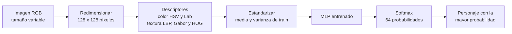
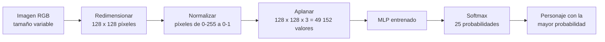
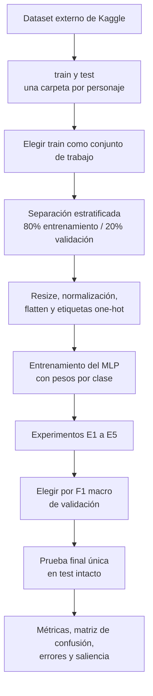
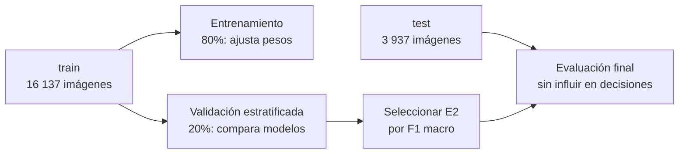
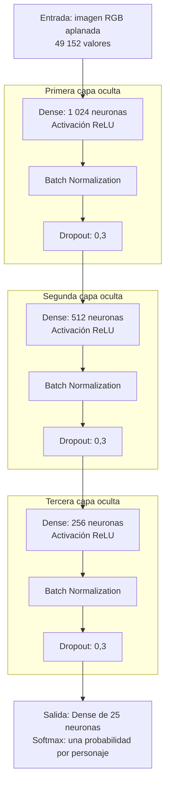
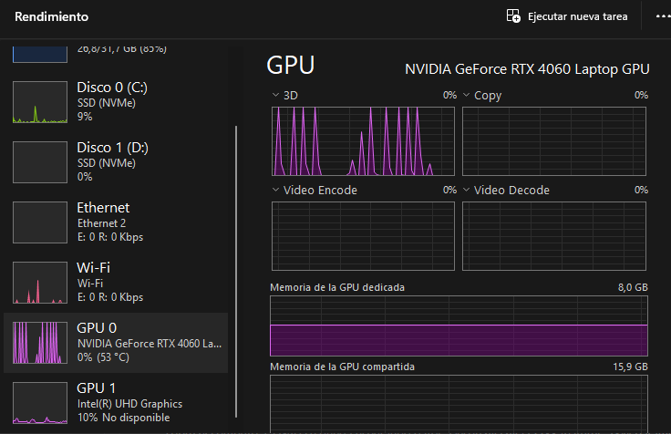

# Clasificador de personajes de Los Simpson con un MLP

Esta carpeta contiene un proyecto de Machine Learning que entrena, compara y evalúa un **Perceptrón Multicapa (MLP)** para identificar qué personaje de Los Simpson aparece en una imagen RGB. El proyecto tiene dos versiones, cada una con sus notebooks, resultados y modelos en carpetas propias (`oldDataset/` y `newDataset/`):

| Versión | Dataset | Notebooks | Resultado en test |
|---|---|---|---|
| **Dataset nuevo (actual)** | 64 personajes y 40.123 imágenes, una carpeta por personaje | [notebooks/](notebooks/) | Accuracy de 0,586 con la imagen completa |
| Dataset anterior | 25 personajes y 20.074 imágenes de Kaggle, con `train` y `test` | [notebooks/oldDataset/](notebooks/oldDataset/) | Accuracy de 51,7 % |

Las dos versiones se entrenan y se evalúan a **128 × 128 en la GPU** (NVIDIA GeForce RTX 4060 Laptop).

> Es un proyecto didáctico de clasificación de imágenes: el MLP asigna un personaje a cada imagen completa. Las cajas alrededor de cada personaje las pone después, con el modelo ya entrenado, el script aparte [scripts/newDataset/detectar_cajas.py](../scripts/newDataset/detectar_cajas.py).

> Las rutas de este documento son relativas a la carpeta `PMC/`, salvo las del script del dataset, los `requirements` y el entorno `.venv-gpu`, que están en la raíz del repositorio y se comparten con los demás modelos. Los comandos se ejecutan desde la raíz del repositorio.

<p align="center">
  
</p>

**Presentación de resultados.** [presentacion_resultados_PMC.html](presentacion_resultados_PMC.html) resume el dataset nuevo en 19 diapositivas: experimentos, KPIs, análisis de errores, costo en CPU frente a GPU y anexos con las tablas completas. Todavía muestra las seis corridas de octubre, en CPU y GPU a 32, 64 y 128 píxeles: se rehace con la nueva corrida a 128 × 128. Es un solo archivo: descárgalo y ábrelo en el navegador (GitHub solo muestra su código). El botón **Presentar** muestra una diapositiva a la vez en pantalla completa; las flechas avanzan y `Esc` sale.

## Dataset nuevo: 64 personajes

El equipo amplió el dataset público de Kaggle con más personajes y con fotogramas de episodio propios. Quedaron 64 personajes en una carpeta cada uno, sin partición previa en `train` y `test`, desde 3.118 imágenes de Homero hasta 94 de Louie. La etiqueta de cada imagen es siempre el nombre de su carpeta.

### Qué cambia respecto del dataset anterior

| Cambio | Cómo se hace |
|---|---|
| Partición propia | Las originales de cada personaje se reparten 70 % / 20 % / 10 % (entrenamiento, validación y test), estratificadas, con semilla 42 y sin tope por personaje. |
| Desbalance de 33:1 | Pesos por clase suavizados: la raíz cuadrada de los balanceados, de 0,49 para Homero a 2,78 para Louie. |
| Imágenes alteradas | Un cuarto de las imágenes de cada personaje tiene una variante con giro, cambio de color y filtro de textura. Cada variante va al mismo conjunto que su original. |
| Imágenes parecidas | Las casi idénticas a otra del mismo personaje entran con una versión filtrada, para que el modelo no acierte en test porque vio casi la misma imagen al entrenar. |
| Descriptores | El MLP no recibe píxeles, sino 2.462 descriptores de color (HSV, Lab) y de textura (LBP, Gabor, HOG). |
| Escenas con varios personajes | En la corrida del 16-10-2026, nombrar a otro personaje presente contaba como acierto en test. Ahora una predicción acierta solo si nombra al personaje de la carpeta, y la escena solo alimenta la accuracy por escena, de referencia. |
| Primero el modelo, después las cajas | El notebook entrena y evalúa con la imagen completa y guarda el modelo final con todo lo necesario para usarlo fuera de él (`mlp_final.keras`, `.json`, `_entrada.py` y `_particion.csv`). Después, [scripts/newDataset/detectar_cajas.py](../scripts/newDataset/detectar_cajas.py) encuentra a cada personaje y el MLP nombra cada caja, sin anotar nada a mano. El notebook no depende de ese script. |
| GPU a 128 × 128 | El notebook usa Keras 3 sobre PyTorch, con un bucle de entrenamiento propio, en la RTX 4060 Laptop. |

El script [scripts/newDataset/generar_imagenes_alteradas.py](../scripts/newDataset/generar_imagenes_alteradas.py), en la raíz del repositorio, genera las alteradas y las parecidas dentro del dataset y registra las imágenes repetidas entre carpetas de personajes distintos. Nunca modifica las originales.

### Cómo procesa una imagen



El modelo base tiene dos capas ocultas (`512 → 256`) con ReLU, BatchNormalization y Dropout 0,3, y se entrena con Adam (`lr=1e-3`), batch 128 y parada temprana. La experimentación compara 15 variantes, cambiando un factor a la vez. En la corrida del 16-10-2026 ganó C1: una entrada de **solo color**, con 370 histogramas, y las tres capas de E2.

### Resultados de la corrida del 16-10-2026

El notebook de GPU se ejecutó completo a 128 × 128, con la imagen completa, en un equipo con Intel Core i7-13620H y NVIDIA GeForce RTX 4060 Laptop. La accuracy usa el criterio de acierto de entonces, que también aceptaba a otro personaje presente; la estricta solo acepta el personaje de la carpeta y es la comparable con el criterio actual.

| Corrida | Configuración final | Accuracy | Estricta | Top-3 | F1 macro | Duración |
|---|---|---:|---:|---:|---:|---:|
| GPU 128 × 128 | C1 - combinación | **0,586** | **0,539** | 0,751 | 0,559 | 28 min 14 s |

- **El color solo gana.** El modelo final usa solo los 370 histogramas de color, con las tres capas de E2: 1.059.648 parámetros, menos que el modelo base con color y textura.
- **La red es pequeña para la tarjeta.** A batch 128 la GPU trabaja el 33,7 % del tiempo, y de batch 128 a 2.048 su rendimiento se multiplica por 14,5. Cargar las imágenes y calcular los descriptores, en la CPU, toma 11 minutos: el 39 % de la corrida.
- **El modelo reconoce paletas, no personajes.** Con solo histogramas de color, confunde a quienes comparten la piel amarilla, como Bart, Lisa y Homero, y a las gemelas Patty y Selma.
- **Frente a la corrida del 15-10-2026**, que daba 0,643 de accuracy estricta, la caída a 0,539 con la misma configuración mide sobre todo la fuga que se eliminó: aquel test no filtraba las imágenes casi idénticas a otras de entrenamiento ni tenía alteradas.

### KPIs

Los umbrales se fijaron antes de entrenar. Los cuatro de calidad se cumplen, también con el criterio estricto (accuracy de 0,539):

| KPI | Métrica en test | Umbral | GPU 128 × 128 |
|---|---|---:|---:|
| Cobertura de asistencia | Top-3 accuracy | ≥ 0,70 | 0,751 |
| Equidad entre personajes | F1 macro | ≥ 0,45 | 0,559 |
| Automatización sin revisión | Accuracy | ≥ 0,50 | 0,586 |
| Ventaja sobre lo trivial | Accuracy / clase mayoritaria | ≥ 4× | 7,5× |
| Costo de catalogación | Imágenes por segundo, descriptores incluidos | ≥ 1.000 | sin medir en esta corrida |

### Cómo ejecutarlo

Los pasos completos están en [notebooks/README.md](notebooks/README.md). En resumen:

1. Deja el dataset, una carpeta por personaje, en `~/Desktop/simpsons_dataset`, o define su ruta en la variable de entorno `SIMPSONS_DATASET`.
2. Genera las imágenes alteradas y parecidas:

   ```powershell
   .\.venv-gpu\Scripts\python.exe scripts\newDataset\generar_imagenes_alteradas.py
   ```

3. Instala la dependencia extra y ejecuta un notebook:

   ```powershell
   .\.venv-gpu\Scripts\python.exe -m pip install -r requirements-newDataset.txt
   .\PMC\scripts\newDataset\ejecutar_notebook_gpu.ps1
   ```

   También se puede usar Docker: copia `.env.example` como `.env`, pon la ruta del dataset y ejecuta `docker compose up --build`.

   Cada corrida guarda su resumen en `resultados/newDataset/GPU/rendimiento_gpu_128x128.json` y sus modelos en `models_gpu/newDataset/`, con el modelo final listo para usarse fuera del notebook.

4. Después, si se quiere, pon cada personaje en su caja con el modelo guardado (paso 4 de la guía):

   ```powershell
   .\.venv-gpu\Scripts\python.exe -m pip install -r requirements-cajas.txt
   .\.venv-gpu\Scripts\python.exe scripts\newDataset\detectar_cajas.py --modelo mlp ruta\a\imagen.jpg
   ```

## Dataset anterior: 25 personajes

La primera versión del proyecto identifica cuál de **25 personajes de Los Simpson** aparece en una imagen RGB. La implementación, el análisis y la predicción están en el notebook [LosSimpsons_GPU_4060M.ipynb](notebooks/oldDataset/LosSimpsons_GPU_4060M.ipynb), que se ejecuta en la GPU a 128 × 128. Las secciones siguientes la documentan y se conservan para comparar con el dataset nuevo.

### Qué hace el modelo

Ante una imagen, el modelo calcula una probabilidad para cada personaje y devuelve la clase con mayor probabilidad. Por ejemplo, puede decidir entre `homer_simpson`, `lisa_simpson` o `marge_simpson`.



Técnicamente, es una **clasificación multiclase de etiqueta única**:

| Elemento | Implementación |
|---|---|
| Entrada | Imagen RGB convertida a un vector de 49.152 valores. |
| Clases | 25 personajes; cada imagen tiene una sola etiqueta. |
| Salida | 25 probabilidades con `softmax`; se elige el valor máximo (`argmax`). |
| Pérdida | `categorical_crossentropy`. |
| Selección del modelo | F1 macro sobre validación, para dar el mismo peso a cada personaje. |

### Resultados principales

El modelo final seleccionado es el experimento **E2**, con tres capas ocultas. Se evaluó una sola vez en 3.937 imágenes de prueba que no se usaron para entrenar ni para escoger hiperparámetros.

| Métrica de prueba | Resultado | Significado |
|---|---:|---|
| Accuracy | **51,7 %** | Acertó algo más de la mitad de todas las imágenes. |
| F1 macro | **48,9 %** | Rendimiento medio de los 25 personajes, sin favorecer a los que tienen más imágenes. |
| F1 ponderado | 51,5 % | F1 que considera el tamaño de cada clase. |
| Top-3 accuracy | 71,8 % | La respuesta correcta quedó entre las tres opciones más probables. |
| Azar | 4,0 % | Elegir aleatoriamente una de 25 clases. |
| Clase mayoritaria | 11,4 % | Predecir siempre a Homero. |

El modelo aprende patrones reales y supera claramente las referencias simples. Aun así, no es un sistema listo para producción: un MLP pierde la información espacial de una imagen al aplanarla. Una CNN o *transfer learning* sería la evolución técnica natural.

### Flujo completo



#### Datos y desbalance

Se usa el dataset de Kaggle [Los Simpson Dataset](https://www.kaggle.com/datasets/alfaro96/los-simpson/data), del usuario `alfaro96`. El flujo del notebook utiliza 16.137 imágenes en `train` y 3.937 en `test`, para 25 personajes.

Las clases están desbalanceadas: `homer_simpson` tiene 1.796 imágenes de entrenamiento y `selma_bouvier` 82, una razón aproximada de 22:1. Por eso no basta con mirar *accuracy*. Durante el entrenamiento se aplican **pesos por clase** (`class_weight`), calculados solamente desde entrenamiento, para que equivocarse en una clase escasa tenga mayor impacto en la pérdida.



### Arquitectura elegida

Cada imagen de `128 × 128 × 3` se convierte en una fila de 49.152 números. La arquitectura E2 procesa esa fila capa por capa:



- **ReLU:** función de activación que facilita el entrenamiento de capas profundas.
- **Batch Normalization:** mantiene estables las escalas de activación.
- **Dropout 0,3:** desactiva neuronas al azar durante el entrenamiento para reducir el sobreajuste.
- **Adam (`lr=1e-3`):** optimizador que ajusta los pesos.
- **EarlyStopping, ReduceLROnPlateau y ModelCheckpoint:** frenan, ajustan y guardan el entrenamiento según la validación.

La arquitectura base (`512 → 256`) tiene cerca de 25,3 millones de parámetros. E2 amplía la red a `1024 → 512 → 256`, con aproximadamente 51,0 millones de parámetros.

### Comparación de experimentos

Cada experimento modifica una sola variable, manteniendo la semilla, división de datos, pesos por clase y callbacks. Así, el cambio observado se puede atribuir mejor a la variable evaluada.

| Experimento | Cambio frente al base | F1 macro validación | Accuracy validación |
|---|---|---:|---:|
| **E2, seleccionado** | Tres capas: `1024 → 512 → 256` | **0,476** | **0,503** |
| Base | Dos capas: `512 → 256` | 0,471 | 0,500 |
| E5 | Batch de 512 | 0,451 | 0,481 |
| E1 | Una capa de 512 neuronas | 0,426 | 0,453 |
| E4 | Learning rate `1e-4` | 0,422 | 0,466 |
| E3 | Activación `tanh` | 0,006 | 0,065 |

### Rendimiento en la GPU

El notebook entrena el MLP en un equipo con Intel Core i7-13620H y NVIDIA GeForce RTX 4060 Laptop,
conectado a la corriente, y deja su resumen en `resultados/oldDataset/GPU/rendimiento_gpu_128x128.json`.

#### Enchufa el portátil antes de medir

Es el factor más grande y el más fácil de pasar por alto. Con batería, el firmware limita la
GPU a 50 W de los 80 W disponibles y el reloj cae de 2.340 a 1.755 MHz; el tiempo por época
se duplica. La tarjeta sigue marcando **100 % de uso** mientras tanto, porque ese porcentaje
mide *ocupación*, no potencia entregada. Todas las cifras de esta sección se tomaron con el
equipo conectado y en modo de máximo rendimiento.

#### Tiempos de la corrida

| Medición | Valor |
|---|---:|
| Segundos por época (benchmark de la arquitectura base) | 0,89 |
| Corrida completa | 4 min 48 s |
| Inferencia sobre las 3.937 imágenes de test | 0,06 s (70.863 imágenes por segundo) |
| Utilización media de la GPU durante el benchmark | 59,7 % |
| Potencia media | 52,6 W |

El benchmark reentrena la arquitectura base unas pocas épocas con el mismo batch y sin parada
temprana, descartando la primera porque incluye el calentamiento. Los tiempos de las secciones
anteriores no sirven para comparar configuraciones, ya que la parada temprana hace que cada una
corra un número distinto de épocas.

#### Qué muestran estos números

**La sobrecarga se bajó quitando dos cuellos de botella, no cambiando de tarjeta.** Primero, los
datos viven enteros en la VRAM en `uint8` y el escalado a [0, 1] lo hace una capa
`Rescaling` dentro del modelo, así que ningún paso espera a que le copien el lote desde la
RAM. Segundo, el entrenamiento no pasa por `model.fit()`, que devuelve el control al
intérprete de Python entre paso y paso: a igualdad de todo lo demás, el bucle propio resulta
**2,3 × más rápido** que `fit()` con el mismo tamaño de lote (0,81 frente a 1,89 segundos por
época en una medición controlada).

Conviene ser preciso con lo que eso significa, porque el porcentaje de uso engaña: a batch
128 el bucle propio marca una utilización parecida a la de `fit()` —en torno al 62 %— y aun
así es más del doble de rápido, porque desperdicia menos tiempo en cada paso. La tarjeta solo
se acerca al 97 % cuando el lote sube a 512 o más, donde cada paso ya trae trabajo suficiente
para mantenerla ocupada. Los detalles están en
[notebooks/oldDataset/README_GPU.md](notebooks/oldDataset/README_GPU.md).

<p align="center">
  
</p>

<p align="center"><em>Captura del montaje anterior (WSL2 + TensorFlow), conservada porque
ilustra el problema que se corrigió: TensorFlow reserva los 8 GB de VRAM, pero el uso del núcleo
sube a picos y vuelve a cero entre lote y lote. Con el montaje actual la VRAM ocupada baja a
~1,5 GB y el uso deja de caer a cero entre pasos.</em></p>

#### Cuánta GPU queda sin usar

A batch 128 sobra tarjeta. El margen está en el tamaño de lote: manteniendo todo lo demás igual,
el rendimiento pasa de 15.015 imágenes por segundo con batch 128 a 70.444 con batch 2.048, un
factor de 4,7, y la utilización sube del 61,9 % al 96,6 %. El estudio se queda en **batch 128**
porque es el valor de su diseño experimental, no porque sea el más rápido; la tabla completa se mide
en cada corrida y queda guardada en el JSON de resultados.

El cuello de botella es la arquitectura, no la tarjeta: el siguiente paso natural del proyecto es
una CNN que aproveche esos 49.152 valores como estructura espacial y no como un vector plano.

### Cómo reproducir el proyecto

#### 1. Instalar dependencias

El notebook usa Keras 3 sobre PyTorch con CUDA, en el entorno `.venv-gpu` descrito en [`requirements-gpu-windows.txt`](../requirements-gpu-windows.txt). Los pasos de instalación y la verificación de la GPU están en [notebooks/oldDataset/README_GPU.md](notebooks/oldDataset/README_GPU.md).

#### 2. Descargar los datos fuera del repositorio

El dataset son unas 20.000 imágenes que ocupan 550 MB (577.675.264 bytes) y no se incluyen en Git. Descarga el dataset desde Kaggle, descomprímelo en una ubicación externa y verifica esta organización:

```text
LosSimpsonsDataset/
├── train/
│   ├── homer_simpson/
│   ├── lisa_simpson/
│   └── ...
└── test/
    ├── homer_simpson/
    ├── lisa_simpson/
    └── ...
```

En la primera celda de configuración del notebook, cambia `DATASET_BASE` a esa carpeta:

```python
from pathlib import Path

DATASET_BASE = Path("C:/ruta/a/LosSimpsonsDataset")
conjunto = "train"
```

El conjunto de prueba es siempre el opuesto: si se entrena con `train`, el notebook reserva `test` para la evaluación final.

#### 3. Ejecutar el notebook en orden

```powershell
.\PMC\scripts\oldDataset\ejecutar_notebook_gpu.ps1
```

Los modelos resultantes se generan en `models_gpu/oldDataset/`: `mlp_base.keras`, `mlp_e1.keras` a `mlp_e5.keras` y `mlp_final.keras`. Son artefactos regenerables e ignorados por Git.

### Límites del enfoque y mejoras

La principal limitación del MLP aparece al aplanar la imagen: no entiende que dos píxeles vecinos estaban cerca ni reutiliza un mismo patrón visual si aparece en otra posición. También puede asociar fondos frecuentes con personajes.

| Limitación | Efecto | Mejora recomendada |
|---|---|---|
| No conserva estructura espacial | No modela rasgos locales como bordes, ojos o siluetas. | CNN. |
| Sensible a posición y escala | Un personaje desplazado se parece a un caso nuevo. | CNN y aumento de datos. |
| Muchos parámetros | Mayor costo y riesgo de sobreajuste. | Convoluciones y *pooling*. |
| Clases desbalanceadas | Los personajes minoritarios pueden quedar mal representados. | Aumento de datos, focal loss o sobremuestreo con transformaciones. |
| Fondos compartidos | Puede aprender el escenario en vez del personaje. | Recortar/detectar personaje antes de clasificar. |

## Estructura de la carpeta

```text
PMC/
├── notebooks/
│   ├── oldDataset/
│   │   ├── LosSimpsons_GPU_4060M.ipynb # MLP en GPU (Windows nativo + RTX 4060), a 128 × 128
│   │   └── README_GPU.md               # Cómo ejecutar el notebook en GPU
│   ├── LosSimpsons_GPU_4060M.ipynb     # Dataset nuevo: MLP sobre descriptores en GPU a 128 × 128
│   └── README.md                       # Cambios, ejecución y resultados del dataset nuevo
├── docs/
│   ├── oldDataset/
│   │   └── Informe.md                  # Informe técnico del proyecto
│   ├── EP1_TLY1102_Instrucciones y Pauta PRESENTACIÓN_Estudiante.pdf
│   └── material_complementario/    # Material de apoyo de la asignatura
├── models_gpu/<oldDataset|newDataset>/  # Modelos .keras regenerables (y cajas_mlp_final/), ignorados por Git
├── resultados/
│   ├── oldDataset/GPU/                 # rendimiento_gpu_128x128.json
│   └── newDataset/
│       └── GPU/                        # rendimiento_gpu_128x128.json; cada corrida reemplaza el anterior
├── images/                         # Recursos visuales
│   ├── homero.png, lisa.png            # Ilustraciones de la portada de los notebooks
│   └── oldDataset/imageGPU.png         # Captura del montaje anterior en GPU
├── scripts/
│   ├── oldDataset/
│   │   └── ejecutar_notebook_gpu.ps1   # Comprueba el entorno y abre el notebook de GPU
│   └── newDataset/
│       └── ejecutar_notebook_gpu.ps1   # Ejecuta el notebook de GPU del dataset nuevo
├── presentacion_resultados_PMC.html  # Presentación de resultados del dataset nuevo (19 diapositivas)
└── README.md                       # Este documento
```

El script que prepara el dataset nuevo (`scripts/newDataset/generar_imagenes_alteradas.py`), los `requirements`, el `Dockerfile` y `docker-compose.yml` están en la raíz del repositorio, porque los comparten todos los modelos; el [README de la raíz](../README.md) los describe.

El dataset no forma parte del repositorio: se descarga aparte y se deja en una ubicación externa, como se explica en [Descargar los datos fuera del repositorio](#2-descargar-los-datos-fuera-del-repositorio). El dataset nuevo tampoco: su ubicación y su preparación están en [notebooks/README.md](notebooks/README.md).

## Referencias internas

**Dataset nuevo**

- [Presentación de resultados](presentacion_resultados_PMC.html): 19 diapositivas con experimentos, KPIs, errores y las seis corridas en CPU y GPU; se rehace con la nueva corrida a 128 × 128.
- [Guía del dataset nuevo](notebooks/README.md): qué cambia, cómo preparar el dataset, cómo ejecutar los notebooks, cómo poner las cajas después y resultados.
- [Notebook GPU](notebooks/LosSimpsons_GPU_4060M.ipynb): experimentos, evaluación y rendimiento a 128 × 128.
- [Resúmenes de rendimiento](resultados/newDataset/): un JSON por corrida con tiempos, entorno y métricas.

**Dataset anterior**

- [Informe técnico](docs/oldDataset/Informe.md): problema de negocio, KPIs, EDA, metodología CRISP-DM y análisis de resultados.
- [Pauta de la evaluación](docs/EP1_TLY1102_Instrucciones%20y%20Pauta%20PRESENTACI%C3%93N_Estudiante.pdf): instrucciones y rúbrica.
- [Notebook GPU](notebooks/oldDataset/LosSimpsons_GPU_4060M.ipynb): el MLP entrenado en la GPU a 128 × 128, en Windows nativo, con un bucle de entrenamiento propio sobre PyTorch.
- [Guía de ejecución en GPU](notebooks/oldDataset/README_GPU.md): entorno de Windows nativo, decisiones de rendimiento y solución de problemas.
- [Resumen de rendimiento](resultados/oldDataset/GPU/rendimiento_gpu_128x128.json): tiempos, entorno y métricas de la corrida.

## Integrantes

- Vincent Farenden Cerón
- Rodrigo Ignacio Martínez Becker
- Iván Manuel Pavón Barría
- Diego Ignacio Peña y Lillo Luhrs

Trabajo para la asignatura **Técnicas Avanzadas para Machine Learning_001D**.
