# Informe técnico — Optimización y auditoría de un Perceptrón Multicapa para reconocer personajes de Los Simpson

Evaluación Parcial 3 · Técnicas Avanzadas de Machine Learning · 15-11-2026

## Resumen

| Tema | Lo importante | Dónde |
|---|---|---|
| Qué se entrega | El Pipeline Integrado de la EP2, optimizado y auditado: un MLP sobre descriptores de color (1.059.648 parámetros) que reconoce a 64 personajes, comparado con una CNN entrenada con las mismas imágenes y el mismo proceso | §4, §13 |
| Resultado | Accuracy de test 0,556, F1 macro 0,557, top-3 0,732 y ROC-AUC macro 0,940: 35,6 veces el azar y 9,4 veces la clase mayoritaria. Los cinco KPIs se cumplen | §3, §10 |
| Presupuesto | Todas las configuraciones se entrenaron con el mismo máximo de 60 épocas y paciencia 12: la comparación es en igualdad de condiciones | §8, §9 |
| Representación | La decisión que más pesa: el color solo (370 histogramas) supera a color y textura (2.462 valores) por 6,9 puntos de F1 macro de validación; los píxeles crudos son la peor entrada | §9 |
| Regularización | Se midió cada técnica con y sin ella. Sin dropout la red memoriza en tres épocas (−7,5 puntos de F1); el suavizado de etiquetas y las imágenes alteradas aportan 3,5 y 2,6; Batch Normalization 1,1; L2 no ayuda | §8 |
| Optimización | Un factor a la vez (16 variantes y una combinación) más un Grid Search completo de 36 configuraciones. Gana GS01: solo color, tres capas y dropout 0,2, 10,5 puntos sobre la base | §9 |
| Auditoría | Métricas por clase, matriz de confusión, ROC-AUC, curvas de aprendizaje, calibración (ECE de 0,044, levemente sobreconfiado), umbral de revisión (resuelve solo el 14,3 % del test al 89,7 % de acierto), sesgos por subgrupo, importancia por permutación y SHAP | §10, §11, §12 |
| Sesgos | La familia Simpson acierta 11,3 puntos menos que el resto (comparte la piel amarilla) y los fotogramas de episodio, 11,9 menos que las imágenes de Kaggle. El tamaño de la clase no pesa | §12 |
| Arquitectura seleccionada | La CNN: gana en desempeño (+22 puntos de accuracy), generalización, interpretabilidad, automatización y catalogación de extremo a extremo; el MLP, en costo de entrenamiento (23 veces menor por época) y en calibración | §13 |
| Uso responsable | Asistente con revisión casi completa: se equivoca en el 44,4 % del test, siempre responde algún personaje y no debe usarse con fotos de personas | §12 |

## 1. Identificación del proyecto

| Elemento | Descripción verificable |
|---|---|
| Tipo de proyecto | Clasificación supervisada de imágenes RGB con un Perceptrón Multicapa (MLP) sobre descriptores de color y textura, comparado con una red neuronal convolucional (CNN). |
| Unidad de predicción | Una imagen recibe una sola etiqueta entre 64 personajes. |
| Implementación evaluada | `PMC/notebooks/LosSimpsons_GPU_4060M.ipynb`: Keras 3 sobre PyTorch, en Windows con una GPU NVIDIA GeForce RTX 4060 Laptop de 8 GB; con las salidas de la corrida a 128 × 128 del 15-11-2026. |
| Módulo común | `scripts/newDataset/pipeline_comun/`: las funciones del pipeline que importan los dos notebooks, con sus pruebas en `scripts/newDataset/tests/`. |
| CNN de la comparación | `CNN/notebooks/LosSimpsons_GPU_4060M.ipynb`: la CNN sobre el mismo dataset y con el mismo proceso, corrida del 14-11-2026; su informe es `CNN/docs/newDataset/Informe.md`. |
| Evidencia de ejecución | Salidas guardadas de los dos notebooks; resúmenes JSON en `PMC/resultados/newDataset/GPU/` y `CNN/resultados/newDataset/GPU/`; historiales de cada configuración en `PMC/models_gpu/newDataset/historiales/`. |
| Framework | Keras 3.15.1 sobre PyTorch 2.14.0 (CUDA 13.0), Python 3.13. |
| Ejecución | Local, en la RTX 4060 Laptop, acordada con el profesor en lugar de Google Colab: la corrida completa tomó 2 h 2 min. |
| Integrantes | Vincent Farenden Cerón; Rodrigo Ignacio Martínez Becker; Iván Manuel Pavón Barría; Diego Ignacio Peña y Lillo Luhrs. |
| Profesor | Francisco Javier Jerez Salazar. |

Cada cifra de este informe sale de las salidas guardadas de los notebooks o de sus resúmenes JSON, y cada figura la
guarda el propio notebook en `figuras/` al ejecutarse.

## 2. Problema, variante y cambio de dataset

### 2.1 Problema abordado

**Clasificación multiclase de etiqueta única**: dada una imagen RGB de Los Simpson, el modelo asigna exactamente uno
de 64 personajes, con su confianza. El escenario de uso declarado es un archivo audiovisual que crece más rápido de
lo que un equipo puede catalogarlo: el modelo propone el personaje y una persona valida, así que el trabajo pasa de
*etiquetar* a *revisar*. No es un encargo de un cliente real, por lo que los KPIs se expresan en cantidades
medibles sobre los datos.

### 2.2 Variante del grupo

| Decisión | Valor |
|---|---|
| Personajes | 64, una carpeta por personaje; la etiqueta es siempre la carpeta, nunca el nombre del archivo |
| Imágenes | Todas las originales de cada personaje (56.268, 3,4 GB), sin tope |
| Partición | 70 / 20 / 10 por personaje, estratificada, con semilla 42 |
| Imágenes alteradas | Una variante (giro de 10 a 20°, cambio de color y filtro de textura) para un cuarto de las imágenes de cada personaje, siempre en el mismo conjunto que su original |
| Imágenes parecidas | Las 9.040 imágenes casi idénticas a otra del mismo personaje entran con una versión filtrada |
| Criterio de acierto | Nombrar al personaje de la carpeta. La accuracy por escena, que también acepta a otro personaje presente, se informa solo como referencia |
| Resolución | 128 × 128 |
| Entrada del MLP | Descriptores calculados sobre la imagen completa: color (HSV y Lab), textura (LBP y Gabor) y bordes (HOG), comparados con los píxeles crudos |

### 2.3 Cambio de dataset respecto de la EP1 y trazabilidad

La pauta recomienda el dataset de la EP1 y pide, si se modifica la variante, justificarlo y mantener la
trazabilidad. El dataset es la misma fuente de Kaggle (Los Simpson, `alfaro96`), ampliada por el equipo:

| | EP1 (MLP) | EP2 y EP3 (MLP y CNN) |
|---|---|---|
| Personajes | 25 | 64 |
| Imágenes originales | 20.074 (16.137 en `train` y 3.937 en `test`) | 56.268: 22.162 de Kaggle y 34.106 fotogramas de episodio |
| Partición | La de Kaggle, de criterio no documentado | Propia: 70 / 20 / 10 estratificada, semilla 42 |
| Casi duplicados entre conjuntos | No se verificaban | Filtrados; cada alterada en el conjunto de su original |
| Información de escena | No | 42.646 de las 70.345 imágenes de trabajo (60,6 %) son fotogramas con episodio e instante conocidos |

Razones: un archivo audiovisual también tiene a los personajes secundarios, y con 64 aparecen los que se parecen
entre sí (Patty y Selma, Carl y Lenny, los Flanders), la prueba más exigente para comparar arquitecturas; la CNN
aprende sus filtros de los píxeles y necesita más ejemplos; y la partición propia permite auditar que una misma
escena no caiga en entrenamiento y test.

**Trazabilidad.** El trabajo de la EP1 se conserva en `PMC/docs/oldDataset/` y `PMC/resultados/oldDataset/`, y su
notebook de GPU en el historial de Git (`PMC/notebooks/oldDataset/LosSimpsons_GPU_4060M.ipynb`, commit `4b8b80e`);
su MLP final, sobre los píxeles y con 51.002.393 parámetros, alcanzó 0,517 de accuracy de test sobre 25 personajes.
Para la EP3 el MLP se volvió a entrenar sobre el dataset nuevo con el mismo pipeline que la CNN. Las cifras de la EP1
no se comparan con las actuales porque miden otros personajes sobre otra partición. La corrida anterior del MLP, del
09-11-2026, se compara con la actual en el anexo del notebook.

### 2.4 Objetivos

**Objetivo general.** Optimizar y auditar un MLP que asigne a cada imagen uno de los 64 personajes, reutilizando el
Pipeline Integrado de la EP2, y compararlo con la CNN en igualdad de condiciones.

**Objetivos específicos.** Medir qué representación de entrada sirve a un MLP; medir el aporte de cada técnica de
regularización con el mismo presupuesto de entrenamiento; seleccionar la configuración con experimentos de un factor
a la vez y un Grid Search; auditar el modelo con accuracy, precision, recall, F1, ROC-AUC, matriz de confusión,
curvas de aprendizaje, calibración, un umbral de revisión, importancia por permutación y SHAP; identificar los sesgos
del dataset y del modelo y sus implicancias; y justificar la arquitectura seleccionada.

## 3. KPIs

Los umbrales se fijaron antes de entrenar y son los mismos para el MLP y la CNN.

| KPI | Qué mide en el negocio | Métrica técnica | Umbral | MLP | CNN |
|---|---|---|---|---:|---:|
| Cobertura de asistencia | Si el catalogador encuentra la respuesta entre tres sugerencias | Top-3 accuracy en test | ≥ 0,70 | 0,732 | 0,908 |
| Equidad entre personajes | Que el catálogo sirva para todos los personajes | F1 macro en test | ≥ 0,45 | 0,557 | 0,755 |
| Automatización sin revisión | Imágenes que el sistema resuelve solo | Accuracy en test | ≥ 0,50 | 0,556 | 0,775 |
| Ventaja sobre el criterio trivial | Información real frente a etiquetar todo como Homero | Accuracy / clase mayoritaria | ≥ 4× | 9,4× | 13,2× |
| Costo de catalogación | Procesar el archivo en un tiempo razonable | Imágenes por segundo, descriptores + red | ≥ 1.000 | 1.360 | 3.567 |

El MLP cumple los cinco, con el margen más justo en la top-3 (3,2 puntos) y en el costo. El costo se mide de extremo
a extremo: calcular en la CPU los descriptores de color de las imágenes ya redimensionadas y pasarlos por la red. La
red sola clasifica 76.661 imágenes por segundo, así que casi todo el costo está en los descriptores. Se mide con una
pasada de calentamiento y la mediana de tres repeticiones, igual que en la CNN. En la corrida, la primera versión de
la celda medía una sola vez en frío y dio 988 imágenes por segundo: incluía el arranque de los procesos de joblib que
calculan los descriptores en paralelo, que se paga una vez por sesión. La celda se corrigió y se volvió a ejecutar
sola; sus tres repeticiones dieron 1.086, 1.413 y 1.360 imágenes por segundo.

## 4. Pipeline Integrado

La EP3 continúa las actividades anteriores: el pipeline de la EP2 se reutiliza y se extiende con las etapas de
regularización, optimización y auditoría. El mismo pipeline sirve a las dos redes, y sus funciones viven en el módulo
`scripts/newDataset/pipeline_comun/`, que importan los dos notebooks. Lo propio del MLP es la representación de la
entrada y la función que construye el modelo.

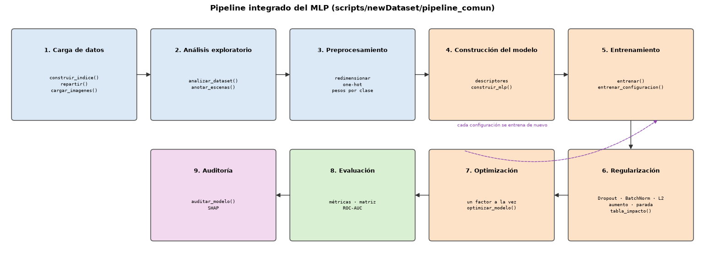

| Etapa | Funciones | Módulo |
|---|---|---|
| Carga de datos | `construir_indice()`, `repartir()`, `cargar_imagenes()` | `datos`, `preprocesamiento` |
| Análisis exploratorio | `analizar_dataset()`, `anotar_escenas()` | `datos` |
| Preprocesamiento | `cargar_y_redimensionar()`, `comprobar_particion()`, `compute_class_weight()` | `preprocesamiento`, `datos` |
| Construcción del modelo | `extraer_representacion()`, `construir_mlp()`, `compilar()` | notebook (lo propio del MLP) |
| Entrenamiento | `entrenar()`, `entrenar_configuracion()`, `entrenar_o_reanudar()` | `entrenamiento`, notebook |
| Regularización | Dropout, Batch Normalization, L2, imágenes alteradas, parada temprana, `tabla_impacto()` | `entrenamiento`, `experimentacion` |
| Optimización | `registrar()`, `combinar_mejoras()`, `optimizar_modelo()` | `experimentacion` |
| Evaluación | `classification_report`, `confusion_matrix`, `roc_auc_score` | scikit-learn |
| Auditoría | `auditar_modelo()`, `explicar_con_shap()`, `graficar_shap()` | `auditoria` |
| Reporte final | `comparar_redes()`, `guardar_figura()` y el resumen JSON | `comparacion`, `rendimiento` |

**Justificación de la estructura.**

1. **Una responsabilidad por etapa**, cada una con su comprobación automática o su tabla antes de seguir.
2. **La partición va antes que los píxeles**: cada personaje se reparte antes de cargar imágenes y cada alterada
   sigue a su original; la estandarización de los descriptores se calcula solo con entrenamiento. Ninguna decisión
   posterior puede filtrar información del test.
3. **Las mismas funciones para todas las configuraciones**: `construir_mlp()` y `entrenar_configuracion()` reciben
   como parámetros todos los factores que se experimentan, incluida la representación de la entrada, así que la base
   y cada variante salen del mismo código.
4. **El mismo pipeline para el MLP y la CNN**, con el mismo formato de resumen: la comparación es cifra a cifra.
5. **Funciones reutilizables, etapas a la vista**: las funciones están documentadas y probadas en el módulo común,
   y el notebook las llama celda a celda, con texto, tablas y gráficos en cada paso.
6. **Mismo presupuesto y entrenamientos reanudables**: toda configuración se entrena con 60 épocas como máximo y
   paciencia 12, y su historial queda en disco, de modo que una corrida cortada se reanuda donde quedó.

## 5. Carga de datos y análisis exploratorio

| Hallazgo | Evidencia | Decisión que motiva |
|---|---|---|
| Desbalance | De 3.118 imágenes de `homer_simpson` a 151 de `maggie_simpson`: 20,6:1 en el dataset y 20,1:1 en entrenamiento | Pesos por clase, partición estratificada y selección por F1 macro |
| Dos orígenes | 60,6 % de fotogramas de episodio y 39,4 % de imágenes de Kaggle, en la misma proporción en los tres conjuntos | Auditoría por origen (§12) |
| Tamaños muy distintos | De 28 a 2.700 píxeles de ancho y de 42 a 3.600 de alto, con una mediana de 960 × 720 | Redimensionado de la imagen completa a 128 × 128 |
| Casi duplicados | 9.040 originales casi idénticas a otra del mismo personaje, en 6.291 grupos (similitud mediana de 0,98) | Versión filtrada en su lugar (similitud mediana de 0,55) |
| Variantes alteradas | 14.077, una por cada cuarto de las originales | Cada una en el mismo conjunto que su original |
| Escenas compartidas | 16.747 imágenes (23,8 %) con otro personaje presente; 6.101 pares de gemelas en carpetas distintas | Accuracy por escena de referencia y análisis de los errores que nombran a otro personaje |
| Parejas en escena | Lou y Wiggum (351 imágenes), Patty y Selma (307), Chalmers y Skinner (274) | Se anticipan como las confusiones más probables |

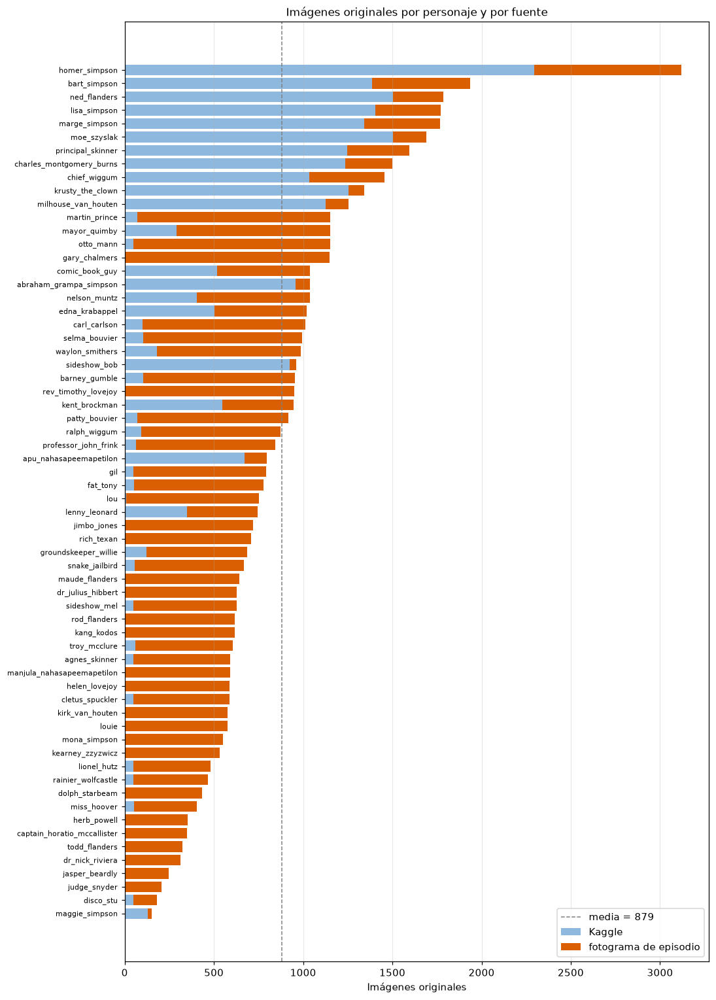

| Conjunto | Originales | Alteradas | Total |
|---|---:|---:|---:|
| Entrenamiento (70 %) | 39.387 | 9.761 | 49.148 |
| Validación (20 %) | 11.254 | 2.876 | 14.130 |
| Test (10 %) | 5.627 | 1.440 | 7.067 |

Ninguna imagen ni ninguna de sus variantes aparece en dos conjuntos, y la desviación máxima de la estratificación es
de 0,35 %. Referencias: azar 1/64 = 0,016 y clase mayoritaria 0,059 en test.

## 6. Preprocesamiento

1. Cada imagen se convierte a RGB y se redimensiona a **128 × 128** con interpolación bilineal (685 s para las
   70.345 imágenes, en la CPU).
2. **Descriptores de la imagen completa** (162 s, unas 430 imágenes por segundo, en paralelo en la CPU):

   | Bloque | Qué mide | Valores |
   |---|---|---:|
   | Color HSV | Histogramas de tono (18 intervalos), saturación (8) y brillo (8) en la imagen completa y en una rejilla 2 × 2 | 170 |
   | Color Lab | Histogramas de L (8), a* (16) y b* (16) en las mismas cinco zonas | 200 |
   | Textura LBP | *Local Binary Patterns* uniformes en rejillas de 4 × 4 y 2 × 2 | 232 |
   | Textura Gabor | Media y desviación de 12 filtros (4 orientaciones × 3 frecuencias) en la rejilla 2 × 2 | 96 |
   | Bordes HOG | Histograma de gradientes orientados en 8 × 8 celdas | 1.764 |

   Con ellos se arman cuatro representaciones: `pixeles` (49.152 valores), `color` (370), `textura` (2.092) y
   `color_textura` (2.462), la del modelo base.
3. Los descriptores se estandarizan con la media y la desviación de **entrenamiento**, dentro del modelo (capa
   `Normalization`); los píxeles, solo en el experimento R1, se escalan a [0, 1] con `Rescaling(1/255)`.
4. Las etiquetas pasan a índice entero y a vector one-hot de 64 posiciones.
5. Los pesos por clase se calculan solo con entrenamiento: la raíz cuadrada del peso balanceado (de 0,55 para Homero
   a 2,48 para Maggie).

Cada paso tiene una celda de comprobación en el notebook.

## 7. Modelo base

| Componente | Configuración |
|---|---|
| Entrada | Los 2.462 descriptores de color y textura, estandarizados dentro del modelo |
| Capas ocultas | Densa de 512 → `BatchNormalization` → ReLU → Dropout 0,3 → densa de 256 → `BatchNormalization` → ReLU → Dropout 0,3 |
| Salida | Densa de 64 con `softmax` |
| Pérdida y optimizador | Entropía cruzada categórica con suavizado de etiquetas de 0,1; Adam, tasa 0,001; batch 128 |
| Parámetros | 1.411.904 (1.410.368 entrenables); la primera capa oculta concentra el 89,4 % |

Con los píxeles aplanados, la misma primera capa tendría 25.166.336 parámetros: los descriptores reducen la entrada
20 veces. Con 1,4 millones de parámetros para 49.148 imágenes de entrenamiento (29 por imagen), el riesgo de
memorizar es alto, y por eso la experimentación mide la regularización y entradas más pequeñas.

## 8. Entrenamiento y regularización

### 8.1 Control del entrenamiento

El modelo se define con Keras y se entrena con un bucle propio sobre PyTorch, con los datos en la VRAM. La red es
pequeña para la tarjeta: a batch 128 la GPU trabaja el 27,8 % del tiempo, y el benchmark de tamaño de lote muestra
que de batch 128 a 2.048 el rendimiento se multiplica por 16,2. El bucle (`pipeline_comun.entrenamiento.entrenar()`)
incluye:

| Mecanismo | Configuración |
|---|---|
| Presupuesto | 60 épocas como máximo para todas las configuraciones |
| Parada temprana | `val_loss` sin mejora en 12 épocas; restaura los pesos de la mejor época |
| Reducción de la tasa | A la mitad tras 4 épocas sin mejora, mínimo 1e-5 |
| Regularización L2 | Opcional (`l2`), sobre los núcleos de las capas densas |
| Aumento de datos | Fuera de línea: las imágenes alteradas. El aumento en línea de la CNN no aplica, porque los descriptores se calculan en la CPU a unas 430 imágenes por segundo y recalcularlos en cada época costaría unos dos minutos por época |
| Reanudación | El historial de cada configuración se guarda en disco con una huella de sus factores; si la corrida se corta, lo ya entrenado se carga en lugar de reentrenarse |

### 8.2 Curvas del modelo base

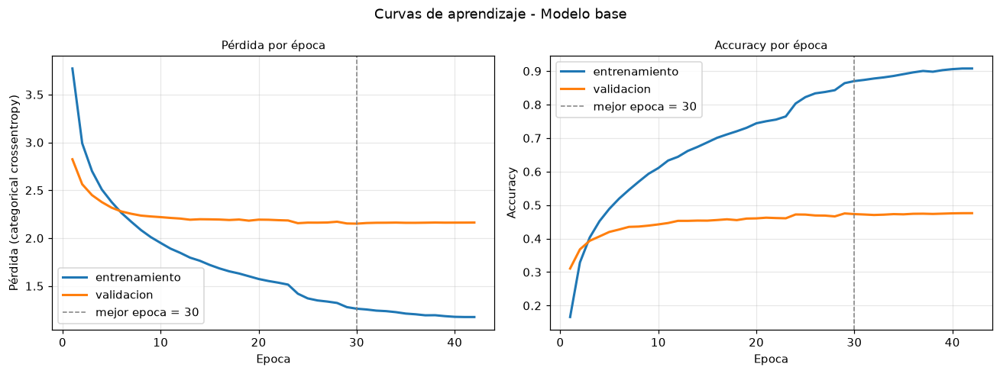

El modelo base se detiene en la época 42 de 60 con su mínimo de `val_loss` (2,151) en la 30. El primer escalón de la
tasa, tras la época 23, sube la accuracy de validación de 0,461 a 0,472. En la mejor época la accuracy es de 0,870 en
entrenamiento y 0,473 en validación: **una brecha de 0,397, sobreajuste claro**. La red memoriza, y la regularización
y la representación de la entrada son las que deben atacarlo.

### 8.3 Parada temprana

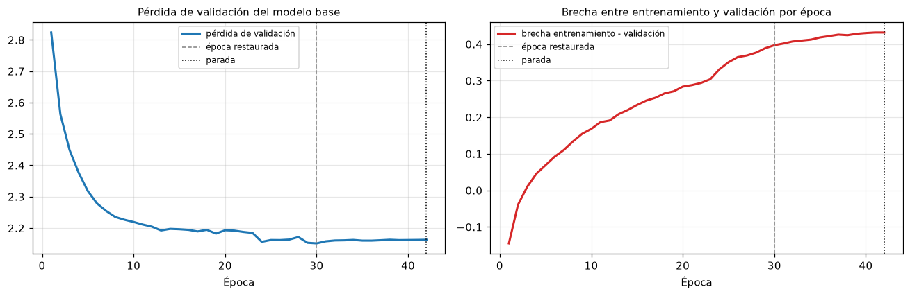

La parada ahorró 18 épocas (unos 45 segundos), pero su aporte principal es la restauración: entre la época 30 y la 42
la pérdida de validación no mejoró (de 2,151 a 2,163) mientras la brecha subía de 0,397 a 0,432 y la accuracy de
validación quedaba casi igual (de 0,473 a 0,476). Sin ella, el modelo final sería el de la última época, más
sobreajustado. Con el mismo presupuesto, 4 de las 18 configuraciones de la experimentación (R2, E6, G2 y C1) y 35 de
las 36 de la búsqueda llegaron al tope, casi todas con su mejor época al final.

### 8.4 Efecto de cada técnica de regularización

Cada técnica se mide frente a la base cambiando solo ese factor, con el mismo presupuesto.

| Técnica | Experimento | Accuracy val. | F1 macro val. | Δ F1 | Brecha | Parada |
|---|---|---:|---:|---:|---:|---|
| Ninguna: la base | Base (dropout 0,3, BatchNorm, suavizado, alteradas) | 0,473 | 0,458 | — | 0,397 | paciencia (42) |
| Dropout | G1 · sin dropout | 0,400 | 0,383 | −7,5 | 0,216 | paciencia (15) |
| Dropout | E6 · dropout 0,5 | 0,474 | 0,460 | +0,2 | 0,284 | tope |
| Batch Normalization | G2 · sin Batch Normalization | 0,460 | 0,447 | −1,1 | 0,367 | tope |
| Regularización L2 | G3 · L2 de 1·10⁻⁴ | 0,464 | 0,452 | −0,7 | 0,311 | paciencia (35) |
| Aumento fuera de línea | A1 · sin alteradas | 0,445 | 0,432 | −2,6 | 0,333 | paciencia (29) |
| Suavizado de etiquetas | S1 · sin suavizado | 0,438 | 0,423 | −3,5 | 0,147 | paciencia (21) |

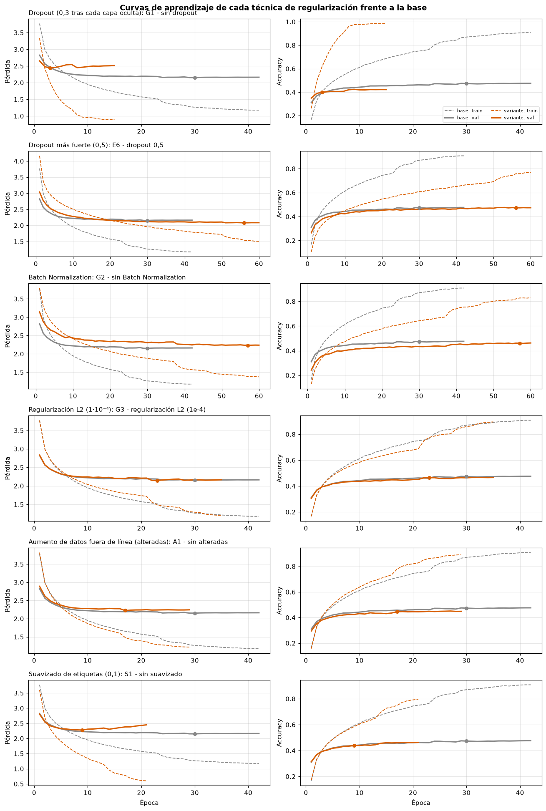

- **Dropout, imprescindible.** Sin él, la pérdida de validación toca su mínimo en la época 3 y sube desde ahí: la red
  memoriza tan rápido que la parada temprana se queda con un modelo casi sin entrenar. Su brecha (0,216) es menor que
  la de la base solo porque paró antes; lo mismo pasa con S1. Subir el dropout a 0,5 deja el F1 igual (+0,2).
- **Suavizado de etiquetas y alteradas, las que suman.** Aportan 3,5 y 2,6 puntos: cambian lo que la red ve al
  entrenar —un objetivo menos tajante, imágenes con otro color y otra textura— en lugar de restringir los pesos.
- **Batch Normalization, aporte pequeño.** Sin ella se pierden 1,1 puntos y la red aprende más lento (mejor época en
  la 57), aunque cada época cuesta 1,4 s en lugar de 2,5.
- **L2, sin efecto.** Baja el F1 0,7 puntos. Es lo mismo que mostró la CNN.

**Conclusión.** La regularización mejora la generalización, pero no cualquiera: el dropout es necesario, y lo que
además mejora la validación es cambiar lo que la red ve (suavizado, alteradas y, sobre todo, la entrada de §9), no
restringir más los pesos.

## 9. Optimización

**Estrategia de búsqueda.** Dos estrategias complementarias, las dos con el presupuesto de 60 épocas y paciencia 12:

1. **Un factor a la vez** alrededor del modelo base, para atribuir cada diferencia a una causa: representación de la
   entrada (R1-R3), arquitectura y optimización (E1-E6), datos (P1, P2, S1, A1) y regularización (G1-G3), más la
   combinación C1 de los factores que superaron a la base (solo color, tres capas, dropout 0,5 y pesos balanceados).
2. **Grid Search completo** (`optimizar_modelo(estrategia="grid")`) sobre la entrada y la arquitectura de C1: tasa de
   aprendizaje {10⁻³, 5·10⁻⁴} × dropout {0,2, 0,3, 0,5} × L2 {0, 10⁻⁵, 10⁻⁴} × batch {128, 512}, 36 configuraciones.
   En el MLP una grilla cabe: cada configuración cuesta entre uno y cuatro minutos, y las 36 tomaron 76 minutos.

| Exp. | Cambio | Accuracy val. | F1 macro val. | Brecha | Parada |
|---|---|---:|---:|---:|---|
| **GS01** | **Grid Search: solo color, 3 capas, tasa 10⁻³, dropout 0,2, sin L2, batch 128** | **0,560** | **0,563** | 0,337 | tope |
| GS03 | Como GS01, con L2 de 10⁻⁵ | 0,561 | 0,562 | 0,337 | tope |
| GS21 | Como GS03, con tasa 5·10⁻⁴ | 0,555 | 0,562 | 0,330 | tope |
| R2 | Solo color (370 valores) | 0,521 | 0,527 | 0,155 | tope |
| C1 | Solo color + 3 capas + dropout 0,5 + pesos balanceados | 0,498 | 0,505 | 0,039 | tope |
| E2 | 3 capas (1024, 512, 256) | 0,483 | 0,471 | 0,386 | paciencia |
| P2 | Pesos balanceados completos | 0,479 | 0,467 | 0,360 | paciencia |
| E6 | Dropout 0,5 | 0,474 | 0,460 | 0,284 | tope |
| Base | Color y textura, 2 capas (512, 256) | 0,473 | 0,458 | 0,397 | paciencia |
| G3 | L2 de 10⁻⁴ | 0,464 | 0,452 | 0,311 | paciencia |
| G2 | Sin Batch Normalization | 0,460 | 0,447 | 0,367 | tope |
| P1 | Sin pesos por clase | 0,462 | 0,444 | 0,338 | paciencia |
| E5 | Batch 512 | 0,457 | 0,444 | 0,358 | paciencia |
| E1 | 1 capa (512) | 0,457 | 0,441 | 0,373 | paciencia |
| A1 | Sin imágenes alteradas | 0,445 | 0,432 | 0,333 | paciencia |
| E4 | Tasa de aprendizaje 0,0001 | 0,439 | 0,426 | 0,370 | paciencia |
| S1 | Sin suavizado de etiquetas | 0,438 | 0,423 | 0,147 | paciencia |
| G1 | Sin dropout | 0,400 | 0,383 | 0,216 | paciencia |
| E3 | Activación tanh | 0,399 | 0,380 | 0,264 | paciencia |
| R3 | Solo textura (2.092 valores) | 0,299 | 0,284 | 0,271 | paciencia |
| R1 | Píxeles crudos (49.152 valores) | 0,243 | 0,213 | 0,137 | paciencia |

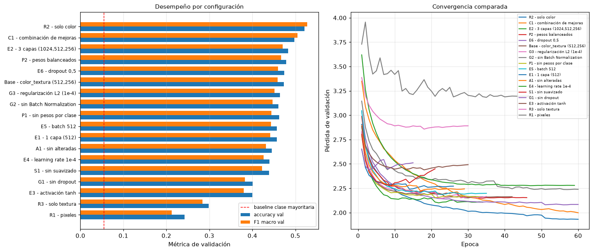

**La representación decide.** El color solo (R2) supera a color y textura por 6,9 puntos de F1 con la cuarta parte de
los parámetros; la textura sola y los píxeles crudos quedan muy atrás. Los personajes de la serie se distinguen por su
paleta, y todos están dibujados con el mismo trazo: la textura suma sobre todo valores para memorizar. En cambio, una
tercera capa aporta 1,2 puntos, la tanh resta 7,9 y la tasa de 0,0001 no llega a converger en 60 épocas (−3,2).

**Grid Search.** El dropout es el factor que decide: en promedio, las configuraciones con 0,2 llegan a 0,556 de F1
macro, las de 0,3 a 0,546 y las de 0,5 a 0,493. La tasa (0,5 puntos), el batch (0,6 a favor de 128) y L2 (menos de
0,3) apenas mueven el resultado. La grilla corrige a la experimentación de un factor: C1 había heredado el dropout
0,5 de E6, que mejoraba al modelo base de 2.462 valores, pero con la entrada de solo color ese dropout sobra. Es una
interacción entre factores que solo la grilla puede ver. GS13, que repite la configuración de C1, obtiene exactamente
su F1 (0,5052): el entrenamiento es reproducible con la misma semilla.

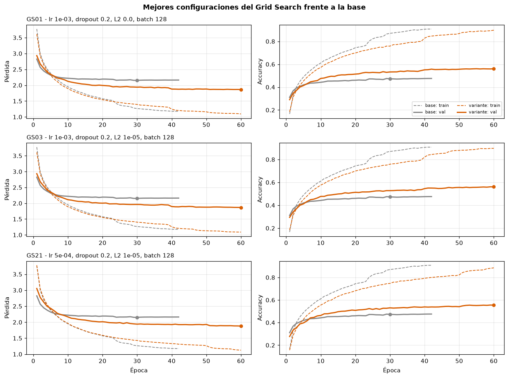

**Selección.** Gana **GS01**, por F1 macro de validación. Con GS03 y GS21 es un empate en la práctica (menos de 0,2
puntos), y GS01 es la más simple de las tres: no usa L2. Frente a C1 sube 5,8 puntos y frente a la base, 10,5. La
reserva: 35 de las 36 configuraciones de la grilla llegaron al tope de 60 épocas, y GS01 tuvo su mejor época en la
última, así que todavía podía mejorar.

## 10. Evaluación y auditoría en test

El test se abre una sola vez, con el modelo elegido.

| Métrica | Valor |
|---|---:|
| Accuracy | 0,556 |
| Precision macro / ponderada | 0,558 / 0,556 |
| Recall macro / ponderado | 0,560 / 0,556 |
| F1 macro / ponderado | 0,557 / 0,554 |
| Top-3 accuracy | 0,732 |
| ROC-AUC macro / ponderada / micro | 0,940 / 0,935 / 0,944 |
| Accuracy por escena (referencia) | 0,648 |

El MLP supera al azar 35,6 veces y a la clase mayoritaria 9,4 veces. El F1 macro de test (0,557) queda 0,6 puntos
bajo el de validación (0,563): elegir entre 54 configuraciones por su F1 de validación apenas infló la cifra.

- **Por personaje.** 27 de 64 tienen F1 de 0,60 o más y 3 quedan bajo 0,30: Maggie (0,21), Todd Flanders (0,22) y Rod
  Flanders (0,24). Los mejores son personajes de paleta inconfundible —Kang y Kodos (0,81), el capitán McCallister
  (0,79), Apu (0,71), Comic Book Guy y Sideshow Bob (0,70)—; Bart, Lisa y Homero, con más de 1.500 imágenes de
  entrenamiento cada uno, quedan en 0,37, 0,41 y 0,43. La correlación entre imágenes de entrenamiento y F1 es de
  −0,04: el tamaño no explica el desempeño, la paleta sí.
- **ROC-AUC.** 11 de 64 personajes quedan bajo 0,90; los peores son Maggie (0,838), Maude Flanders (0,849) y Homero
  (0,861), cuya paleta amarilla es la más genérica de la serie. Judge Snyder tiene 0,996 de ROC-AUC y 0,61 de F1: el
  modelo lo pone alto en el ranking, pero a menudo en segundo lugar.

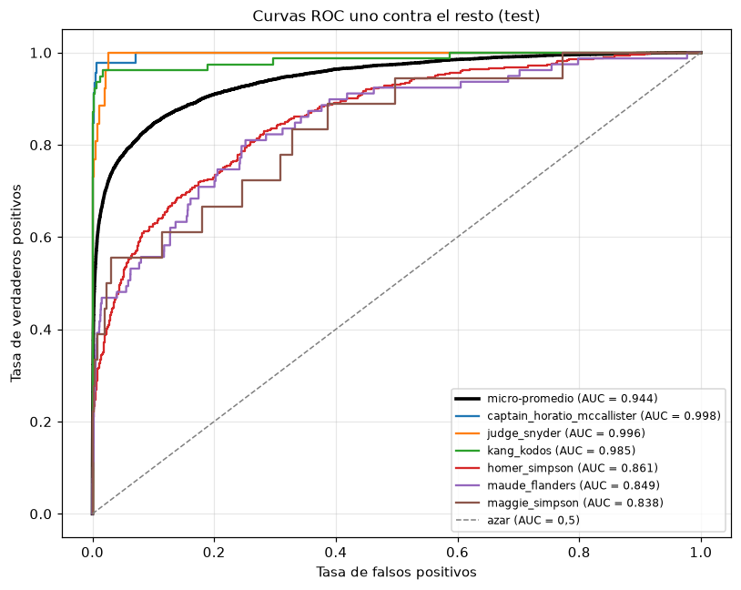

- **Matriz de confusión.** Recall medio de 0,559. Las confusiones son de personajes que comparten paleta —Bart y Lisa
  se confunden entre sí 70 veces, Homero se predice como Bart 18 veces—, de personajes dibujados casi iguales —Selma
  como Patty en el 33,6 % de sus imágenes, Todd como Rod en el 42,5 %— o que salen juntos —Wiggum y Lou, Chalmers y
  Skinner, Burns y Smithers—.
- **Escenas.** El 23,9 % del test tiene otro personaje presente; ahí la accuracy es 0,369, frente a 0,614 en el resto,
  y el 20,8 % de los errores nombra a un personaje que sí está en la escena.
- **Tipos de imagen.** Originales 0,564, parecidas 0,641 y alteradas 0,474: el cambio de color de las alteradas le
  cuesta 9,0 puntos, porque cambia justo lo que el modelo mira, y gana 7,8 con las tomas casi idénticas a otra.
- **Errores.** 3.141 (44,4 %). La confianza separa aciertos (0,74) de errores (0,42); 401 errores superan 0,80 y 231
  superan 0,90.

## 11. Explicabilidad: importancia por permutación y SHAP

El MLP no recibe la imagen sino sus descriptores, así que no se le puede dibujar un mapa de calor encima: se explica
qué descriptores usa.

**Importancia por permutación.** Barajar entre las imágenes de test el bloque HSV baja el F1 macro de 0,557 a 0,08, y
barajar el Lab, a 0,12. La red depende por completo del color, y de los dos espacios a la vez: no usa uno como
respaldo del otro.

**SHAP.** `shap.GradientExplainer` reparte la probabilidad de la clase predicha entre los 370 descriptores, imagen por
imagen, sobre 400 imágenes de test con 200 de entrenamiento como fondo. Los valores se agrupan por canal de color y
por zona (la imagen completa y sus cuatro cuadrantes):

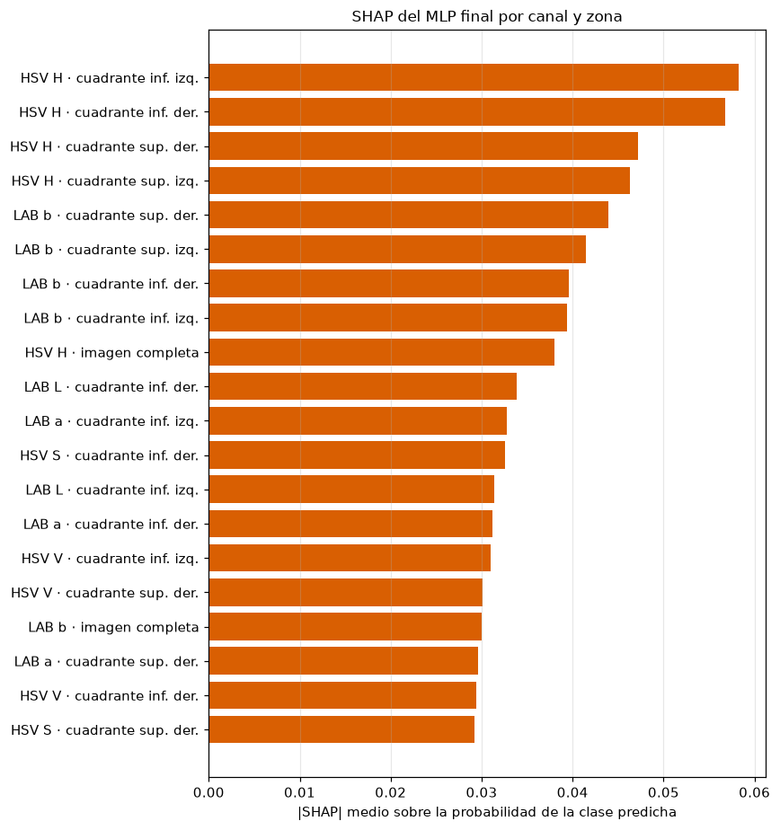

- **El tono pesa más que el brillo.** El canal H de HSV reúne el 24,5 % de la explicación y el eje b* de Lab (del azul
  al amarillo) el 19,3 %; la saturación, el brillo y los ejes L y a*, entre el 13,7 % y el 14,3 % cada uno. HSV y Lab
  quedan casi parejos (52,2 % y 47,8 %).
- **Importa dónde está el color.** Los cuatro cuadrantes reúnen el 84,8 % y el histograma de la imagen completa el
  15,2 %: la red usa en qué zona aparece cada color, no solo cuánto hay.

La explicación es exacta sobre lo que la red usa, pero lo que usa son proporciones de color por cuadrante: no hay
forma, ni peinado, ni cara. Explica por qué falla: dos personajes con la misma paleta son, para el MLP, casi la misma
entrada.

**Recreación de cada personaje.** El anexo del notebook genera una imagen de cada personaje solo desde el MLP de
píxeles (R1), con DeepInversion. El MLP reconoce las 64 recreaciones que genera, con 0,988 de probabilidad media,
pero son manchas de color sin forma, y las dos CNN reconocen 3 y 2 de las 64, lo mismo que el azar: lo que separa a
los personajes para el MLP no es lo que usa la CNN.

## 12. Auditoría, sesgos e impacto ético

`auditar_modelo()` audita el modelo final sin volver a entrenar: ROC-AUC, calibración, un umbral de revisión elegido
en validación y el desempeño por subgrupo.

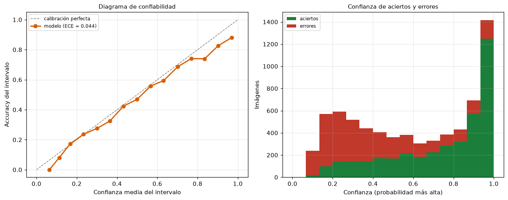

- **Calibración.** ECE de 0,044. El modelo es **levemente sobreconfiado**: confianza media de 0,598 frente a una
  accuracy de 0,556. Está mejor calibrado que la CNN (0,078), así que su confianza se puede leer casi como una
  probabilidad.
- **Umbral de revisión.** Elegido en validación para que lo aceptado acierte al menos el 90 %: 0,958. En test el
  sistema resuelve solo el **14,3 %** de las imágenes con una accuracy de **0,897** (en validación, 15,0 % y 0,900) y
  manda el 85,7 % a revisión, donde acertaría el 50 %. La CNN, con su umbral, resuelve sola el 71,6 %.

| Variable | Grupos | Accuracy en test | Brecha |
|---|---|---|---:|
| Origen | Kaggle / fotograma de episodio | 0,627 / 0,508 | 11,9 puntos |
| Familia Simpson | familia / resto | 0,464 / 0,577 | 11,3 puntos |
| Tamaño de la clase | pequeñas / medianas / grandes | 0,571 / 0,556 / 0,550 | 2,1 puntos |
| Tipo de imagen | parecida / original / alterada | 0,641 / 0,564 / 0,474 | 16,8 puntos |

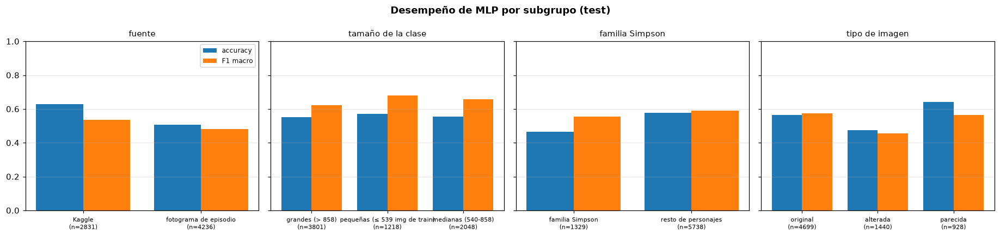

- **Sesgo contra la familia Simpson.** Es el sesgo propio del MLP: los siete personajes de la familia aciertan 11,3
  puntos menos que el resto, y la CNN no tiene esa brecha (0,5 puntos). Los histogramas de color no separan a
  personajes que comparten la piel amarilla, y son justo los más buscados en un archivo de la serie.
- **Sesgo de origen.** 0,627 en las imágenes de Kaggle (F1 macro de 0,537) y 0,508 en los fotogramas de episodio
  (0,480). La brecha es menor que en la CNN (26,3 puntos) porque el MLP también rinde poco con las imágenes de Kaggle,
  no porque maneje mejor los fotogramas. La cifra que representa un archivo de episodios es la de los fotogramas.
- **Sesgo de selección de la ampliación.** Parte de los fotogramas entró al dataset con la herramienta de Frinkiac,
  que usó la CNN de octubre para decidir cuáles eran «seguros». En el MLP no se ve que eso los haga más fáciles: rinden
  12 puntos por debajo de las imágenes de Kaggle. Aun así, el dataset subrepresenta los fotogramas que ningún modelo
  reconocía.
- **Desbalance y parecido.** El tamaño de la clase no pesa: las pequeñas aciertan incluso algo más que las grandes. Lo
  que pesa es parecerse a otro o salir con él: usado para medir presencia en pantalla, el catálogo contaría a Judge
  Snyder 1,38 veces sus apariciones reales y a Patty Bouvier 1,20, a Homero 0,79 y a Maggie 0,61. Ese error llegaría
  directamente a decisiones de licencias o de merchandising.
- **Ruido en las etiquetas.** La auditoría de errores de la CNN encontró imágenes cuya carpeta no corresponde al
  personaje que muestran (Agnes Skinner en la carpeta de Helen Lovejoy, Ned Flanders en la de Maude); están también en
  el entrenamiento y el test del MLP. Hay que limpiarlas antes de usar el catálogo para medir algo.
- **Revisión humana.** Se equivoca en el 44,4 % del test, 401 errores superan una confianza de 0,80 y siempre responde
  algún personaje. Debe usarse como asistente con revisión casi completa: aceptar solo lo que supera el umbral de
  0,958, mostrar las tres sugerencias en el resto (73,2 % de cobertura) y revisar a mano todo lo que afecte a terceros.
- **Derechos de autor.** Personajes y fotogramas son obras protegidas; se usan solo con fines académicos y ni el
  dataset ni los modelos se versionan.
- **Fuera del dominio.** Con fotos de personas reales sería un sistema de reconocimiento de personas, con problemas de
  privacidad y consentimiento que el proyecto no aborda: no debe usarse así.

## 13. Comparación entre el MLP y la CNN

### 13.1 Desempeño y costo

| Concepto | MLP · GPU 128 × 128 | CNN · GPU 128 × 128 | Diferencia |
|---|---:|---:|---|
| Configuración final | GS01 del Grid Search, sobre 370 valores de color | G4, aumento de datos en línea | |
| Parámetros | 1.059.648 | 473.120 | La CNN tiene menos de la mitad |
| Accuracy | 0,556 | 0,775 | +22,0 puntos |
| Precision / recall macro | 0,558 / 0,560 | 0,754 / 0,762 | +19,6 / +20,2 |
| F1 macro | 0,557 | 0,755 | +19,8 |
| F1 ponderado | 0,554 | 0,776 | +22,2 |
| Top-3 accuracy | 0,732 | 0,908 | +17,7 |
| ROC-AUC macro | 0,940 | 0,987 | +4,7 |
| Accuracy por escena (referencia) | 0,648 | 0,848 | +20,0 |
| Error de calibración (ECE) | 0,044 | 0,078 | El MLP está mejor calibrado |
| Errores con confianza > 0,80 | 401 | 137 | |
| Segundos por época (benchmark) | 2,25 | 51,7 | 23 veces más |
| Inferencia de la red sola | 76.661 img/s | 3.553 img/s | |
| Catalogación de extremo a extremo | 1.360 img/s, limitada por los descriptores en la CPU | 3.567 img/s | La CNN, 2,6 veces más rápida |
| Uso de la GPU | 27,8 %, unos 11 W | 99,4 %, unos 70 W | |

Las cifras salen de los resúmenes JSON de las dos redes, que tienen las mismas claves, y de las salidas de sus
notebooks: la corrida del MLP del 15-11-2026 y la de la CNN del 14-11-2026. El tiempo total de entrenamiento no se
compara: el MLP entrenó 54 configuraciones en 1 h 46 min y la CNN 26 en 15 h 47 min.

### 13.2 Capacidad de generalización

| Indicador | MLP | CNN |
|---|---:|---:|
| Brecha entre entrenamiento y validación del modelo base | 0,397 | 0,142 |
| Brecha del modelo final | 0,337 | 0,033 |
| Caída en las alteradas frente a las originales (puntos) | 9,0 | 1,2 |
| Ventaja de las parecidas sobre las originales (puntos) | 7,8 | 6,1 |
| Errores con confianza > 0,80 por cada 1.000 imágenes de test | 56,7 | 19,4 |

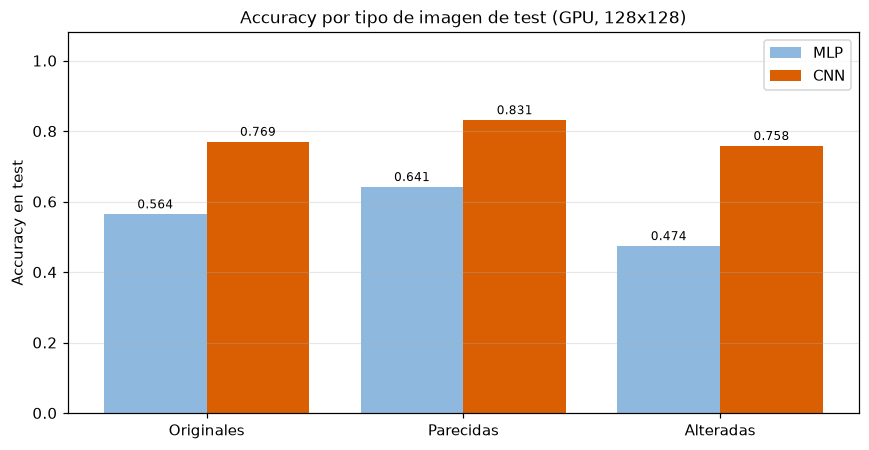

La CNN memoriza menos, resiste mejor las alteraciones y comete menos errores confiados. Las dos redes ganan algo
parecido con las tomas casi idénticas a otra: haber visto casi la misma toma ayuda a cualquier modelo, y por eso la
partición por grupo de tomas es una de las propuestas.

### 13.3 Interpretabilidad

| | SHAP (MLP) | Permutación por bloque (MLP) | Grad-CAM (CNN) |
|---|---|---|---|
| Qué explica | Cuánto aporta cada grupo de descriptores a la probabilidad de la clase predicha | Cuánto cae el F1 macro de test al barajar un bloque | Qué zona de la imagen sube la probabilidad de la clase |
| Granularidad | Canal de color × zona, por imagen | Bloque de descriptores | Un mapa de 16 × 16 sobre la imagen, por predicción y por clase |
| Costo | Cientos de evaluaciones por imagen, sobre una muestra | Una evaluación del test por bloque | Una pasada hacia adelante y una hacia atrás por imagen |
| Limitación | Explica descriptores, no la imagen | Global, no explica una predicción | Resolución gruesa; dice dónde, no qué rasgo |

SHAP es exacto sobre lo que el MLP usa, pero lo que usa —proporciones de color por cuadrante— no es lo que una
persona mira para reconocer a un personaje. Grad-CAM muestra que la CNN mira al personaje, sobre todo a la cara (el
10 % de píxeles más cálidos reúne el 72,7 % de la influencia), y se puede verificar a simple vista. La CNN es la más
interpretable para quien usa el catálogo.

### 13.4 Ventajas, desventajas y arquitectura seleccionada

| | Ventajas | Desventajas |
|---|---|---|
| **MLP** | Cada época cuesta 23 veces menos y una grilla completa de 36 configuraciones toma 76 minutos; la red sola infiere 76.661 imágenes por segundo; apenas ocupa la GPU; mejor calibrado (ECE de 0,044) | No aprende de la imagen: combina histogramas de color y confunde a los personajes que comparten paleta (la familia Simpson, con F1 de 0,37 a 0,64 y 11,3 puntos de sesgo); memoriza más (brecha de 0,397); calcular los descriptores en la CPU limita su velocidad de extremo a extremo (1.360 imágenes por segundo); con el umbral de revisión solo automatiza el 14,3 % |
| **CNN** | Aprende sus propios filtros y reconoce la forma (la familia Simpson sube a F1 de 0,78 a 0,82); 22 puntos más de accuracy con menos de la mitad de parámetros; generaliza mejor; cataloga 2,6 veces más rápido de extremo a extremo; Grad-CAM explica cada decisión | Entrenar cuesta 23 veces más por época y exige GPU; a 128 × 128 dos configuraciones no caben en 8 GB; el modelo base sobreajusta si no se le da variedad a los datos |

**La CNN es la arquitectura seleccionada.** Gana en todos los criterios menos en el costo de entrenamiento y en la
calibración. El costo se paga una sola vez —unos 50 minutos por configuración en la RTX 4060, frente a unos 3 del
MLP—, mientras que la calidad, la automatización y la catalogación se aprovechan en cada imagen del archivo; y la
mejor calibración del MLP no compensa que se equivoque en el 44 % del test. El MLP solo sería preferible donde no haya
GPU para entrenar y baste con reconocer a los personajes de paleta única.

## 14. Limitaciones y medidas para la robustez y la confiabilidad

| Limitación | Medida propuesta |
|---|---|
| El MLP no ve la forma: confunde a los personajes que comparten paleta y tiene 11,3 puntos de sesgo contra la familia Simpson | Una red que aprenda sus propias características (la CNN) o transfer learning; con un MLP, descriptores de forma solo en la zona de la cabeza |
| Los histogramas cuentan el fondo igual que al personaje | Calcular los descriptores sobre la caja de cada personaje que da `scripts/newDataset/detectar_cajas.py` |
| Sesgo de origen: 0,51 en fotogramas de episodio frente a 0,63 en Kaggle | Más fotogramas con planos generales y varios personajes, sin filtrarlos con un modelo anterior; informar siempre la cifra por origen |
| Personajes que salen siempre juntos (Patty y Selma, Rod y Todd, Wiggum y Lou) | Nombrar a cada personaje en su propia caja o una salida multietiqueta con sigmoides |
| 35 de las 36 configuraciones de la grilla y el modelo final pararon por el tope, todavía mejorando | Más épocas para la búsqueda |
| Sensible al cambio de color: −9,0 puntos en las alteradas | Más variantes de color en entrenamiento; descriptores menos sensibles al tono (por ejemplo, normalizados por imagen) |
| Poca automatización: el umbral de revisión solo acepta el 14,3 % del test | Usarlo como asistente con las tres sugerencias; para automatizar, la CNN |
| Costo de catalogación con poco margen (1.360 imágenes por segundo) | Calcular solo los descriptores de color, ya en uso, y paralelizar en más núcleos o en la GPU |
| Una sola semilla: las tres mejores de la grilla quedan a menos de 0,2 puntos | Varias semillas o validación cruzada, reportando media y desviación |
| Tomas casi idénticas a otra (+7,8 puntos) | Partición por grupo de tomas o por episodio |
| Ruido en las etiquetas | Revisar las imágenes con errores de confianza muy alta o muy baja y sacar de su carpeta las que no muestran al personaje |
| El modelo siempre responde algún personaje | Umbral de confianza para derivar a revisión humana (0,958) |

## 15. Reproducibilidad y estructura de entrega

```text
CNN/docs/EP3_TLY1102_Instrucciones Estudiante.docx    # encargo de la evaluación
PMC/docs/newDataset/Informe.md                        # este informe
PMC/docs/newDataset/figuras/                          # figuras del informe, guardadas por el notebook
PMC/notebooks/LosSimpsons_GPU_4060M.ipynb             # notebook evaluado, con salidas
PMC/notebooks/README.md
PMC/presentacion_resultados_PMC.html                  # presentación de resultados
PMC/resultados/newDataset/GPU/rendimiento_gpu_128x128.json
PMC/resultados/newDataset/recreaciones/               # recreación de cada personaje desde el MLP
scripts/newDataset/pipeline_comun/                    # funciones del pipeline, comunes al MLP y la CNN
scripts/newDataset/tests/                             # pruebas del módulo común
scripts/newDataset/generar_imagenes_alteradas.py      # prepara el dataset para el MLP y la CNN
scripts/newDataset/generar_presentacion.py            # genera las presentaciones desde los resultados
CNN/notebooks/LosSimpsons_GPU_4060M.ipynb             # CNN de la comparación
```

**Ejecución.** Crear el entorno `.venv-gpu` con `requirements-gpu-windows.txt`, ubicar el dataset (o fijar
`SIMPSONS_DATASET`), ejecutar una vez `scripts/newDataset/generar_imagenes_alteradas.py` y ejecutar el notebook
completo con el kernel de `.venv-gpu`. Con `SIMPSONS_PRUEBA=1` el notebook corre de punta a punta con 40 imágenes por
personaje, 2 épocas y una grilla de 2 configuraciones, y escribe en carpetas `prueba/` aparte: sirve para comprobarlo
antes de la corrida completa. Las pruebas del módulo común se ejecutan con `pytest scripts/newDataset/tests`. La
ejecución local quedó acordada con el profesor en lugar de Google Colab.

**Estado de las salidas.** Las salidas son las de la corrida completa del 15-11-2026 (de 11:22 a 13:25, 2 h 2 min
44 s), ejecutada de principio a fin sin intervención: las 84 celdas de código terminaron sin errores. Después de la
corrida solo se volvió a ejecutar la celda de los KPIs, con la medición del costo corregida (§3).

## 16. Conclusiones

El MLP aprende el problema: con descriptores de color alcanza una accuracy de test de 0,556, un F1 macro de 0,557 y una
ROC-AUC macro de 0,940, 9,4 veces la clase mayoritaria, y cumple los cinco KPIs. Pero reconoce paletas, no personajes,
y la CNN, con el mismo pipeline, los mismos datos y la misma resolución, lo supera en 22 puntos de accuracy y 20 de F1
macro.

La optimización y la auditoría de la EP3 dejan cuatro lecciones. **La representación de la entrada pesa más que la
capacidad**: pasar a solo color suma 6,9 puntos de F1, y una tercera capa, 1,2. **Un factor a la vez no ve las
interacciones**: el dropout que mejoraba al modelo base sobraba con la entrada de solo color, y solo el Grid Search lo
mostró (+5,8 puntos sobre C1). **La regularización que sirve es la que cambia lo que la red ve**: el dropout es
imprescindible, el suavizado y las alteradas suman, y L2 no aporta, igual que en la CNN. **La auditoría encuentra lo
que la accuracy esconde**: el modelo acierta 11,3 puntos menos en la familia Simpson y 11,9 menos en los fotogramas
de episodio, y aunque está bien calibrado, solo puede catalogar sin revisión el 14,3 % del test al 90 % de acierto.

Por eso la arquitectura seleccionada es la CNN. El MLP queda como línea base y como evidencia de por qué existen las
redes convolucionales: sus límites —no ver la forma, contar el fondo igual que al personaje— son justo los que la
convolución y el pooling vienen a resolver.

## Referencias

- Alfaro, A. (s. f.). *Los Simpson* [conjunto de datos]. Kaggle. https://www.kaggle.com/datasets/alfaro96/los-simpson
- Rumelhart, D. E., Hinton, G. E. y Williams, R. J. (1986). Learning representations by back-propagating errors.
  *Nature, 323*, 533-536.
- Kingma, D. P. y Ba, J. (2015). Adam: A method for stochastic optimization. *ICLR 2015*.
  https://arxiv.org/abs/1412.6980
- Ioffe, S. y Szegedy, C. (2015). Batch Normalization: Accelerating deep network training by reducing internal
  covariate shift. *ICML 2015*. https://arxiv.org/abs/1502.03167
- Srivastava, N., Hinton, G., Krizhevsky, A., Sutskever, I. y Salakhutdinov, R. (2014). Dropout: A simple way to
  prevent neural networks from overfitting. *Journal of Machine Learning Research, 15*, 1929-1958.
- Szegedy, C., Vanhoucke, V., Ioffe, S., Shlens, J. y Wojna, Z. (2016). Rethinking the Inception architecture for
  computer vision. *CVPR 2016*. https://arxiv.org/abs/1512.00567 (suavizado de etiquetas)
- Ojala, T., Pietikäinen, M. y Mäenpää, T. (2002). Multiresolution gray-scale and rotation invariant texture
  classification with local binary patterns. *IEEE TPAMI, 24*(7), 971-987.
- Dalal, N. y Triggs, B. (2005). Histograms of oriented gradients for human detection. *CVPR 2005*.
- Bergstra, J. y Bengio, Y. (2012). Random search for hyper-parameter optimization. *Journal of Machine Learning
  Research, 13*, 281-305.
- Guo, C., Pleiss, G., Sun, Y. y Weinberger, K. Q. (2017). On calibration of modern neural networks. *ICML 2017*.
  https://arxiv.org/abs/1706.04599
- Lundberg, S. M. y Lee, S.-I. (2017). A unified approach to interpreting model predictions. *NeurIPS 2017*.
  https://arxiv.org/abs/1705.07874
- Breiman, L. (2001). Random forests. *Machine Learning, 45*, 5-32. (importancia por permutación)
- Yin, H., Molchanov, P., Alvarez, J. M., Li, Z., Mallya, A., Hoiem, D., Jha, N. K. y Kautz, J. (2020). Dreaming to
  distill: Data-free knowledge transfer via DeepInversion. *CVPR 2020*. https://arxiv.org/abs/1912.08795
