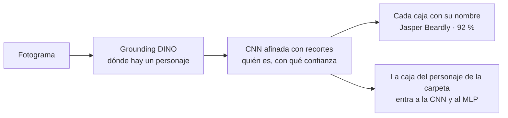
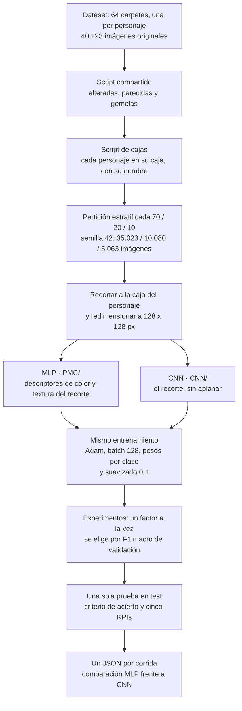
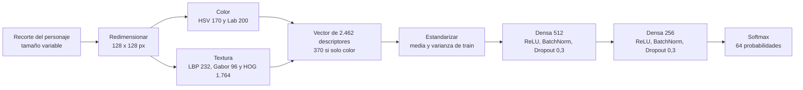
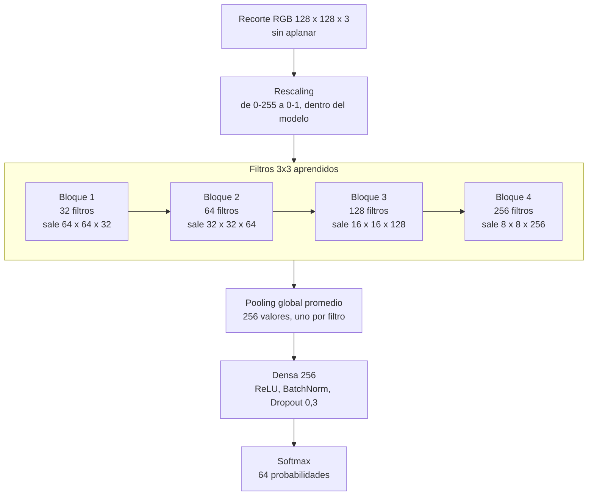
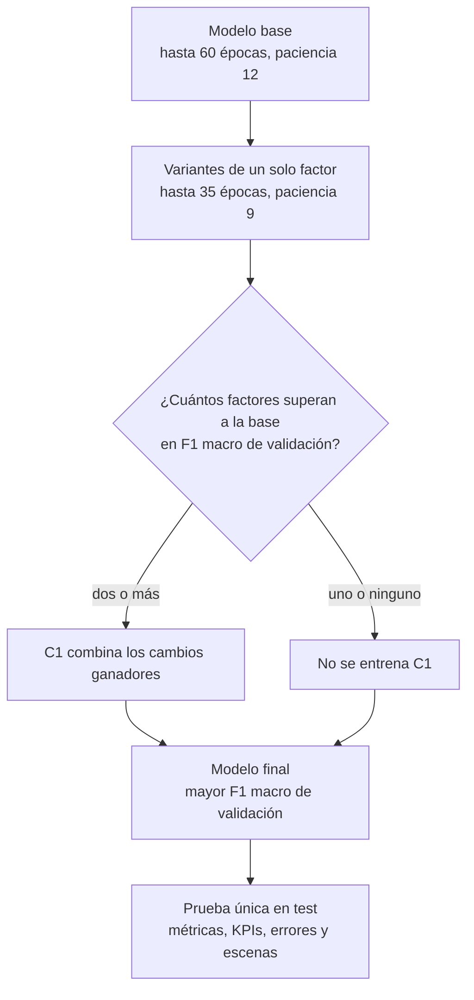

# Clasificador de personajes de Los Simpson: MLP frente a CNN

Este repositorio es una **comparativa entre dos redes neuronales** que identifican qué personaje de Los Simpson aparece en una imagen RGB: un **perceptrón multicapa (MLP)** y una **red neuronal convolucional (CNN)**. Las dos se entrenan y se evalúan con exactamente el mismo proceso, a 128 × 128 en la misma GPU (NVIDIA GeForce RTX 4060 Laptop): el mismo dataset de 64 personajes, la misma partición, las mismas imágenes alteradas y parecidas, la misma caja alrededor de cada personaje, el mismo bucle de entrenamiento, los mismos experimentos, el mismo criterio de acierto y los mismos KPIs. Así, la diferencia entre sus resultados se debe al modelo: el MLP recibe descriptores de color y textura elegidos a mano, calculados sobre el recorte del personaje; la CNN recibe ese recorte y aprende sus propios filtros.

<p align="center">
  
</p>

## En resumen

| | MLP | CNN |
|---|---|---|
| Carpeta | [PMC/](PMC/) | [CNN/](CNN/) |
| Qué recibe | 2.462 descriptores de color y textura del recorte de cada personaje, calculados en la CPU; con la imagen completa, el modelo final usaba los 370 de color | El recorte del personaje, de 128 × 128 × 3, sin aplanar |
| Cómo obtiene sus características | Elegidas a mano: histogramas HSV y Lab, LBP, Gabor y HOG | Aprendidas: filtros de 3 × 3 que recorren el recorte |
| Corrida con la imagen completa | GPU a 128 × 128, del 16-10-2026 | GPU a 128 × 128, del 19-10-2026 |
| Resultado en test, con la imagen completa | Accuracy 0,586 y F1 macro 0,559 (C1) | **Accuracy 0,847 y F1 macro 0,810** (modelo base) |
| Corrida con cajas | Pendiente: notebook de GPU a 128 × 128, resultados en `PMC/resultados/newDataset/cajas/GPU/` | Pendiente: notebook de GPU a 128 × 128, resultados en `CNN/resultados/newDataset/cajas/GPU/` |
| Presentación de resultados | [presentacion_resultados_PMC.html](PMC/presentacion_resultados_PMC.html) | [presentacion_resultados_CNN.html](CNN/presentacion_resultados_CNN.html) |
| Informe técnico | [Informe de la EP1](PMC/docs/oldDataset/Informe.md), sobre el dataset anterior de 25 personajes | [Informe de la EP2](CNN/docs/newDataset/Informe.md): la CNN y su comparación con el MLP |

Las presentaciones son archivos HTML de un solo archivo: descárgalos y ábrelos en el navegador (GitHub solo muestra su código). El botón **Presentar** muestra una diapositiva a la vez en pantalla completa. Todavía muestran las corridas de octubre a varias resoluciones; se rehacen con las corridas a 128 × 128 con cajas.

## Cada personaje en su caja

Un fotograma suele mostrar a varios personajes y la etiqueta (la carpeta) solo nombra a uno. Por eso, antes de entrenar, [scripts/newDataset/detectar_cajas.py](scripts/newDataset/detectar_cajas.py) pone una caja alrededor de cada personaje y le da un nombre con su confianza, sin anotar nada a mano:

1. **Dónde.** Grounding DINO, un detector preentrenado de Hugging Face, encuentra a cada personaje animado. No sabe quién es cada uno: solo dónde está.
2. **Quién.** Una CNN del proyecto, afinada con recortes, nombra cada caja con uno de los 64 personajes y su confianza: si aparece Jasper Beardly, su caja dice `Jasper Beardly · 92 %`.

La caja del personaje de la carpeta es la que entra a los dos modelos: la CNN recibe el recorte y el MLP calcula sus descriptores sobre él. Si en una imagen nadie reconoce al personaje, entra completa. Una predicción acierta solo si nombra al personaje de la caja.



El script mide la cobertura de los 64 personajes y deja hojas de contacto en `cajas_por_revisar/`, junto al dataset, para mirar las cajas sin anotarlas.

## Cómo funciona la comparativa

Todo lo que no es el modelo se comparte: los datos, su preparación, el entrenamiento, la elección de la configuración y la evaluación. Cada corrida deja un JSON con las mismas claves en `resultados/newDataset/cajas/GPU/rendimiento_gpu_128x128.json` (la corrida con la imagen completa, en `resultados/newDataset/GPU/`), así que las dos redes se comparan cifra a cifra.



Las cifras de 35.023 / 10.080 / 5.063 imágenes son las de las corridas de octubre; cambian si el dataset crece, por ejemplo con Frinkiac.

## Cómo funciona cada modelo

### MLP: descriptores elegidos a mano

Cada recorte se resume primero en un vector fijo que calcula la CPU: histogramas de color HSV y Lab, en el recorte completo y en sus cuatro cuadrantes, y descriptores de textura LBP, Gabor y HOG. La red solo ve ese vector. Cada neurona se conecta con todas las entradas y no sabe qué parte de la imagen describe cada una, así que el MLP distingue paletas, no formas. En la corrida con la imagen completa ganó una entrada de solo color (370 valores).



### CNN: filtros que se aprenden

La CNN recibe el recorte del personaje como un tensor de alto × ancho × 3. Cada bloque aplica filtros de 3 × 3 con los mismos pesos en todas las posiciones, normaliza, activa con ReLU y reduce el mapa a la mitad con *max pooling*. Los primeros bloques responden a bordes y zonas de color; el último, con un campo receptivo de 38 × 38 píxeles, a partes del personaje. El pooling global resume cada uno de los 256 mapas en un número, esté donde esté el patrón, y una capa densa decide entre los 64 personajes.



Cada bloque es Conv2D 3 × 3 → BatchNorm → ReLU → MaxPool 2 × 2; la variante E2 usa dos convoluciones por bloque. El modelo base tiene 473.120 parámetros a cualquier resolución: los filtros no cambian con el tamaño de la imagen, solo la cantidad de posiciones que recorren.

### Lo que cambia entre los dos

| | MLP | CNN |
|---|---|---|
| Entrada | Vector de 2.462 descriptores del recorte (370 en el modelo final con la imagen completa) | Tensor del recorte, sin aplanar |
| Estructura espacial | Se pierde: cada neurona ve todo el vector | Se conserva: cada filtro mira una vecindad de 3 × 3 |
| Características | Fijas, elegidas a mano | Aprendidas junto con el resto de la red |
| Dónde se calcula la entrada | En la CPU, antes de la red | Dentro de la red, en la GPU |
| Parámetros del modelo final | 1.059.648 (C1) | 473.120 (modelo base) |
| Explicación de la decisión | Importancia por permutación de cada bloque de descriptores | Grad-CAM sobre la imagen |

## Cómo se entrena y se elige cada modelo

Los dos modelos pasan por el mismo protocolo, con un bucle de entrenamiento propio sobre PyTorch: Adam con tasa `1e-3`, batch 128, pesos por clase (la raíz cuadrada de los balanceados), suavizado de etiquetas 0,1, parada temprana y `ReduceLROnPlateau`. Cada variante cambia un solo factor respecto del modelo base: la entrada, la profundidad, la activación, la tasa de aprendizaje, el batch, el dropout, los pesos por clase, el suavizado o las imágenes alteradas. Las corridas con la imagen completa daban además un 15 % del objetivo a los otros personajes de la escena; con el recorte ya no hace falta.



El test no se toca hasta el final. Una predicción es correcta si nombra al personaje de la caja, que es el de la carpeta. La accuracy por escena, que además acepta a otro personaje presente (misma escena del episodio o imagen gemela en otra carpeta), se informa solo como referencia. Las corridas con la imagen completa usaban ese criterio tolerante, más una verificación por imagen de los errores confiados.

## Resultados con la imagen completa: MLP frente a CNN

Las cifras de esta sección son las de las corridas de octubre, con la imagen completa y el criterio de acierto de entonces: la columna «Estricta» es la comparable con las corridas con cajas. Esas corridas dejan su JSON en `resultados/newDataset/cajas/GPU/` de cada modelo, y cada notebook las compara con estas en su sección «Imagen completa frente a caja».

Corridas en GPU (NVIDIA GeForce RTX 4060 Laptop) a 128 × 128:

| Modelo | Configuración final | Parámetros | Accuracy | Estricta | Top-3 | F1 macro | Entrenamiento | Duración |
|---|---|---:|---:|---:|---:|---:|---:|---:|
| MLP | C1 - combinación | 1.059.648 | 0,586 | 0,539 | 0,751 | 0,559 | 15,9 min | 28 min 14 s |
| CNN | Base - 1 convolución por bloque | 473.120 | **0,847** | **0,797** | **0,937** | **0,810** | 290,5 min | 5 h 08 min 56 s |

Los cinco KPIs tienen umbrales fijados antes de entrenar. Los cuatro de calidad se cumplen en las dos redes; el de costo solo se midió en la CNN:

| KPI | Métrica en test | Umbral | MLP | CNN |
|---|---|---:|---:|---:|
| Cobertura de asistencia | Top-3 accuracy | ≥ 0,70 | 0,751 | 0,937 |
| Equidad entre personajes | F1 macro | ≥ 0,45 | 0,559 | 0,810 |
| Automatización sin revisión | Accuracy | ≥ 0,50 | 0,586 | 0,847 |
| Ventaja sobre lo trivial | Accuracy / clase mayoritaria | ≥ 4× | 7,5× | 10,8× |
| Costo de catalogación | Imágenes por segundo, de extremo a extremo | ≥ 1.000 | sin medir | 3.085 |

**Lo que muestra la comparación**

- **La CNN gana:** 26,1 puntos más de accuracy y 25,1 de F1 macro, con el mismo proceso y los mismos datos. Lo que decide es la representación, no el ajuste fino: en la CNN, ninguna variante de hiperparámetros superó a la base.
- **La forma separa lo que el color confunde.** Homero, Marge, Bart y Lisa comparten la piel amarilla, y el MLP, que solo ve sus histogramas de color, los confunde entre sí; la CNN los sube a un F1 de 0,81 a 0,89.
- **El costo se mueve al entrenamiento.** Entrenar la CNN cuesta 18,3 veces más que el MLP, y la corrida completa pasa de 28 minutos a 5 horas. A cambio, la CNN usa la GPU de verdad (el 98,8 % del tiempo, frente al 33,7 % del MLP) y no calcula descriptores en la CPU antes de clasificar.
- **Los errores de la CNN son de otra naturaleza.** Los del MLP siguen a la paleta; casi todos los errores confiados de la CNN nombran a otro personaje que sí está en la imagen, así que su accuracy es una cota inferior.

Las lecturas completas están en el [README del MLP](PMC/README.md), el [README de la CNN](CNN/README.md) y en las dos presentaciones.

## Lo que comparten los modelos

**Dataset.** 64 personajes y 40.123 imágenes originales, una carpeta por personaje, sin partición previa. No se versiona: por defecto se busca en `~/Desktop/simpsons_dataset`, o en la ruta de la variable de entorno `SIMPSONS_DATASET`. La etiqueta de cada imagen es siempre el nombre de su carpeta.

**Preparación del dataset.** [scripts/newDataset/generar_imagenes_alteradas.py](scripts/newDataset/generar_imagenes_alteradas.py) genera dentro del dataset las variantes alteradas y las versiones filtradas de las imágenes casi idénticas, y registra las imágenes repetidas entre carpetas de personajes distintos. Nunca modifica las originales. Se ejecuta desde la raíz del repositorio cada vez que cambia el dataset:

```powershell
.\.venv-gpu\Scripts\python.exe scripts\newDataset\generar_imagenes_alteradas.py
```

**Cajas alrededor de cada personaje.** Después, también cada vez que cambia el dataset, [scripts/newDataset/detectar_cajas.py](scripts/newDataset/detectar_cajas.py) pone la caja con nombre de cada personaje (ver «Cada personaje en su caja»). Deja `_cajas.csv` y `_cajas_candidatas.csv` en la raíz del dataset, y los notebooks de GPU no se ejecutan sin ellos. La primera vez tarda unas 2 a 2,5 horas en la RTX 4060; las siguientes solo procesan las imágenes nuevas:

```powershell
.\.venv-gpu\Scripts\python.exe -m pip install -r requirements-cajas.txt
.\.venv-gpu\Scripts\python.exe scripts\newDataset\detectar_cajas.py
```

Los pasos completos, con sus opciones y la versión en Docker, están en la [guía del dataset nuevo](PMC/notebooks/newDataset/README.md).

**Ampliación con Frinkiac.** 52 personajes tienen menos de 1000 imágenes originales. `pnpm frinkiac` los completa hasta 1000 con fotogramas de Frinkiac, ubicados con los guiones de Kaggle:
- guarda todo en `frinkiac_ampliacion/`, junto al dataset en el Escritorio;
- deja cada personaje en `por_revisar/` para la revisión manual;
- con `pnpm frinkiac clasificar`, la CNN separa esas imágenes en seguras, dudosas y ruido, y solo se revisan a mano las dudosas;
- al terminar abre un issue en este repositorio.

También puede correr en una EC2 con S3. Solo agrega originales: las variantes sintéticas se generan después, con el script anterior. Los detalles están en [scripts/newDataset/frinkiac/](scripts/newDataset/frinkiac/README.md).

**Entorno.** Keras 3 sobre PyTorch, en Windows nativo (`.venv-gpu`) o en Docker:

| Archivo | Para qué |
|---|---|
| `requirements-gpu-windows.txt` | Entorno `.venv-gpu`: Keras 3 sobre PyTorch con CUDA. Los pasos de instalación están en [PMC/notebooks/oldDataset/README_GPU.md](PMC/notebooks/oldDataset/README_GPU.md). |
| `requirements-newDataset.txt` | scikit-image, para los descriptores de color y textura del MLP del dataset nuevo. |
| `requirements-cajas.txt` | transformers, para el detector de `scripts/newDataset/detectar_cajas.py`. Se instala en `.venv-gpu`; los notebooks no lo necesitan. |
| `Dockerfile` y `docker-compose.yml` | Jupyter Lab con la GPU y el dataset montados: copia `.env.example` como `.env`, pon la ruta del dataset y ejecuta `docker compose up --build`. |

## Estructura del repositorio

```text
.
├── PMC/                            # Perceptrón multicapa: todo su trabajo, con su propio README
│   ├── notebooks/<oldDataset|newDataset>/
│   ├── models_gpu/                 # Modelos .keras regenerables, ignorados por Git
│   ├── resultados/<oldDataset|newDataset>/GPU/
│   ├── scripts/                    # Lanzadores de los notebooks de GPU
│   ├── images/                     # Imágenes de los notebooks y del README del MLP
│   ├── docs/                       # Informe, pauta de la EP1 y material de la unidad
│   ├── presentacion_resultados_PMC.html  # Presentación de resultados del MLP (19 diapositivas)
│   └── README.md
├── CNN/                            # Red convolucional: mismo dataset y mismo proceso, con su propio README
│   ├── notebooks/newDataset/       # Notebook de GPU a 128 × 128 (sin versión para el dataset anterior)
│   ├── models_gpu/                 # Modelos .keras regenerables, ignorados por Git
│   ├── resultados/newDataset/      # JSON de cada corrida a 128 × 128: GPU/ con la imagen completa y cajas/GPU/
│   ├── scripts/                    # Lanzador del notebook de GPU, generador de la presentación y predicción de imágenes
│   ├── images/                     # Imágenes de los notebooks
│   ├── docs/                       # Encargo de la EP2 e informe técnico, con sus figuras
│   ├── presentacion_resultados_CNN.html  # Presentación de resultados de la CNN (29 diapositivas)
│   └── README.md
├── scripts/newDataset/
│   ├── generar_imagenes_alteradas.py  # Prepara el dataset nuevo: alteradas, parecidas y gemelas
│   ├── detectar_cajas.py           # Cada personaje en su caja, con su nombre y su confianza
│   ├── tests/                      # Pruebas de la geometría de las cajas
│   └── frinkiac/                   # pnpm frinkiac: amplía con Frinkiac a 1000 originales por personaje
├── images/logoLosSimpsons.png
├── Dockerfile
├── docker-compose.yml
├── .env.example                    # Ruta del dataset para Docker; se copia como .env
├── requirements-gpu-windows.txt
├── requirements-newDataset.txt
├── requirements-cajas.txt          # transformers, para detectar_cajas.py
├── package.json                    # Atajos de pnpm (pnpm frinkiac)
└── README.md                       # Este documento
```

Cada modelo sigue la misma organización: una carpeta propia con `notebooks/`, `models_gpu/`, `resultados/` y `scripts/`, y dentro de cada una una subcarpeta por dataset.

## Integrantes

- Vincent Farenden Cerón
- Rodrigo Ignacio Martínez Becker
- Iván Manuel Pavón Barría
- Diego Ignacio Peña y Lillo Luhrs

Trabajo para la asignatura **Técnicas Avanzadas para Machine Learning_001D**.
