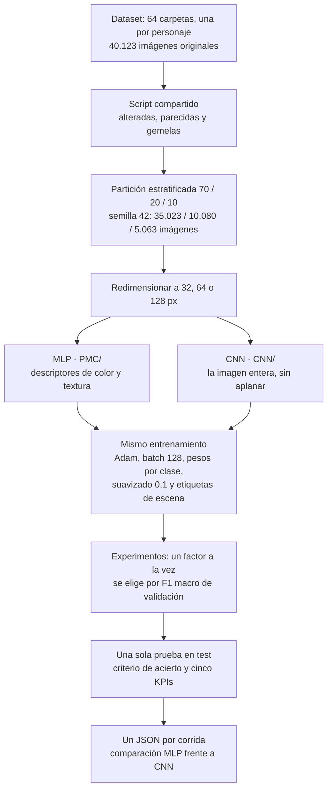
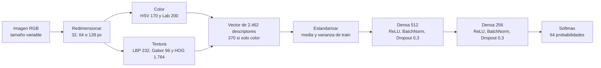
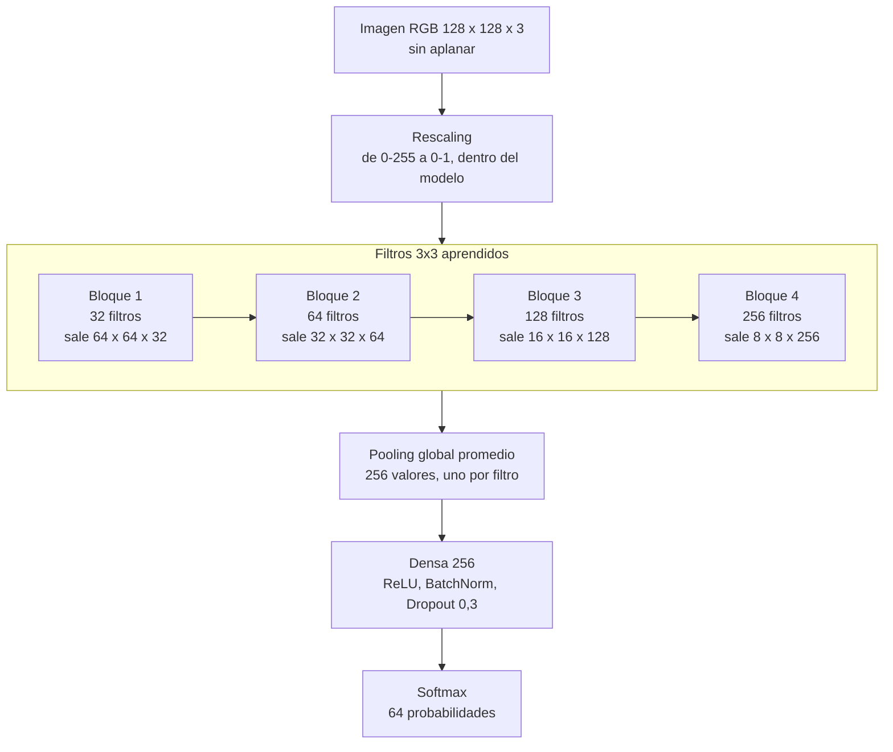
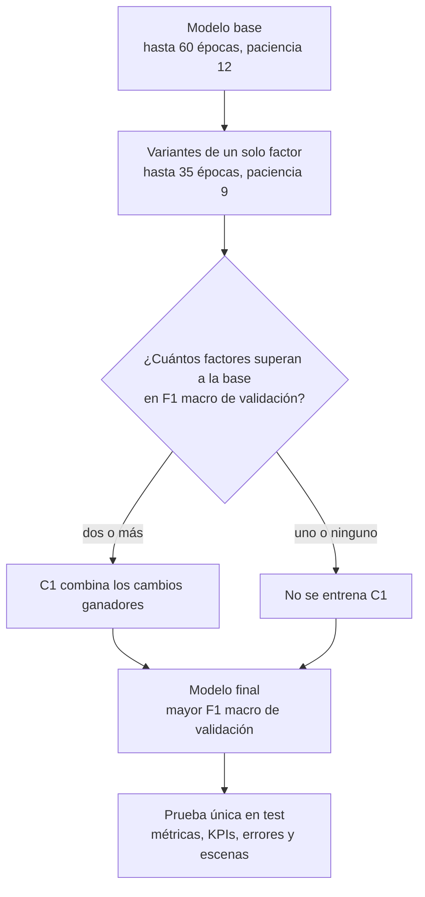

# Clasificador de personajes de Los Simpson: MLP frente a CNN

Este repositorio es una **comparativa entre dos redes neuronales** que identifican qué personaje de Los Simpson aparece en una imagen RGB: un **perceptrón multicapa (MLP)** y una **red neuronal convolucional (CNN)**. Las dos se entrenan y se evalúan con exactamente el mismo proceso: el mismo dataset de 64 personajes, la misma partición, las mismas imágenes alteradas y parecidas, el mismo bucle de entrenamiento, los mismos experimentos, el mismo criterio de acierto y los mismos KPIs. Así, la diferencia entre sus resultados se debe al modelo: el MLP recibe descriptores de color y textura elegidos a mano; la CNN recibe la imagen y aprende sus propios filtros.

<p align="center">
  
</p>

## En resumen

| | MLP | CNN |
|---|---|---|
| Carpeta | [PMC/](PMC/) | [CNN/](CNN/) |
| Qué recibe | 2.462 descriptores de color y textura calculados en la CPU; los modelos finales usan los 370 de color | La imagen entera, de 32 × 32 a 128 × 128 × 3, sin aplanar |
| Cómo obtiene sus características | Elegidas a mano: histogramas HSV y Lab, LBP, Gabor y HOG | Aprendidas: filtros de 3 × 3 que recorren la imagen |
| Corridas | Seis, del 16-10-2026: CPU y GPU a 32, 64 y 128 píxeles | Tres, del 19-10-2026: GPU a 32, 64 y 128 píxeles; la de CPU, pendiente |
| Mejor resultado en test | Accuracy 0,586 y F1 macro 0,559 (GPU 128 × 128, C1) | **Accuracy 0,847 y F1 macro 0,810** (GPU 128 × 128, modelo base) |
| Presentación de resultados | [presentacion_resultados_PMC.html](PMC/presentacion_resultados_PMC.html) | [presentacion_resultados_CNN.html](CNN/presentacion_resultados_CNN.html) |
| Informe técnico | [Informe de la EP1](PMC/docs/oldDataset/Informe.md), sobre el dataset anterior de 25 personajes | [Informe de la EP2](CNN/docs/newDataset/Informe.md): la CNN y su comparación con el MLP |

Las presentaciones son archivos HTML de un solo archivo: descárgalos y ábrelos en el navegador (GitHub solo muestra su código). El botón **Presentar** muestra una diapositiva a la vez en pantalla completa.

## Cómo funciona la comparativa

Todo lo que no es el modelo se comparte: los datos, su preparación, el entrenamiento, la elección de la configuración y la evaluación. Cada corrida deja un JSON con las mismas claves en `resultados/newDataset/<CPU|GPU>/`, así que las dos redes se comparan cifra a cifra a la misma resolución y en el mismo dispositivo.



## Cómo funciona cada modelo

### MLP: descriptores elegidos a mano

Cada imagen se resume primero en un vector fijo que calcula la CPU: histogramas de color HSV y Lab, en la imagen completa y en sus cuatro cuadrantes, y descriptores de textura LBP, Gabor y HOG. La red solo ve ese vector. Cada neurona se conecta con todas las entradas y no sabe qué parte de la imagen describe cada una, así que el MLP distingue paletas, no formas. En las seis corridas ganó una entrada de solo color (370 valores).



### CNN: filtros que se aprenden

La CNN recibe la imagen como un tensor de alto × ancho × 3. Cada bloque aplica filtros de 3 × 3 con los mismos pesos en todas las posiciones, normaliza, activa con ReLU y reduce el mapa a la mitad con *max pooling*. Los primeros bloques responden a bordes y zonas de color; el último, con un campo receptivo de 38 × 38 píxeles, a partes del personaje. El pooling global resume cada uno de los 256 mapas en un número, esté donde esté el patrón, y una capa densa decide entre los 64 personajes.



Cada bloque es Conv2D 3 × 3 → BatchNorm → ReLU → MaxPool 2 × 2; la variante E2 usa dos convoluciones por bloque. El modelo base tiene 473.120 parámetros a cualquier resolución: los filtros no cambian con el tamaño de la imagen, solo la cantidad de posiciones que recorren.

### Lo que cambia entre los dos

| | MLP | CNN |
|---|---|---|
| Entrada | Vector de 2.462 descriptores (370 en los modelos finales) | Tensor de la imagen, sin aplanar |
| Estructura espacial | Se pierde: cada neurona ve todo el vector | Se conserva: cada filtro mira una vecindad de 3 × 3 |
| Características | Fijas, elegidas a mano | Aprendidas junto con el resto de la red |
| Dónde se calcula la entrada | En la CPU, antes de la red | Dentro de la red, en la GPU |
| Parámetros del modelo final | 340.800 (R2) o 1.059.648 (C1) | 1.258.400 (E2) o 473.120 (modelo base) |
| Explicación de la decisión | Importancia por permutación de cada bloque de descriptores | Grad-CAM sobre la imagen |

## Cómo se entrena y se elige cada modelo

Los dos modelos pasan por el mismo protocolo, con un bucle de entrenamiento propio sobre PyTorch: Adam con tasa `1e-3`, batch 128, pesos por clase (la raíz cuadrada de los balanceados), suavizado de etiquetas 0,1, un 15 % del objetivo para los otros personajes de la escena, parada temprana y `ReduceLROnPlateau`. Cada variante cambia un solo factor respecto del modelo base: la entrada, la profundidad, la activación, la tasa de aprendizaje, el batch, el dropout, los pesos por clase, el suavizado, las etiquetas de escena o las imágenes alteradas.



El test no se toca hasta el final. Una predicción es correcta si nombra al personaje de la carpeta o a otro que aparece en la imagen (misma escena del episodio, imagen gemela en otra carpeta o misma toma verificada); la accuracy estricta, que solo acepta la carpeta, se informa como referencia.

## Resultados: MLP frente a CNN

Corridas en GPU (NVIDIA GeForce RTX 4060 Laptop), a la misma resolución:

| Resolución | Modelo | Configuración final | Parámetros | Accuracy | Estricta | Top-3 | F1 macro | Entrenamiento | Duración |
|---|---|---|---:|---:|---:|---:|---:|---:|---:|
| 32 × 32 | MLP | R2 - solo color | 340.800 | 0,541 | 0,501 | 0,724 | 0,515 | 15,6 min | 19 min 36 s |
| 32 × 32 | CNN | E2 - 2 convoluciones por bloque | 1.258.400 | 0,786 | 0,732 | 0,887 | 0,741 | 53,7 min | 59 min 03 s |
| 64 × 64 | MLP | R2 - solo color | 340.800 | 0,550 | 0,507 | 0,731 | 0,522 | 17,1 min | 23 min 19 s |
| 64 × 64 | CNN | E2 - 2 convoluciones por bloque | 1.258.400 | 0,830 | 0,777 | 0,932 | 0,788 | 95,6 min | 1 h 44 min 33 s |
| 128 × 128 | MLP | C1 - combinación | 1.059.648 | 0,586 | 0,539 | 0,751 | 0,559 | 15,9 min | 28 min 14 s |
| 128 × 128 | CNN | Base - 1 convolución por bloque | 473.120 | **0,847** | **0,797** | **0,937** | **0,810** | 290,5 min | 5 h 08 min 56 s |

Las corridas de CPU del MLP dieron una accuracy de 0,533, 0,584 y 0,561 a 32, 64 y 128 píxeles. La de la CNN en CPU está pendiente: a 64 × 64 tomaría más de quince horas.

Los cinco KPIs, con umbrales fijados antes de entrenar, se cumplen en todas las corridas de los dos modelos:

| KPI | Métrica en test | Umbral | MLP (seis corridas) | CNN (tres corridas) |
|---|---|---:|---:|---:|
| Cobertura de asistencia | Top-3 accuracy | ≥ 0,70 | 0,718 – 0,751 | 0,887 – 0,937 |
| Equidad entre personajes | F1 macro | ≥ 0,45 | 0,510 – 0,567 | 0,741 – 0,810 |
| Automatización sin revisión | Accuracy | ≥ 0,50 | 0,533 – 0,586 | 0,786 – 0,847 |
| Ventaja sobre lo trivial | Accuracy / clase mayoritaria | ≥ 4× | 6,8× – 7,5× | 10,0× – 10,8× |
| Costo de catalogación | Imágenes por segundo, de extremo a extremo | ≥ 1.000 | 1.285 – 1.557 | 3.085 – 5.326 |

El costo de catalogación se midió en dos corridas de cada modelo.

**Lo que muestra la comparación**

- **La CNN gana a cada resolución:** entre 24,5 y 28,0 puntos más de accuracy y entre 22,7 y 26,6 de F1 macro, con el mismo proceso y los mismos datos. Lo que decide es la representación, no el ajuste fino: ninguna variante de hiperparámetros movió más de 3 puntos en ninguno de los dos modelos.
- **La forma separa lo que el color confunde.** Homero, Marge, Bart y Lisa comparten la piel amarilla: el MLP los deja con un F1 de 0,35 a 0,67, y la CNN los sube a 0,81–0,89. Lisa y Bart se confunden entre sí un 16 a 19 % en el MLP y un 3 a 4 % en la CNN.
- **La resolución ayuda más a la CNN, cada vez menos.** La CNN gana 4,5 puntos de accuracy de 32 a 64 px y 1,7 de 64 a 128. El MLP gana 4,5 de 32 a 128, y con la misma configuración (R2) solo 2 a 3: sus histogramas resumen el color, no la forma.
- **El costo se mueve al entrenamiento.** Entrenar la CNN cuesta de 3,4 a 18,3 veces más que el MLP, y la corrida completa pasa de 20–28 minutos a entre una y cinco horas. A cambio, la CNN usa la GPU de verdad (del 36,5 al 98,8 % del tiempo, frente al 22,5–33,7 % del MLP) y, de extremo a extremo, cataloga más rápido, porque el MLP calcula sus descriptores en la CPU.
- **Los errores de la CNN son de otra naturaleza.** Los del MLP siguen a la paleta; casi todos los errores confiados de la CNN nombran a otro personaje que sí está en la imagen, así que su accuracy es una cota inferior.

Las lecturas completas están en el [README del MLP](PMC/README.md), el [README de la CNN](CNN/README.md) y en las dos presentaciones.

## Lo que comparten los modelos

**Dataset.** 64 personajes y 40.123 imágenes originales, una carpeta por personaje, sin partición previa. No se versiona: por defecto se busca en `~/Desktop/simpsons_dataset/simpsons_dataset`, o en la ruta de la variable de entorno `SIMPSONS_DATASET`. La etiqueta de cada imagen es siempre el nombre de su carpeta.

**Preparación del dataset.** [scripts/newDataset/generar_imagenes_alteradas.py](scripts/newDataset/generar_imagenes_alteradas.py) genera dentro del dataset las variantes alteradas y las versiones filtradas de las imágenes casi idénticas, y registra las imágenes repetidas entre carpetas de personajes distintos. Nunca modifica las originales. Se ejecuta desde la raíz del repositorio cada vez que cambia el dataset:

```powershell
.\.venv-gpu\Scripts\python.exe scripts\newDataset\generar_imagenes_alteradas.py
```

Los pasos completos, con sus opciones y la versión en Docker, están en la [guía del dataset nuevo](PMC/notebooks/newDataset/README.md).

**Entorno.** Keras 3 sobre PyTorch, en Windows nativo (`.venv-gpu`) o en Docker:

| Archivo | Para qué |
|---|---|
| `requirements-gpu-windows.txt` | Entorno `.venv-gpu`: Keras 3 sobre PyTorch con CUDA. Los pasos de instalación están en [PMC/notebooks/oldDataset/README_GPU.md](PMC/notebooks/oldDataset/README_GPU.md). |
| `requirements-newDataset.txt` | scikit-image, para los descriptores de color y textura del MLP del dataset nuevo. |
| `requirements.txt` | Dependencias del notebook de CPU del dataset anterior, que usa TensorFlow. |
| `Dockerfile` y `docker-compose.yml` | Jupyter Lab con la GPU y el dataset montados: copia `.env.example` como `.env`, pon la ruta del dataset y ejecuta `docker compose up --build`. |

## Estructura del repositorio

```text
.
├── PMC/                            # Perceptrón multicapa: todo su trabajo, con su propio README
│   ├── notebooks/<oldDataset|newDataset>/
│   ├── models/ y models_gpu/       # Modelos .keras regenerables, ignorados por Git
│   ├── resultados/<oldDataset|newDataset>/<CPU|GPU>/
│   ├── scripts/                    # Lanzadores de los notebooks de GPU y diagrama de la red
│   ├── images/                     # Imágenes de los notebooks y del README del MLP
│   ├── docs/                       # Informe, pauta de la EP1 y material de la unidad
│   ├── presentacion_resultados_PMC.html  # Presentación de resultados del MLP (19 diapositivas)
│   └── README.md
├── CNN/                            # Red convolucional: mismo dataset y mismo proceso, con su propio README
│   ├── notebooks/newDataset/       # Notebooks de GPU y CPU (sin versión para el dataset anterior)
│   ├── models/ y models_gpu/       # Modelos .keras regenerables, ignorados por Git
│   ├── resultados/newDataset/GPU/  # Un JSON por corrida; CPU/ aparece al ejecutar ese notebook
│   ├── scripts/                    # Lanzador del notebook de GPU, generador de la presentación y predicción de imágenes
│   ├── images/                     # Imágenes de los notebooks
│   ├── docs/                       # Encargo de la EP2 e informe técnico, con sus figuras
│   ├── presentacion_resultados_CNN.html  # Presentación de resultados de la CNN (26 diapositivas)
│   └── README.md
├── scripts/newDataset/
│   └── generar_imagenes_alteradas.py  # Prepara el dataset nuevo: alteradas, parecidas y gemelas
├── images/logoLosSimpsons.png
├── Dockerfile
├── docker-compose.yml
├── .env.example                    # Ruta del dataset para Docker; se copia como .env
├── requirements.txt
├── requirements-gpu-windows.txt
├── requirements-newDataset.txt
└── README.md                       # Este documento
```

Cada modelo sigue la misma organización: una carpeta propia con `notebooks/`, `models/`, `resultados/` y `scripts/`, y dentro de cada una una subcarpeta por dataset.

## Integrantes

- Vincent Farenden Cerón
- Rodrigo Ignacio Martínez Becker
- Iván Manuel Pavón Barría
- Diego Ignacio Peña y Lillo Luhrs

Trabajo para la asignatura **Técnicas Avanzadas para Machine Learning_001D**.
